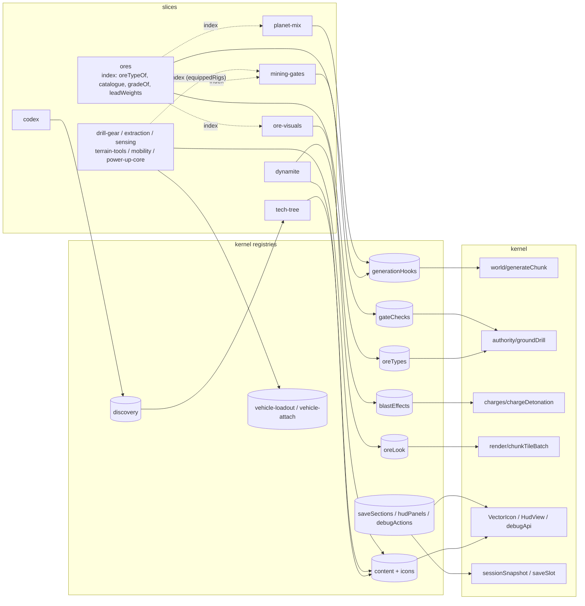

# Feature slices: how materials, dynamite, planet mixes, gates and visuals ship in parallel

Standard for #155. Build ticket: #156. Owner: Technical Director. Decided 2026-10-06 against `main` at `af0d3db` (`src/` unchanged at `5987e09`).

Up to four loop sessions build at once (`/workspace/claude-sessions/steampunk-loop`). The code is grouped by layer, so every feature edits the same shared lists and the driver's `git rebase origin/main` fails. This standard fixes where feature code lives, how it reaches the kernel without editing it, and what a session may touch. Paths marked **(new)** do not exist yet. Every other path and symbol exists on `main`.

## Decisions at a glance

1. **Kernel = everything in `src/` outside `src/features/`.** Nothing moves in bulk.
2. **A slice is one folder**, `src/features/<slice>/`. The first five: `ores`, `planet-mix`, `mining-gates`, `dynamite`, `ore-visuals`. Then `codex`, `tech-tree`, `power-up-core`, `drill-gear`, `extraction`, `sensing`, `terrain-tools`, `mobility`. `example` is the committed template.
3. **One public file per slice**, `index.ts`. Lint fails any other cross-slice import, and any kernel import of a slice. The tool is `eslint-plugin-import-x` `no-restricted-paths`, with zones generated from the folder list. CI already runs `npm run lint`.
4. **Slices reach the kernel only through append-only registries.** Each slice's `register.ts` is found by one `import.meta.glob` in the loader `src/features/index.ts`. Registries iterate sorted by id and are sealed after loading.
5. **#156 wires every call site with an empty-registry fast path.** Generation, drill, blast, ore look and HUD all ask their registries. With no slice registered, output is byte-identical.
6. **Slice state is a versioned section.** Each section has its own version and is restored by exact match: refused, never migrated. A save written before a section existed gets that section at its initial value (#224). It lives under an optional `slices` key that is omitted while empty. Adding a slice section bumps that section's version and is recorded in the golden header. `SNAPSHOT_VERSION` is not bumped for it.
7. **#156 bumps no version.** The 8 goldens stay byte-identical. Bumps belong to the build that adds state, commands or hooks. Each bump goes in that build's last commit, and on a conflict the build re-bumps as main + 1.
8. **Icons and ore look are kernel registries with enforced ownership.**
   - Every content entry has an `iconId`, and a kernel coverage test fails on any unresolved id.
   - `VectorIcon` gets a visible fallback in #156.
   - Only the `ore-visuals` slice and the kernel loader read the art direction.
9. **`vehicle-loadout`, `vehicle-attach` and `discovery` are kernel registries (#162).**
   - #156 creates them.
   - The builds that land loadout and codex add the state, commands and bumps.
10. **One session, one slice.** Kernel changes get their own small tickets (K1–K5, section 6.3). `gameStore.ts` is not split; it stops growing.
11. **Tests move with their slice's migration (#191).** Kernel tests, shared goldens and cross-slice checks stay in the kernel. There are no symlinks and no re-export files, and `tests/MANIFEST.md` is the overview (section 6.5).

## Why: the measured collisions

From the last 300 commits that touched `src/` or `tests/` (since 2026-10-04 21:54), and `driver.log` (36 failed rebases across 16 tickets; 16 session logs contain `CONFLICT`):

| File | Commits touching it | Session logs with a conflict in it |
| --- | --- | --- |
| `tests/golden/{money-past-1e40,dig-and-return,strand-and-rescue,destroyed-and-towed}.golden.json` | 22 each | 9, 9, 8, 8 |
| `src/systems/authority/sessionSnapshot.ts` / `.test.ts` | 18 / 21 | 6 / 7 |
| `src/systems/art/assetManifest.test.ts` | | 7 |
| `src/systems/authority/authorityCommand.ts` | 23 | 5 |
| `src/systems/art/artCatalogue.ts` | 12 | 5 |
| `src/debug/debugApi.ts` / `debugApi.test.ts` | 26 / 27 | – / 5 |
| `src/debug/debugScreens.test.ts` | 24 | 5 |
| `src/store/gameStore.ts` | 31 | |
| `src/constants/scene.ts` | 30 | |
| `src/logging/eventNames.ts` | 28 | |
| `src/logging/domainEventLog.ts`, `src/systems/authority/domainEvent.ts` | 26, 25 | |
| `src/systems/authority/debugCommandRules.ts`, `src/systems/render/vehicleLook.ts`, `src/store/presentationSlice.ts`, `src/scene/VehiclePlaceholder.tsx`, `applyCommand.test.ts` | | 4 each |

Two causes. **Central lists**:
- `COMMAND_RULES` in `applyCommand.ts`
- `CommandPayloads`
- `DomainEventBodies`
- `RejectionReason`
- `RUN_EVENT_REGISTRY`
- `PROJECTIONS`
- the `DebugActions` intersection in `gameStore.ts`
- the `DebugApi` object
- `vectorIconIds()`

**Version bumps that rewrite every golden.** Registries remove the first cause. The second can't be removed, so it gets a rule (section 5.5).

## 1. Slice layout

### 1.1 Kernel and slices

The kernel is every path in `src/` outside `src/features/`. A slice holds one feature: its data, rules, slice state, UI, art and debug surface.

```
src/features/
  index.ts                  kernel-owned loader (new); the only file at this level besides tests
  sliceBoundaries.test.ts   lint proof (new)
  <slice>/
    index.ts                public API: types, read selectors, constants, intents (after K1)
    register.ts             export const slice: SliceDefinition; no side effects at import
    <slice>.economy.json    the slice's numbers (optional)
    systems/                pure rules: the authority lint set (exact maths, no clock or random)
    systems/render/         pure look maths: exempt from the exact-maths set only
    store/                  optional zustand store fed by listenForDomainEvents
    ui/                     React + CSS Modules
    scene/                  R3F components
    icons/<icon-id>.svg     found by the kernel icon registry
    debug.ts                debug actions (optional)
    *.test.ts               beside the code
```

The subfolder names are the kernel layer names, so the existing layer rules in `eslint.config.js` apply to slices through added globs (section 2.2):
- `systems/` gets `FRAMEWORK_IMPORTS`, `CLOCK_AND_RANDOM`, `NO_IMPORT_META`, `APPROXIMATED_MATH` and `INEXACT_SYNTAX`. These are the sets that cover `src/systems/authority/**`.
- `ui/`, `scene/` and `store/` get the `no-restricted-globals` block.

| Slice | Owns | Stays kernel | Build |
| --- | --- | --- | --- |
| `ores` (#140 said `ore-catalogue`) | Ore catalogue: identity, families, cycle/echo, grade thresholds, lead weights, `requires`; registers `oreTypes` | Value and hardness by tier: `src/systems/economy/oreEconomy.ts` (≈20 kernel importers), the `ore` block of `economy.json` | #146 |
| `planet-mix` | Planet themes and ore roles (#141 `oreThemes.json`, `oreRoles`); registers generation hooks | Patch lattice `src/systems/world/orePatches.ts`, cell layout `worldCell.ts` | #147 |
| `mining-gates` | #142's gate table from the planet mix, `canMine`, the drill classes, the five extractors and the gate ledger; registers `gateChecks`, `oreDrillClasses`, the extractors' `vehicle-item` rows (148a, ticket 236); locked-marker model (148c) | Drill rule `src/systems/authority/groundDrill.ts` | #148 |
| `dynamite` | Sizes, plant/fuse, its blast command (after K1); registers `blastEffects` and `content` `dynamite-size` | Ground removal; the shipped charges code until #153 decides | #149 |
| `ore-visuals` | Ore look by family/tier/grade (#151); registers `oreLook`; ore icons | `src/systems/render/chunkTileBatch.ts`, `artDirection.ts` loader | #144, #150 |
| `example` **(new)** | Template and lint fixture; one read-only debug action | | #156 |
| `codex` | `discovery` provider, `first_contact` handling, `codex` section v1 | `discovery` query point | after K1 |
| `tech-tree` | Nodes, prerequisites, costs, `techTree` section v1 | `content` registry | #165 |
| `power-up-core` | Charge classes, activation, power-up logs. **Not** the loadout | `vehicle-loadout` | #162 builds |
| `drill-gear`, `extraction`, `sensing`, `terrain-tools`, `mobility` | Item rows registered as `vehicle-item` content with slot acceptance and attach id | `vehicle-loadout`, `vehicle-attach` | #162 builds |

The first five are the ones created first. Later slices follow the same template. #163 and #164 pick their slice ids under the same rule (kebab-case, one folder).

Rejected options:
- Moving `src/systems/*` into slices now. It collides with every open ticket and moves code the materials work never touches.
- Per-layer slice folders (`src/systems/ores`, `src/ui/ores`). The layer folders stay the merge point, and lint has no boundary to anchor on.

### 1.2 Slice id rule

The folder name is the id. Every registered id starts with `<slice>.`, and the registrar throws otherwise. Slice run events are named `<slice_snake>_<event>`, so `eventNames.test.ts` keeps its snake_case rule.

## 2. Public API and boundary lint

### 2.1 `index.ts` is the contract

`index.ts` exports types, pure read selectors, constants and, after K1, command-intent factories and event-name lists. It never exports React, zustand or store objects.
- A slice's own UI reads its own `store/`.
- Other slices never read it.
- A contract change lands in the provider's `index.ts` first, in its own commit. The consumer's ticket names it.

### 2.2 Tool choice

Checked on npm on 2026-10-06. The repo uses ESLint 10.12 flat config. The box runs Node v20.19.2 and the CI `verify` job runs Node 22.

| Option | Verdict |
| --- | --- |
| `eslint-plugin-import` 2.32.0 | Peer `eslint` up to `^9`. Ruled out for ESLint 10. |
| `dependency-cruiser` 18.5.0 | `engines: node ^22.13 \|\| ^24 \|\| >=26`. Sessions run lint on Node 20. Separate CLI, no editor feedback. Ruled out. |
| `eslint-plugin-boundaries` 7.2.0 | Peer `>=6`, works. But it brings a second vocabulary (elements, captures, the new `boundaries/dependencies` policies) for one rule. Not chosen. |
| **`eslint-plugin-import-x` 4.17.1** | Peer `^8.57 \|\| ^9 \|\| ^10`. `import-x/no-restricted-paths` checks resolved paths. **Chosen.** |

### 2.3 Config (verified)

The diff below was applied to a copy of `main` with `npm i -D eslint-plugin-import-x@4.17.1`.
- `npm run lint` passed on the whole tree (about 20 s), and `tsc` and `prettier --check` stayed clean.
- Probes showed each zone fires and the allowed paths pass:
  - a slice importing another slice's internals: error
  - a slice importing another slice's `index.ts`: allowed
  - a slice importing the loader: error
  - the kernel importing a slice: error
  - `bootstrap.ts` and `scripts/` importing the loader: allowed

The zones are generated from `readdirSync`, so adding a slice never edits the config.

```diff
+import { readdirSync } from 'node:fs'
 import js from '@eslint/js'
+import { createNodeResolver, importX } from 'eslint-plugin-import-x'
@@ after the DECIMAL_CONSTRUCTION const
+// Feature slices (docs/standards/feature-slices.md): every folder under src/features is a slice,
+// read at lint time, so adding a slice never edits this file.
+const SLICES = readdirSync('src/features', { withFileTypes: true })
+  .filter((entry) => entry.isDirectory())
+  .map((entry) => entry.name)
+  .sort()
+const KERNEL_DIRS = readdirSync('src', { withFileTypes: true })
+  .filter((entry) => entry.isDirectory() && entry.name !== 'features')
+  .map((entry) => `./src/${entry.name}`)
+const COMPOSITION_ROOTS = ['./src/bootstrap.ts', './src/testSetup.ts', './scripts']
+const SLICE_ZONES = SLICES.map((slice) => ({
+  target: `./src/features/!(${slice})/**/*`,
+  from: `./src/features/${slice}`,
+  except: ['./index.ts'],
+  message: `Another slice imports slice "${slice}" only through src/features/${slice}/index.ts.`,
+}))
+const KERNEL_ZONES = [
+  {
+    target: './src/features/*/**/*',
+    from: './src/features/index.ts',
+    message: 'A slice never imports the loader; it is called by the composition roots only.',
+  },
+  {
+    target: [...KERNEL_DIRS, './src/App.tsx', './src/main.tsx'],
+    from: './src/features',
+    message: 'The kernel never imports a slice: slices register through the kernel registries.',
+  },
+  {
+    target: COMPOSITION_ROOTS,
+    from: './src/features',
+    except: ['./index.ts'],
+    message: 'Composition roots load slices only through src/features/index.ts.',
+  },
+]
+const ART_DIRECTION_JSON = {
+  group: ['**/artDirection.json'],
+  message: 'Only src/systems/render/artDirection.ts reads artDirection.json.',
+}
+const ART_DIRECTION_LOADER = {
+  group: ['**/systems/render/artDirection'],
+  message: 'Ore family, tier and grade come from the ores index; only ore-visuals reads the art direction.',
+}
@@ pure-rules block
-    files: ['src/systems/**/*.ts'],
-    ignores: ['src/systems/**/*.test.ts'],
+    files: ['src/systems/**/*.ts', 'src/features/*/systems/**/*.ts'],
+    ignores: ['src/systems/**/*.test.ts', 'src/features/**/*.test.ts'],
@@ exact-maths block (authority, world, economy, vehicle, money)
+      'src/features/*/systems/**/*.ts',
+    ],
+    ignores: ['src/systems/**/*.test.ts', 'src/features/**/*.test.ts', 'src/features/*/systems/render/**'],
-    ignores: ['src/systems/**/*.test.ts'],
@@ no-restricted-globals block
+      'src/features/*/{scene,ui,store}/**/*.{ts,tsx}',
@@ appended to tseslint.config(...)
+  {
+    files: ['src/**/*.{ts,tsx}', 'scripts/**/*.ts'],
+    plugins: { 'import-x': importX },
+    settings: { 'import-x/resolver-next': [createNodeResolver({ extensions: ['.ts', '.tsx', '.json'] })] },
+    rules: { 'import-x/no-restricted-paths': ['error', { zones: [...SLICE_ZONES, ...KERNEL_ZONES] }] },
+  },
+  {
+    // A second rule name, so these bans never replace the layer bans of no-restricted-imports.
+    files: ['src/**/*.{ts,tsx}'],
+    ignores: ['src/systems/render/artDirection.ts', 'src/systems/render/*.test.ts'],
+    rules: { '@typescript-eslint/no-restricted-imports': ['error', { patterns: [ART_DIRECTION_JSON] }] },
+  },
+  {
+    files: ['src/features/**/*.{ts,tsx}'],
+    ignores: ['src/features/ore-visuals/**'],
+    rules: {
+      '@typescript-eslint/no-restricted-imports': ['error', { patterns: [ART_DIRECTION_JSON, ART_DIRECTION_LOADER] }],
+    },
+  },
```

The full applied diff, 136 lines with prettier formatting, is attached to the #155 resolution.

Pitfalls found while verifying:
- **Repeating a rule overrides it.** In flat config, a later block's `no-restricted-imports` *replaces* the options of an earlier block for the same files. A second block with that rule name silently dropped the `decimal.js` ban. That is why the ownership bans use `@typescript-eslint/no-restricted-imports`.
- **Unresolved imports are skipped.** `no-restricted-paths` ignores an import it cannot resolve. `tsc` fails such an import anyway.
- **Globs are not imports.** `import.meta.glob` strings are not import statements. The kernel loader and icon registry can discover slice files without tripping the kernel zone.

### 2.4 Proof test (verified)

`src/features/sliceBoundaries.test.ts` **(new)** passed in 2.5 s against the config above. It needs the `example` slice to exist.

```ts
import { ESLint } from 'eslint'
import { describe, expect, it } from 'vitest'

const eslint = new ESLint()

async function boundaryErrorsOf(filePath: string, code: string): Promise<string[]> {
  const [result] = await eslint.lintText(code, { filePath })
  return result.messages
    .filter((message) => message.ruleId === 'import-x/no-restricted-paths')
    .map((message) => message.message)
}

describe('slice boundary lint', () => {
  it('refuses a slice importing another slice past its index', async () => {
    const errors = await boundaryErrorsOf('src/features/boundary-probe/probe.ts',
      "import { slice } from '../example/register'\nexport const probe = slice\n")
    expect(errors).toHaveLength(1)
  })
  it('lets a slice import another slice through its index', async () => {
    const errors = await boundaryErrorsOf('src/features/boundary-probe/probe.ts',
      "import { EXAMPLE_SLICE_ID } from '../example'\nexport const probe = EXAMPLE_SLICE_ID\n")
    expect(errors).toEqual([])
  })
  it('refuses the kernel importing any slice', async () => {
    const errors = await boundaryErrorsOf('src/systems/world/probe.ts',
      "import { EXAMPLE_SLICE_ID } from '../../features/example'\nexport const probe = EXAMPLE_SLICE_ID\n")
    expect(errors).toHaveLength(1)
  })
})
```

#156 adds two more cases:
- a slice importing `'../index'` gives 1 error
- a slice file importing `**/artDirection.json` gives 1 error under `@typescript-eslint/no-restricted-imports`

## 3. Kernel registries

### 3.1 Rules for every registry

- **Append-only.** A registry has no unregister and no replace. Ids are unique, and a duplicate throws, naming both slices.
- **Prefixed ids.** Every id starts with `<slice>.`. Kernel defaults use `kernel.`.
- **Sorted by id, always.** No registry exposes registration order. Slices register in id order too.
- **Sealed.** `loadFeatures()` seals all registries. Registering after the seal throws. Reading before it throws `FeaturesNotLoadedError` **(new)**, so a root that forgets the loader fails at its first read, not silently.
- **One-provider registries** (`oreTypes`, `oreLook`, `discovery`) throw at seal time on a second provider.
- **Empty means today.** Every call site has a fast path that keeps current behaviour exactly when nothing is registered.

### 3.2 Where things live

| Module | Holds |
| --- | --- |
| `src/registries/sliceDefinition.ts` **(new kernel dir)** | `SliceDefinition`, `SliceRegistrar`, `FeaturesNotLoadedError` |
| `src/registries/registrar.ts` **(new)** | `registrarFor(sliceId)`, `sealRegistries()`, `withRegistrations(slices, run)`, the test seam that swaps in a fresh sealed set and restores it |
| `src/systems/registries/*.ts` **(new)** | Pure registries: `content`, `oreTypes`, `oreSignatures` (#232, 3.26), `gateChecks`, `blastEffects`, `generationHooks`, `hookSeed`, `saveSections`, `discovery`, `vehicleLoadout`, `vehicleAttach`, `oreLook`, `botPurchases`, `authorityReactions` (#219, 3.21), `seal`; `vehicleMotionEffects`, `hullDamageIntercepts`, `enemyDetectionModifiers`, `heatPauses` (ticket 233, 3.27); `drillGear` (ticket 234, 3.28); `artefactOptions` (K2 #324, 3.35); `itemHooks` (ticket 323, 3.36), `liveBeacon` (ticket 326, 3.36); `slotHoldCues` (ticket 253, 3.30); `itemDescriber`, `itemDescriptionEntries`, `buyableRefs` (K7, 3.19); `magneticGround`, `shockShields` (ticket 290, 3.34); `collapseBraces` (ticket 331, 3.38); `autoActors` (ticket 317, 3.40); `planetSkyBand` (ticket 293, 3.41); `bayEntries` (ticket 344, 3.42); `planetCardLines` (ticket 343, 3.43); `groundReinforcement` (ticket 365, 3.46); `enemyLures` (ticket 361, 3.48); `spendFamilies` (ticket 370, 3.49); `incomeRates` (ticket 384, 3.56); `oneShots` (ticket 372, 3.51); `enemyStepModifiers` (ticket 375, 3.52); `enemyFlushes` (ticket 386, 3.57); `autoGuns` (ticket 382, 3.61); `vehicleLooks` (ticket 389, 3.62); `boreLineListeners` (ticket 412, 3.66) |
| `src/ui/registries/hudPanels.ts` **(new)** | HUD panels |
| `src/ui/registries/screens.ts` | Full slice screens (#211) |
| `src/ui/registries/bayPanels.ts`, `moneyCounter.ts` | Bay header and above-bay panels; the one money-counter provider (ticket 220) |
| `src/ui/registries/bayScreens.ts` | A slice's whole bay screen, one per bay (ticket 227, 3.24) |
| `src/systems/registries/soundCues.ts`, `partMotionRequests.ts` | Slice sound cues with voice budgets; part poses and swaps on the drawn car (ticket 227, 3.24) |
| `src/scene/registries/vehiclePieces.ts` | Slice pieces drawn on the local vehicle, at its attach points through `MountedParts` (ticket 235, 3.25) |
| `src/ui/vectorIcons.ts` | Icon registry (extended) |
| `src/debug/debugActionRegistry.ts` **(new)** | Debug actions |
| `src/logging/registries/*.ts` | Slice run events and event projections (K1, 3.15); report rows (#223, 3.23) |

`src/registries/` sits outside `src/systems/`, so it may import UI and debug types. `src/systems/**` may not: `FRAMEWORK_IMPORTS` bans `**/ui/**`. Kernel tests use `withRegistrations` and never import a slice.

### 3.3 Registrar and loader

```ts
// src/registries/sliceDefinition.ts (new)
export interface SliceDefinition {
  id: string                                   // equals the folder name; the loader checks it
  register(r: SliceRegistrar): void
}
export interface SliceRegistrar {
  content<K extends ContentKind>(kind: K, entries: readonly ContentKinds[K][]): void  // bare catalogue ids, #224
  oreTypes(provider: OreTypeProvider): void           // one provider
  oreSignature(tag: OreSignatureTag): void             // fold over the provider (#232, 3.26)
  gateCheck(check: GateCheck): void
  blastEffect(effect: BlastEffect): void
  clockStep(step: ClockStep): void                     // #217, section 3.20
  collapseBrace(provider: CollapseBraceProvider): void // ticket 331, section 3.38
  reinforcement(provider: ReinforcementProvider): void // ticket 365, section 3.46
  dockService(service: DockService): void              // #217, section 3.20
  inputReaction(reaction: InputReactionEntry): void    // #217, section 3.20
  generationHook(hook: GenerationHook): void
  oreLook(provider: OreLookProvider): void            // one provider
  cellGateLook(provider: CellGateLookProvider): void  // one provider, tickets 298 and 299, section 3.33
  saveSection<T>(section: SaveSection<T>): void
  discovery(provider: DiscoveryProvider): void        // one provider
  discoveryKind<K extends DiscoveryKind>(kind: K, ...codec: DiscoveryCodecArgument<K>): void  // #209
  discoveryAliases(table: DiscoveryAliasTable): void                                          // #209
  itemDescriber(provider: ItemDescriberProvider): void              // one provider (K7, 3.19)
  itemDescriptionEntries(entries: readonly ItemDescriptionEntry[]): void
  loadoutAcceptance(rule: LoadoutAcceptance): void
  attachUse(use: AttachUse): void
  buildingAttachUse(use: BuildingAttachUse): void      // #175, section 3.11
  hudPanel(panel: HudPanel): void
  touchBinding(row: TouchBindingRow): void            // ticket 474, section 3.68
  bayPanel(panel: BayPanel): void                      // ticket 220, section 3.22
  moneyCounter(provider: MoneyCounterProvider): void   // one provider, ticket 220, section 3.22
  bayScreen(screen: SliceBayScreen): void              // one per bay, ticket 227, section 3.24
  soundCue(cue: SoundCue): void                        // ticket 227, section 3.24
  oneShot(oneShot: OneShot): void                      // ticket 372, section 3.51
  partMotionRequests(source: PartMotionRequestSource): void  // ticket 227, section 3.24
  vehicleLook(source: VehicleLookSource): void          // ticket 389, section 3.62
  worldPiece(piece: WorldPiece): void                  // #175, section 3.14
  vehicleStaging(provider: VehicleStagingProvider): void  // one provider, #175, section 3.14
  artAssets(assets: readonly ArtAsset[]): void          // bare art ids, #214
  botPurchase(purchase: BotPurchase): void                  // #211, section 3.17
  screen(panel: ScreenPanel): void                          // #211, section 3.18
  sceneLayer(layer: SceneLayer): void                  // #213, section 3.14
  chargeBlastCue(provider: ChargeBlastCueProvider): void  // one provider, #213, section 3.14
  planetSkyBand(provider: PlanetSkyBandProvider): void  // one provider, ticket 293, section 3.41
  planetCardLine(source: PlanetCardLineSource): void  // ticket 343, section 3.43
  boreGun(provider: BoreGunProvider): void             // one provider, ticket 313, section 3.37
  autoGuns(provider: AutoGunsProvider): void           // one provider, ticket 382, section 3.61
  autoActor(actor: AutoActor): void                    // ticket 317, section 3.40
  slotHoldCue(source: SlotHoldCueSource): void             // ticket 253, section 3.30
  debugActions(actions: Readonly<Record<string, DebugAction>>): void
  commandRules(rules: SliceCommandRules): void              // K1, section 3.15
  authorityReaction(reaction: AuthorityReaction): void      // #219, section 3.21
  eventProjections(projections: SliceEventProjections): void
  runEvents(events: SliceRunEvents): void
}
```

```ts
// src/features/index.ts (new, kernel-owned)
const SLICE_MODULES = import.meta.glob<{ slice: SliceDefinition }>('./*/register.ts', { eager: true })

export function loadFeatures(): readonly string[] {
  // idempotent: a second call returns the same list
  // 1. check each slice.id equals its folder name; reject duplicates naming both folders
  // 2. sort by id; slice.register(registrarFor(slice.id)) for each
  // 3. sealRegistries()
}
```

**Timing.** Registration happens once, synchronously, before the first tick, render or test. Each composition root calls `loadFeatures()` first:
- the page: `startGame()` in `src/bootstrap.ts`
- every Vitest spec: `src/testSetup.ts`, already `setupFiles` in `vite.config.ts`
- the chunk worker (ticket 337): `src/chunkWorker.ts`, a second realm the renderer starts, whose generation hooks and ore, gate and field looks paint the chunks it meshes
- the 11 vite-node entries:
  - `scripts/updateGoldenRuns.ts`
  - `balanceReport`, `balancePlanets`, `balanceGuns`, `balanceCharges`, `balanceRefinery`, `balanceHeat`
  - `benchGenerateChunk`, `benchChunkBatch`, `benchGround`, `benchCombatTick`

No module may read a registry at import time, because the read would throw. `src/features/loadFeatures.test.ts` **(new)** asserts that every `scripts/*.ts` imports and calls `loadFeatures` from `../src/features`.

Rejected options:
- **A manifest line per slice.** Two branches appending to one file conflict, which is the problem #116 removed for art.
- **A generated manifest.** Regeneration conflicts, and it adds one more gate step.
- **Side-effect imports.** Order-dependent and untestable in isolation.

### 3.4 Content and icons (every entry has an `iconId`)

```ts
// src/systems/registries/content.ts (new)
export interface ContentEntry { id: string; iconId: string }
/** Kinds are added by module augmentation from the kind's owner; values must extend ContentEntry. */
export interface ContentKinds { 'vehicle-item': VehicleItem }   // kernel kind (3.10)
export type ContentKind = keyof ContentKinds
export function contentOf<K extends ContentKind>(kind: K): readonly ContentKinds[K][]   // sorted by id
export function contentIconIds(): readonly { kind: string; id: string; iconId: string }[]
```

The owner of a kind declares it from its own `systems/` folder. For example, `tech-tree` declares `'tech-node'` and `dynamite` declares `'dynamite-size'`:

```ts
declare module '../../../systems/registries/content' {
  interface ContentKinds { 'tech-node': TechNode }
}
```

Other slices register entries of that kind and import its type from the owner's `index.ts`. This replaces per-slice registration functions like #160's `registerTechNodes`: other slices register `content('tech-node', ...)`, and only `tech-tree` reads it.

**Bare catalogue ids (#224).** A content entry's id is `<slice>.<name>`, or a bare catalogue id `<category>.<name>` (`slot.powerup_4`, `power.mineral_drain`, `tech.terrain.cradle_4`), so the store, the tree and the descriptions share one id. The categories are `power`, `consumable`, `passive`, `gear`, `rig`, `slot`, `combo` (the milestone combos, 206b) and `tech`, in the one kernel constant `BARE_CATALOGUE_CATEGORIES` (`src/systems/registries/catalogueIds.ts`); none is a kernel item kind. The registrar refuses a bare id with no category (a flat stats.json row id like `remote_detonator`), with any other category, or with no snake_case name. Each bare id has one owning slice: a second slice registering it is refused at boot, naming both slices. Every other registry keeps the `<slice>.` prefix.

**Icon registry.** `src/ui/vectorIcons.ts` keeps its glob over `./icons/*.svg` and adds a second one over `'../features/*/icons/*.svg'`. The id is the file stem in both cases. It exports:
- `iconUrlOf(iconId): string | null`, unchanged
- `registeredIconIds(): readonly string[]` **(new)**

A slice adds an icon by adding a file. No kernel edit.

**Coverage test.** `src/ui/iconCoverage.test.ts` **(new)**, kernel-owned, lands in #156. It collects every id the game can emit:
- `contentIconIds()`
- each ore type in `oreTypes` `catalogue()`
- `vectorIconIds()` in `src/systems/art/artIds.ts`
- `MODE_MARKERS` in `src/systems/views/hudReadings.ts` and `WARNING_MARKERS` in `src/systems/views/hudModel.ts`; #156 exports both

It fails when:
- an id does not resolve and is not on the allowlist
- an allowlisted id resolves (the list may only shrink)
- an id is added to the allowlist
- one stem ships from two folders

The missing ids today (`src/ui/icons/` holds 11 SVGs):

```ts
/** Shrink-only. #163 empties it. */
export const KNOWN_MISSING_ICON_IDS = [
  'anchor', 'wheel', 'empty-tank', 'broken-gear',  // hudReadings.ts:54-57 MODE_MARKERS
  'gauge-hatched', 'gauge-hatched-double',         // hudModel.ts:124-125 WARNING_MARKERS
  'emblem-bay-sell', 'emblem-bay-upgrade', 'emblem-bay-refinery', // artIds.ts vectorIconIds(); manifest status "placeholder"
] as const
export const NO_ICON = 'none'                       // hudModel.ts:123 ok-state sentinel, never drawn
```

The six HUD ids only appear as `data-icon` attributes (`HudBanner.tsx` lines 19 and 39) and are never drawn. The three bay emblems are declared in `vectorIconIds()` and in `art/assets/emblem-bay-*.json` with no SVG.

**VectorIcon fix (in #156).** `src/ui/VectorIcon.tsx` line 10 renders an empty `<span>` for a missing id. It becomes a visible placeholder with `data-missing-icon={iconId}`:
- dev: a magenta square, per #158
- production: a neutral token-coloured outlined square

In dev it also calls `console.warn` once per id. #163 draws the real icons and empties the allowlist.

### 3.5 Ore types (`ores` provides)

```ts
// src/systems/registries/oreTypes.ts (new)
export interface OreQuery { tier: number; cellFamily: ResourceFamily }   // ResourceFamily: world/worldCell.ts
export interface OreType {
  id: string                 // kernel default: `kernel.${family}.t${tier}`
  name: string
  family: string             // catalogue family name (#140); kernel default: 'metal' | 'crystal'
  cellFamily: ResourceFamily; tier: number
  grade: number              // integer, 0 in the kernel default
  iconId: string
  requires: readonly string[]  // #140 `requires`, read only by mining-gates; empty in the default
  signature?: boolean          // #141 signature ore; set only by a signature tag (#232, 3.26)
  saleTier?: number            // set with signature: tier + ore.signatureValueLead (#232)
}
export interface OreTypeProvider {
  id: string
  indexTag: string                  // names the bit index beside the bytes it wrote (#219)
  oreTypeOf(query: OreQuery): OreType
  bitIndexOf(ore: OreType): number  // whole number >= 0, one bit per ore (#219)
  catalogue(): readonly OreType[]   // for icon coverage and the codex
}
export function oreTypeOf(query: OreQuery): OreType   // provider, else the kernel default
export function oreBitIndexOf(ore: OreType): number   // provider, else `tier * 2 + (crystal ? 1 : 0)`
export function oreIndexTag(): string                 // provider, else 'kernel.tier-family-grade'
```

The bit index is the codex's `ore` bitset position (#207 TD lock). The kernel default orders by `(tier, cellFamily, grade)`, so `kernel.metal.t5` and `kernel.crystal.t5` take bits 10 and 11; grade is 0 there and adds no bits. #146 swaps the provider's index and tag, and the codex re-encodes on load.

The query is `{tier, cellFamily}`, the two things a cell knows (`kind | family | tierOffset`). That leaves the #140/#141 family question to the provider. `ResourceFamily` takes every code of the 4-bit field, 0 to 15 (#232): `RESOURCE_FAMILY` names the three the kernel draws itself (`none`, `metal`, `crystal`), #141's twelve families are 1 to 12 in the `ores` catalogue, and 13 to 15 are spare, with no catalogue row and never placed by generation.

### 3.6 Gate checks (`mining-gates` provides): #142's named extension point

```ts
// src/systems/registries/gateChecks.ts
export type GateOutcome = 'cut' | 'refused' | 'blocked' | 'lost'
export interface GateQuery {
  state: AuthorityState; playerId: string; tile: TilePoint; cell: number; ore: OreType
  blast: BlastEvent | null                                     // K2: null when the drill asks
  tool?: string                                                // #236: a power-up edit's source
}
export interface GateVerdict {
  outcome: GateOutcome; gateKind: string; required: string; have: string
  opensAfterTicks?: number                                     // ticket 237: standing by opens it
}
export interface GateCheck { id: string; check(query: GateQuery): GateVerdict | null }   // null: no gate on this cell
/** refused > blocked > lost > cut; ties break on the lowest check id. null when no check has an opinion. */
export function gateVerdictOf(query: GateQuery): GateVerdict | null
```

A verdict answers the means in the query: `cut` opens the cell to it, `refused` leaves the cell standing, `lost` breaks it without ore. `blocked` (#236) also leaves it standing: #142's scratch-only cell, a drill-gated signature the tip only scratches, which `gate_hit` reports apart from a skid. `required` and `have` are the gate's own words for #142's `gate_hit` and HUD chip.

**Drill** (#156/#183, `src/systems/authority/drillGates.ts`), for ore cells only:
- A `refused` or `blocked` verdict makes the `CellDrillTicks` answer `null` (not drillable).
- `collectYieldedCells` skips `collectTile` for a `lost` verdict. `TileDestroyed` still fires.
- **K2 (#185):** each stop is reported as the kernel domain event `DrillGated {tx, ty, oreId, family, tier, gateKind, outcome: refused|blocked|lost, required, have}`: a refused or blocked cell once per drill command that met it, a lost one right after its `TileDestroyed`. A command the gates refused entirely charges no energy and answers only its `DrillGated` events. It is logged as the core run event `gate_hit` with the same fields.

**Blast (K2, #185)** (`src/systems/authority/charges/blastGates.ts`): a charge asks about every ore cell in its radius, with its `BlastEvent`.
- `refused` or `blocked`: the cell stands (#153 amendment: dense and rig-gated cells are anchors in the crater).
- `cut`: the cell breaks past the charge's hardness cap and pays its full unit, after the kept share (#142: a qualifying charge frees a dynamite-gated cell whole).
- `lost`: the cell breaks, and its sale value joins `blast_resolved.oreValueLost` (it was `charge_detonated`'s before K6).
- A cell with no verdict takes today's blast.

**Extractor verbs (ticket 237):** a verdict may read the asking player's slice state, since `query.state` carries it. `mining-gates` answers an owned extractor's cell by its verb: refused until a tune, an etch or a pull the drill's touch starts (its `required` reads `<extractor>:<state>`), or lost once the canisters or the tether's cable run out. `opensAfterTicks` says how long such a standing cell takes to open after a touch, so the pacing bot (`bot/botGates.ts` `extractorWaitOf`) waits there instead of routing round; absent, standing by opens nothing. The coil's pull opens its cell through the K6 terrain-edit queue with the source `mining-gates.induction`, the one tool its gate lets through.

One verdict per tile is asked per drill command or blast slice (`cellGates.ts`), on the state the command or slice started from. A refused cell is an anchor the live blast passes over without counting it against its 64 tiles a tick (K6). With no check registered, nothing is asked and both paths are unchanged.

### 3.7 Blast effects (`dynamite` and others provide)

```ts
// src/systems/registries/blastEffects.ts (new)
export interface BlastEvent { tx: number; ty: number; radiusMm: number; size: number; playerId: string; source: string; tick: number }
export interface BlastEffect { id: string; apply(state: AuthorityState, blast: BlastEvent, params: PlanetParams): RuleEffect }
export function applyBlastEffects(state: AuthorityState, blast: BlastEvent, params: PlanetParams): RuleEffect
```

`applyBlastEffects` uses `chainEffects` over the effects sorted by id.

**Wired in #156** in `blastCharge` (`src/systems/authority/charges/chargeDetonation.ts`):
- It runs after `checkCollapseNearBlast`, with `source: 'charge'` and the planted size's `radiusMm` (all fields are integers).
- Its events append after today's.
- With no effect registered, the state and events are identical.

Presentation (VFX, audio) listens to domain events (3.12) and never registers here. K3 (#186) added `size`, the #153 ladder rung (1 to 10) whose radius `radiusMm` carries; the shipped charge blasts as size 1.

**K8 (#218): the size ladder.** `size` and `radiusMm` now come from the planted charge, whose size `PlantCharge {size}` names; every per-size number (radius, unlock, price units, kept share, rack slots, fuse, the lethal core) is read from `blastingCharges.sizes` in the kernel `economy.json` through `economy/chargeSizes.ts`, with `chargeSpec(n, p)` and `minChargeFor(cell, p)` for the `dynamite` slice to re-export. No provider registry: the charges machine stays kernel (GD and TD locks on #149). Sizes 7 to 10 have no fuse; `detonatePlantedCharge(state, playerId, tick, 'plunger')` in `chargeDetonation.ts` is the call #149's plunger command makes, and `ChargeDetonated` carries `by`. A live remote charge is disarmed (`ChargeDisarmed`) on dock, on wreck and 3600 ticks after planting, from `changeMode` and the clock; there is no dock or wreck hook.

**K6 (#189): the sliced live blast.** Detonation lands its hits, the effects above and `ChargeDetonated {tx, ty}` on its tick, then leaves a live blast (`charges/liveBlast.ts`, in the snapshot and digest). Since K6 the effects run **before** the blast's ground breaks, not after. Each tick the clock breaks the next slice along the nearest-first front (`blastFront.ts`): 64 tiles shared by the live blasts, oldest first, anchors and air passed over without counting. Presentation follows two domain events:
- `BlastFront {tx, ty, rInnerMm, rOuterMm}` once per slice tick, for the fire-and-dust ring and edge debris (the flash, shake and sound stay on `ChargeDetonated`);
- `BlastResolved` once per blast, logged as `blast_resolved` (tiles cleared, ore units kept, ore value lost, rim collapse checks, ticks). A blast's `TileDestroyed` events carry `cause: 'blast'` and project no `tile_destroyed` line.

### 3.8 Generation hooks (`ores`, `planet-mix` provide)

```ts
// src/systems/registries/generationHooks.ts (new)
export interface PatchContent { family: ResourceFamily; tierOffset: number }
export interface GenerationHook {
  id: string
  /** Fold over each patch's content, after the lattice rolls it (default: patch.family, band - 1). */
  patchContent?(params: PlanetParams, patch: OrePatch, content: PatchContent, seed: number): PatchContent
  /** Fold over each painted ore cell. */
  oreCell?(params: PlanetParams, tile: TilePoint, cell: number, seed: number): number
  /** Paint after lava pockets, before the dock, starter-vein and cache stamps. */
  paint?(params: PlanetParams, cells: Uint32Array, cx: number, cy: number, seed: number): void
}
```

- Hooks are folds applied in id order, never a single "weights provider", so two slices can stack.
- `seed` is `subSeedForHook(params, hook.id)`.
- **Wired in #156** in `src/systems/world/generateChunk.ts`: `paintOrePatches` for `patchContent` and `oreCell`, and `generateChunkCells` for `paint`.
- With no hook registered, the cells are unchanged, so `chunkDigest` and `generatorGolden.test.ts` don't move.
- Hooks must be integer-only (`systems/` lint) and a pure function of params and chunk. That keeps any chunk order giving the same planet.

### 3.9 Ore look hook (`ore-visuals` provides)

```ts
// src/systems/registries/oreLook.ts (new)
export interface OreLookProvider { id: string; oreLookOfCell(params: PlanetParams, cell: number): OreLook }  // OreLook: render/oreLook.ts
export function oreLookProvider(): OreLookProvider   // default: today's oreLookOfCell
```

**Wired in #156**: `chunkTileBatch.ts` line 222 calls `oreLookProvider().oreLookOfCell` and keeps its `oreLooks` cache.

**Ownership:**
- `src/systems/render/artDirection.json` is imported today by `artDirection.ts` and `oreLook.test.ts` only. `ART_DIRECTION` is used by `bandPalette`, `chunkTileBatch`, `enemyPlaceholder`, `oreLook` and `enemyTint`.
- Lint (2.3) lets only `artDirection.ts` and specs in `src/systems/render/` import the JSON.
- Under `src/features/`, only `ore-visuals` may import the loader.
- `ore-visuals` reads family, tier and grade only from the `ores` index (`oreTypeOf`). The zone rule enforces that it cannot reach `ores` internals.
- `scripts/art/author_tiles.py` reads the JSON from Python, outside lint. It stays the art pipeline's reader.

### 3.10 Vehicle loadout (kernel `vehicle-loadout`, #162)

```ts
// src/systems/registries/vehicleLoadout.ts (new)
export const LOADOUT_SLOT_IDS = ['powerup.1', 'powerup.2', 'powerup.3', 'powerup.4', 'powerup.5',
  'drill.head', 'drill.flank', 'drill.collar'] as const   // no rig.* slots: GD ruling on #162 (K4)
export type LoadoutSlotId = (typeof LOADOUT_SLOT_IDS)[number]
export type EquipRefusal = 'not_owned' | 'slot_locked' | 'exclusive_taken' | 'not_docked' | 'wrong_slot'
export interface VehicleItem extends ContentEntry { slots: readonly LoadoutSlotId[]; attach: AttachId | null }
export interface LoadoutAcceptance { id: string; itemId: string; slots: readonly LoadoutSlotId[] }
export function acceptedSlotsOf(itemId: string): readonly LoadoutSlotId[]
```

**#156 ships:**
- the slot table, as constants
- the `vehicle-item` content kind
- acceptance registration

**The loadout build under #90 (K4) ships:**
- the state: `loadout: Record<LoadoutSlotId, string | null>` in per-player vehicle state
- the command: `equip_item {slot, itemId | null}`, platform only
- the event: `equip_refused {slot, itemId, reason}`
- the `loadout` section v1
- the `SNAPSHOT_VERSION` and `AUTHORITY_PROTOCOL_VERSION` bumps and golden regeneration
- `debugApi.setVehicleLoadout` (today `notImplemented`, `src/debug/debugApi.ts` lines 217 and 412)

**Landed in K4 (#187).** The state is `vehicle.loadout {slots, owned}` (`src/systems/vehicle/loadoutState.ts`): owned items are the kernel's `ownsItem(state, playerId, itemId)`, and extractors take effect whenever owned, with no slot. The rules are `src/systems/authority/loadoutRules.ts`. A refusal is answered as the `EquipRefused` domain event (`equip_refused` in the log), checked in the order `not_docked`, `wrong_slot`, `slot_locked`, `not_owned`, `exclusive_taken`. A cradle item opens its slot through `VehicleItem.opensSlot`. The section is `{version: 1, body}` on the portable vehicle (`loadoutSection.ts`).

`power-up-core` registers activation, not slots. Item slices register acceptance and never import each other.

### 3.11 Vehicle attach (kernel `vehicle-attach`, render-only)

```ts
// src/systems/registries/vehicleAttach.ts (new; 27 ids since K5 #188, 32 since ticket 376)
export const ATTACH_IDS = ['drill.head', 'drill.flank', 'drill.collar', 'drill.hood', 'drill.fork',
  'drill.housing', 'hull.front', 'hull.arm.left', 'hull.arm.right', 'hull.roof.fore', 'hull.roof.mid',
  'hull.roof.aft', 'hull.turret', 'hull.rear', 'hull.hitch', 'hull.boiler', 'hull.stack', 'hull.cargo',
  'hull.plates', 'hull.liner', 'hull.powerup.1', …, 'hull.powerup.5', 'chassis.drive', 'cab.gauge',
  'hull.stack.side', 'hull.nose', 'hull.roof.coils', 'hull.tail', 'hull.flank'] as const
export type AttachId = (typeof ATTACH_IDS)[number]
export type ItemAttach = AttachId | 'slot'   // "slot": drawn at hull.powerup.n of its powerup.n slot
export interface AttachUse { id: string; itemId: string; attach: ItemAttach }
export function attachOf(itemId: string): ItemAttach | null
export function attachPointOfEquipped(itemId: string, slot: LoadoutSlotId): AttachId | null
```

Attach data never enters the authority state, snapshot or any digest. Only scene code reads it.

K5 (#188), with #166, adds:
- the `attach: [{id, atM, z}]` array of the `parts.json` sidecar (`src/systems/art/partsSidecar.ts`, landed with the #174 shop buildings), exported from `attach.<id>` empties. Sidecar schema stays 1; the field is checked when present, and the base `vehicle` sidecar must carry exactly the attach ids (`src/systems/art/sidecarAttach.ts`).
- the coverage rule (`src/systems/registries/attachCoverage.ts`, run by the asset lint): each physical item names exactly one attach that exists in `ATTACH_IDS` and in the sidecar, and no two co-equippable items share one. An owned item with no loadout slot counts as always equipped. `"slot"` is valid only for `powerup.*` items. No item takes a point the vehicle's own upgrades hold (`drill.housing`, `hull.turret`, the six #180 showcase points) or a `hull.powerup.n` by name. `cab.gauge` (one gauge cluster) and `hull.rear` (the charge rack the crates and mortar ride) are shared.
- the asset lint: every `"slot"` item ships a `vehicle-item-<id>` model.

Ticket 376 (TD lock on #265) adds five ordinary named points for the aetheric parts, one owner each: `hull.stack.side` (resonance whistle), `hull.nose` (phase lantern), `hull.roof.coils` (arc coil), `hull.tail` (chronometric governor) and `hull.flank` (aether condenser). They are neither held nor shared. A later item shares one only if it can never be on the vehicle with the owner, and a test must show that. The five `atM` values are clear of every part that can be drawn alongside them (`scripts/art/place_vehicle_attach.py`). Ticket 265 hangs the parts there: each is a `signature` row of the tech-tree's `techGear.json`, drawn once its item is owned, and the tech-tree registers every `signature` row's point as an attach use (`tech-tree.<itemId>`, `signatureAttachUses`). The row is then the one place such a part names its point: the item slice leaves `attach: null`, and the coverage rule reads the point the rig draws at, even before the item ships.

**Building attach (kernel `building-attach`, #170, built in #175).** `src/systems/registries/buildingAttach.ts` holds the Game Director's seven points on the two shop buildings (`sell.chute`, `sell.ticker`, `sell.stack`, `workshop.gantry`, `workshop.platform`, `workshop.stack`, `workshop.showcase_cam`), read from each building's sidecar `attach` array by `shopBuildingAttachPointOf`. A slice registers each use it makes of a point (`buildingAttachUse`), render-only like vehicle attach.

### 3.12 Discovery (kernel query point, `codex` provides)

```ts
// src/systems/registries/discovery.ts (new)
export type DiscoveryCodec = 'ids' | 'bitset'
export interface DiscoveryKinds { ore: 'bitset'; enemy: 'ids'; hazard: 'ids' }  // slices augment (#209)
export type DiscoveryKind = keyof DiscoveryKinds
export type DiscoveryKey = `${DiscoveryKind}:${string}`
export interface DiscoveryAliasTable { id: string; aliases: Readonly<Partial<Record<DiscoveryKey, DiscoveryKey>>> }
export interface DiscoveryProvider { id: string; hasDiscovered(state: AuthorityState, playerId: string, key: DiscoveryKey): boolean }
/** Provider answer, else the fallback: discovered once the node's unlock planet is reached. */
export function hasDiscovered(state: AuthorityState, playerId: string, key: DiscoveryKey,
  fallback: { progress: UnlockProgress; unlockPlanetIndex: number }): boolean
```

With no provider, the answer is `progress.highestPlanetIndex >= unlockPlanetIndex`. `UnlockProgress` is in `src/systems/unlocks/unlockSchedule.ts`.

Discovery kinds are open (#209, from the TD rulings on #178). Ore, enemy and hazard are kernel kinds. A slice adds a kind by augmenting `DiscoveryKinds` with the kind's storage codec as the value, then registers it with `r.discoveryKind(kind)`. The codec is `ids` (a sorted id list, the default) or `bitset` (base64 bytes; only `ore` uses it), and a non-`ids` codec must be named at registration. A kind is bare (`artefact`, keys `artefact:<id>`), so the kind is its registry id: it registers once across slices, and a kernel kind is refused. `discoveryKinds()` lists every kind with its codec, sorted, and `discoveryCodecOf(kind)` reads one.

A slice may register an alias table (`r.discoveryAliases`, id `<slice>.<name>`). `canonicalDiscoveryKey(key)` maps a key through the first table, in id order, that holds it. The codex canonicalises through it on load and on every write, so the ores slice (#146) can map `ore:kernel.<family>.t<tier>` onto its `typeId` with no section migration.

The codex build (after K1) adds:
- the provider
- the `first_contact {key, via}` event
- the `codex` section v1, derived only from logged events

### 3.13 Save sections

```ts
// src/systems/registries/saveSections.ts (new)
export interface SaveSection<T> {
  id: string                       // '<slice>' or '<slice>.<name>'
  version: number                  // exact match on restore
  scope: 'session' | 'player'
  initial: T
  problems(body: unknown): string[]
  toPortable(value: T): unknown    // integers, strings, booleans, null, canonical Money strings
  ofPortable(body: unknown): T
}
export function readSection<T>(state: AuthorityState, playerId: string | null, section: SaveSection<T>): T
export function withSection<T>(state: AuthorityState, playerId: string | null, section: SaveSection<T>, value: T): AuthorityState
```

**State.** `AuthorityState.slices?` and `PlayerState.slices?` (`src/systems/authority/authorityState.ts`) are `Readonly<Record<string, unknown>>`.
- The key is omitted, never `undefined`: `toCanonicalJson` throws on `undefined`, and any present key changes `stateDigest`.
- The portable form under `PortableState.slices` and `PortablePlayer.slices` (`sessionSnapshot.ts`) is `{[id]: {version, body}}`.

**Restore.** `readSnapshot` lists a problem, and restores nothing, for:
- an unknown section
- a version mismatch

A registered section that is missing (the save predates it) restores at its `initial`, with no migration step (#224, the #200 locks). `sectionsRestoredBy(snapshot)` names those sections, and the checkpoint logs them after the chain's steps as one `save_migrated {restoredSections}` line. A missing kernel part is still refused.

`saveSlot.ts` carries the sections inside its existing `world` and `profile` parts, so the save header and `SAVE_FORMAT_VERSION` don't change.

### 3.14 HUD panels and debug actions

```ts
// src/ui/registries/hudPanels.ts (new)
export type HudSlot = 'overlay' | 'gauges' | 'banner' | 'position' | 'prompts' | 'threats'
export type HudPanel =                                                          // reads its own slice store; no props
  | { id: string; slot: Exclude<HudSlot, 'overlay'>; Panel: ComponentType }
  | { id: string; slot: 'overlay'; priority: number; Panel: ComponentType }    // #208
export function hudPanelsOf(slot: HudSlot): readonly HudPanel[]               // sorted by id

// #208: the overlay slot is a full-screen, click-through layer over the canvas and under every
// other slot. Its panels draw `OverlayCard`s (src/ui/overlay) at world points, placed each frame
// by the projector in src/ui/projection/worldToScreen.ts (`project`, `onFrame`) through a ref and
// a CSS transform. At most 16 cards hold a seat; past that the lowest priority, then the oldest,
// is evicted (`ui.getOverlayStats()`).

// src/debug/debugActionRegistry.ts (new)
export type DebugAction = (...args: readonly unknown[]) => DebugResult          // debug/debugScreens.ts:45
export function debugActionsBySlice(): Readonly<Record<string, Readonly<Record<string, DebugAction>>>>
```

**HUD.** `HudView.tsx` renders each slot's panels right after its kernel component (`GaugeCluster`, `HudBanner`, `PositionPanel`, `HudPrompts`, `ThreatMarkers`). An empty slot renders no markup. The touch controls' tiles (the power-up slot column of #217, the fire tile) were the `slots` slot; since ticket 474 they are touch binding rows (3.68), drawn after the cluster by `TouchBindingTiles.tsx`.

**World pieces and vehicle staging (#175).** `src/scene/registries/worldPieces.ts` is the scene's counterpart of the HUD slots: `GameScene` draws each layer's pieces (`platform`, on the pad behind the vehicle) in id order, and an empty layer draws nothing. `src/systems/registries/vehicleStaging.ts` takes one provider that says, from the authority state alone, where the local car is drawn relative to its body, where the camera looks and whether input waits (the Workshop auto-roll of #170). `scene/vehicleStage.ts` reads it once per fixed step; it never moves the body or the authority pose, and with no provider nothing is staged.

**Scene layers and the blast cue (#213).** `src/scene/registries/sceneLayers.ts` takes `{id, Layer, budget: {drawCalls, instances}}`; `GameScene` draws every layer in id order after `BlastScorches` and before `SoundStage` (where the kernel's `PlantedCharges` stood until the `dynamite-visuals` layer replaced it, #215), and with none registered `SceneLayers` renders nothing. A `Layer` takes no props, reads domain events (`listenForDomainEvents`), the kernel's `src/store/*Reads` and its own slice store, places objects from fixed pools in `useFrame`, and never writes the authority state, the camera or the sound. Its budget is the most it draws: a pooled `InstancedMesh` or `Points` is one draw call (#154). The budgets of every loaded layer, with the kernel's always-on spray layer (section 3.44), together stay within `SCENE_LAYER_LINE` (`{drawCalls: 27, instances: 1128}` in `src/constants/scene.ts`; 1024 until the measured raise for #293's field lines, section 3.41, then 1088 until the one for the terrain magnets' fields, #286), a draw envelope carved from #38's 150 and separate from #154's 2 ms rebuild line; `sceneLayerBudget.test.ts` fails a load that goes over. `src/systems/registries/chargeBlastCue.ts` takes one provider, `kickOf(detonated, distanceMm) → {shake, flash, thumpDelayTicks}`, asked for each `ChargeDetonated` with the distance from the local vehicle to the charge tile's centre. The kernel clamps shake and flash to 0..1 and the thump to 0..60 ticks, applies them through the player's shake and flash switches (a blast may flash although its accent is not the bloom flash), and `SoundStage` holds the blast's sound for the thump delay. With no provider every blast kicks as the shipped charge: shake 0.8, no flash, the sound at once. `ChargeDetonated` carries the blast's `size` and `radiusMm` for it (`charge_detonated` logs both, optional in the schema, and `readChargeDetonation` reads an older line as size 1); the radius is a render hint balance never reads.

**Debug.** `createDebugApi()` adds one key, `features`, so tests call `window.steampunkDebug.features['<slice>'].<action>()`. In #156, actions are read-only. Since K1 (#184), a state-changing action submits a `debug.<slice>.<action>` command through `submitSliceDebugCommand` (`src/debug/sliceDebugCommands.ts`), so it replays and logs `debug_command_applied`.

### 3.15 Commands, events and run events (K1, built in #184)

Before K1, `RejectionReason` was a union, and `COMMAND_RULES`, `PROJECTIONS` and `RUN_EVENT_REGISTRY` were closed objects. K1 added:
- **Open types.** `CommandPayloads` extends the closed `KernelCommandPayloads`, `DomainEventBodies` extends `KernelDomainEventBodies`, and `RejectionReason` is `keyof RejectionReasons`. Slices augment the open interfaces. The kernel's own tables are typed over the closed ones, so an augmentation never breaks the kernel's typecheck.
- **`commandRules`** (`src/systems/registries/commandRules.ts`). `applyCommand.ts` asks the kernel table first, so a kernel command never reads the registry. Types are `<slice>.<name>`, or `debug.<slice>.<name>` for a debug command, which marks the session debugged and logs `debug_command_applied` like the kernel's `debug.*`.
- **`eventProjections`** (`src/logging/registries/eventProjections.ts`), keyed by `<slice>.<Event>` domain event type, which `domainEventProjection.ts` asks for a non-kernel event.
- **`runEvents`** (`src/logging/registries/runEvents.ts`), keyed by `<slice>.<snake_case>` name with a fully specified payload, which `registeredEventOf` in `eventNames.ts` asks for a non-kernel name. The run-log schema therefore checks slice lines too.
- **`submitSliceDebugCommand`** (`src/debug/sliceDebugCommands.ts`) for state-changing slice debug actions.
- **Schedule coverage** (`src/systems/registries/scheduleRows.ts`): every row of `docs/scaling/horizontal/stats.json` has exactly one home, a content entry's `scheduleRowId` or the shrink-only generated or deferred list.

With nothing registered, every command, event and log line is the same as before K1. The worked example is `src/registries/sliceCommands.test.ts`; the copyable shape is in `slice-template.md`.

### 3.16 Terrain edits (K6, built in #189)

A power-up that changes the terrain never edits the world in its command. Its command rule returns `queueTerrainEdit(state, { playerId, source: '<slice>.<item>', cells })` (`src/systems/authority/terrain/terrainEdits.ts`), where each cell is `{ kind: 'density', tx, ty, density }` (every unlined sample of the tile to that density; the pad and lava never change) or `{ kind: 'swap', tx, ty, cell }` (the tile's material cell). The world's one terrain pass per tick then applies, in order:
1. drill breaks, on their own command, never queued;
2. the live blasts' slice, always in full;
3. the queued edits: first in first out per player, round-robin across players, 32 density cells or 64 swaps and at most 2 chunks a tick (lowest `chunkKey` first), the rest carried over (`terrainEditPlan.ts`).

The queue is in the snapshot and the digest. An edit credits no ore, so a slice queues only cells it may change, and it changes the ground as plain `GroundChanged`. Its ore cells still go through `canMine` (#236, `terrain/terrainEditGates.ts`): each is asked with the edit's `source` as `query.tool` and no blast, and only a cell with no verdict or a `cut` one changes; any other stands as solid ground while the rest of the edit goes on.

**Magnet shift (ticket 283, GD lock on #246).** A terrain magnet never builds its own edit: every cell it moves goes through `shiftCellsByMagnet(state, { playerId, source, pushes, askedQuantaPerCell })` (`src/systems/authority/magnet/`), where each push is `{ from, to: [open cells, best first] }`. It moves at most `magnets.maxCellsMoved` (8) cells, in push order, charges each `energyPerMovedCell` (the ask, floored at the cell's dig energy) and stops at the first the tank cannot pay. A cell moves only if it is ground or ore the drill could dig now, of the ordinary drill class, with no `canMine` verdict for the magnet (a `cut` holds it too), unlined and off every vehicle's 1 m anchor (`terrain/terrainAnchors.ts`). It goes into a touching cell of its own band that is unyielded air at half density or less, unlined, off every anchor, and that gives it the same drill verdict; with none, it stays. A yielded tunnel is never a destination, since the cell would read as air there. The moves queue as two K6 edits, every origin opening (density 0, the open cell's air swapped in) before any destination fills, so a split tick can leave a cell nowhere for a moment but never in two places. `planMagnetShift` answers the same plan without touching the state, and `cellsMagnetMayHold` answers the first 8 cells a holding field (the lode clamp) may pin.

**Repulsor coil (ticket 284, build 3 of the #246 lock).** `terrain-tools` registers `power.repulsor_coil` as a charged power-up (item, Content's card, a one-off at the lane's 15 band-5 units, on sale from its node's P25 only). Its act fires a wave from the vehicle's tile with the Mark magnitude as its radius in whole tiles: every tile within it, nearest first (seeded ties), is one push whose open cells are the touching tiles that head away from the vehicle, nearest the line out first (`tilesOutwardOf`), asked at no energy over the dig-energy floor. Metal enemies the wave reaches move one metre out on the act's tick through the kernel's `pushMetalEnemies(state, terrain, { centre, radiusTiles, tick }, tags)` (`magnet/enemyPush.ts`): never where their kind cannot stand or a rig stands, never while enemies are frozen. The vehicle is never pushed, so no `vehicleMotionEffects` source is registered. Each act raises `terrain-tools.MagnetUsed`, logged as `magnet_used {itemId, verb, cellsMoved, energy}`; a wave that moves nothing is refused (`terrain-tools.nothing_to_push`) at no cost. "Loose rubble" is ground: a collapse refills its block as plain ground, and the game has no other loose body.

**Lode clamp (ticket 285, build 4 of the #246 lock).** `terrain-tools` registers `power.lode_clamp` as a charged power-up used by holding its slot (`release` and `holdOf`, 3.39), on sale from its node's P28. Its act pins the nearest tiles within `reachTiles` (2) of the rig's tile, by distance then `tx` then `ty` (`tilesNearestFirstByPlace`), that `cellsMagnetMayHold` allows: at most 8, never gated, core or lava. The set is fixed at the act and saved as the `terrain-tools` section's optional `clamp {cells, startTick, finishTick, energy}`, absent while nothing is held (section still v1). One `collapseBraces` provider (`terrain-tools.lode-clamp`, 3.38) claims, open-ended, every block `blocksTouchingTile(cell, 1)` names for each pinned cell while the clamp is owned; ring 0 is the GD's containing-only fallback. The field ends on the release tick, at `finishTick` (the Mark magnitude, 180 ticks ×1.15 a Mark to 360), on the tick the tank runs dry, or when its vehicle leaves play or the clamp its slot, always in one path: the cooldown restarts from that tick (`startCooldownAt`, floor 600 by the ladder) and `magnet_used {itemId, verb: 'anchor', cellsMoved: 0, energy}` logs the whole hold's draw. The draw is the drill's per-tick quanta (`ENERGY_QUANTA_PER_TICK.drill`), taken in the slice clock step once per authority tick, the release tick included since a command lands after its tick's steps. A field with nothing to pin is refused (`terrain-tools.nothing_to_pin`) at no cost. `clampLatticeOf(state, playerId)` (debug `getClampLattice()`) lists the braced blocks with the countdown each had left when the brace caught it, for the magnet fields' lattice (#286). The provider answers `frozenTicksLeftAt` with the same value (`frozenTicksLeftOf`), so the collapse telegraph's cracks stand still while braced (ticket 357).

**Magnet fields (ticket 286, build 5 of the #246 lock).** The GD and TD rulings on #286. This is render-only: no authority, protocol, snapshot, log or golden change. `terrain-tools` registers the scene layer `terrain-tools.magnet-fields`, one `LineSegments` of at most 40 pieces (`{drawCalls: 1, instances: 40}`, `magnetFieldBudget.ts`). One player's full set is 34 pieces: the beacon's 8 arcs, the coil's ring and 8 flares, and the clamp's lattice over up to 8 pinned cells with struts on up to 9 braced blocks. The layer is kept apart from planet-mix's field lines, and the galvanic probe brightens only planet-mix's lines.
- **What draws** (`systems/render/magnetFields.ts`): only an owned item that is planted or acting, so a player with no magnet draws nothing, on a magnetic planet too.
  - A beacon planted on this planet draws faint (at most a third of the bright light) while it waits.
  - Its gather, heard as the lodestone `TerrainEdited` at the dock (`heardMagnetFields.ts`), ramps to bright over 6 ticks, holds while its swaps land, then fades.
  - Each coil `MagnetUsed` opens a ring from the vehicle's tile to its radius at the Mark of the same batch's `PowerUpUsed` in the 6-tick response, then fades.
  - A held clamp that is still owned draws a crossed square over each pinned cell and over each block `clampLatticeOf` lists.
  - The local player's fields come first, then the others nearest the view. A field that does not fit is dropped.
- **The buffer** (`magnetFieldBuffer.ts`, `magnetFieldRefresh.ts`): allocated once at the cap. Each vertex carries its field's centre, its timing after an epoch tick, and its faint and bright light.
  - It is written again only when a beacon or pinned set, the collapse list, the heard fields, the planet or the view's chunk changes, or when a field ends.
  - Otherwise only the uniforms move: the authority tick and the sweep. The sweep holds still under reduce motion.
  - The vertex shader is `magnetFieldLight.ts` ported, so the light reads the same at any frame rate. Look numbers live in `magnetFieldLooks.json`.
- **The line's second measured raise.** `SCENE_LAYER_LINE.instances` went from 1088 to 1128.
  - `npm run bench:render` prints `magnetFieldsFrame`: a P43 descent at 16 m/s with all three verbs live for three players, timed before and after the layer's frame work, right after `fieldArcsFrame`.
  - Pass is a p95 change of at most 0.1 ms and no buffer reallocation, recorded on #213. The TD's fallback is the cap at 34.
- **Debug:** `steampunkDebug.features['terrain-tools'].getMagnetFields()` answers `{ fields: { pieces, rebuilds, fields: [{ kind, playerId, pieces, light, growth }] } | null }`. `.timeMagnetFieldFrames(seed, now)` is the bench.

### 3.17 Bot purchases (#211)

`src/systems/registries/botPurchases.ts`: a slice whose command the pacing bot should buy registers `{ id, command, payloadsToTry, estimateCost, isAvailable }`. After the kernel's own Upgrade bay purchases, the bot takes the first purchase in id order with a payload that `isAvailable`, that the wallet pays with the next service kept back (`estimateCost`), and that the authority would accept, and submits `{ type: command, payload }`; it repeats while one pays. `payloadsToTry` is the one addition to the Q3 shape on #165: it keeps the choice of payload (which node) in the slice. The bot records every Upgrade bay purchase in `SliceRun.shopSpend` (the kernel's at what the wallet paid, a slice's at its estimate), and `spendShareByPlanet` (`src/systems/bot/shopSpend.ts`) turns that into the per-planet slice share. With nothing registered the bot's run log is byte-identical.

### 3.18 Slice screens (#211)

`src/ui/registries/screens.ts`: `{ id, priority, render }`, where `render` takes `ScreenProps` (`onDismiss`). The store holds at most one open screen (`openScreen(id)`, `dismissScreen()`); while one is open a lower-priority request leaves it, and an equal or higher one replaces it. The shell (`src/ui/screens/SliceScreen.tsx`) draws it over the HUD and the dock screen, under the cache cards and settings. The `screen` input layer sits between those: `ui_cancel` (Escape, Backspace) dismisses it. Opening a screen is presentation only: no command, no log line, no digest change. A slice opens its screen from its own UI through the store's `openScreen`; `steampunkDebug.ui.openScreen(id)` does the same for specs.

### 3.19 Item cards (K7, built in #199)

The descriptions slice (#164) reaches the kernel's shop rows, platform cards and tooltips as data, never as a component:
- **`itemDescriber`** (`src/systems/registries/itemDescriber.ts`), one provider. `describeItem(ref, ctx)` returns `ItemDescription | null` (`flavour`, `statLines`, `unlock?`, `gateNote?`); null with no provider. `ItemRef = {kind, id, grade?}`, where `ItemKind` is the kernel kinds (`track | service | module | bay | artefact`), every `ContentKind`, and the augmentable `ItemKinds`. `ItemCtx` carries `playerId`, `planetIndex`, `level`, an optional `source` (`shop | merchant | drop | reward`) and a frozen `ItemSnapshotView` (`itemSnapshotView.ts`: wallet, levels, docked bay, `section(s)`), never authority state. Answers are memoised per ref, level, planet and source on one view. `StatLine.kind` is a `TrackKind` (`trackKindOf` in `economy/trackKind.ts` for the kernel tracks).
- **`itemDescriptionEntries`**, append-only and sorted by id. An entry `matches` by kind plus an exact `id` or an `idPrefix`, gives a `flavour`, raw `statLines` specs (`value(ref, ctx)` returns `number | Money`, never text) and optional generated `refs(planetIndex)`. Two entries that can match one ref are refused at the seal (`Registry.sealProblemOf`).
- **`listBuyableRefs(maxPlanet = 1)`** (`buyableRefs.ts`): the kernel's buyables (`kernelItems.ts` names each ref; every kernel player command says what it buys, so a new one fails the typecheck and `buyableRefs.test.ts`) plus every entry's refs for planets 1 to `maxPlanet`, each once, sorted.
- **`ItemCard`** (`src/ui/kit/ItemCard.tsx`): screen models carry an `ItemCardModel` (`systems/views/itemCardModel.ts`). `compact` is the Upgrade bay's buy rows (tracks, casing, lining, guns, charges, rack): tapping or focusing opens the full card in place and the store's `tapItemCard` buys on the second tap. `full` is the platform card (the next refinery slot, the artefact cache's cards) and `ItemTooltip` (repair, recharge, quick service; hover or focus 250 ms, a 400 ms touch hold). With no provider every surface draws its old markup.
- **`formatPercent(ratio)`** sits beside `formatAmount` in `src/systems/displayAmount.ts`, and lint bans `toFixed`, `toPrecision`, `toLocaleString`, `Number(` and `parseFloat` in `src/features/descriptions/**`.

### 3.20 Clock steps, input reactions and dock services (#217)

Kernel seams for `power-up-core` (#200), from the TD lock on #200. With nothing registered the clock, routing, recharge and goldens are unchanged.

- **`clockSteps`** (`src/systems/registries/clockSteps.ts`): `{ id, nextTick(state): number | null, run(state, tick): RuleEffect }`. `authorityClock.ts` runs the steps in id order after its own steps, on every live tick and at every tick a quiet clock stops at; `nextTick` joins the quiet clock's stop list. `run` must do nothing when nothing is due. Its events are stamped with the tick. Wind-ups and channel cancels resolve here, so spend logs stay on the authority clock.
- **`inputReactions`** (`src/systems/registries/inputReactions.ts`): `{ id, actionId, contexts, toIntent(situation): CommandIntent | null }`. `reactionToPress` asks the reactions only for an action its fixed table has no rule for in the top layer, and for `plant_charge` while the kernel has nothing to plant (the plant key becomes the plunger's Detonate while a charge is live, #153, `dynamite` #149); the first intent in id order is submitted, and a null intent does nothing. `InputSituation` carries the authority replica and the player. The kernel ships `use_slot_1` to `use_slot_5` on `Digit1` to `Digit5`, rebindable. On touch, a slot button calls `pressSlotButton` / `releaseSlotButton` in `src/store/touchRuntime.ts`: a tap uses the slot at once, and a hold of `ITEM_CARD_LONG_PRESS_MS` (400 ms, the same touch hold as the #199 item tooltips) shows the #164 item card (`isSlotCardShown`) and uses nothing. The drill sockets press the same way (#244): `power-up-core`'s column adds a tile for `drill.flank` and `drill.collar` after slot 5 when either holds gear a press uses, and that tile presses the socket's own key (`SOCKET_ACTION_IDS`: `use_drill_flank`, `use_drill_collar`). A reaction may also declare `toReleaseIntent(situation)` (ticket 332, section 3.39): the kernel asks it when a pressed action comes up, on any layer.
- **`dockServices`** (`src/systems/registries/dockServices.ts`): `{ id, onRecharge(state, playerId): RuleEffect }`, run in id order at the end of `rechargeEnergy`, so also on quick service's recharge leg. A refill is free on the paid bill, which never changes. A service logs what it refilled (charges-after) so a balance read can tell a refill from a paid buy.

### 3.21 Authority reactions (built in #219)

A slice folds the kernel's domain events into its own section inside the authority's answer, so what it records lands with the events it heard, in headless, bot and golden runs alike. The codex (#207) is the first user: `CargoAdded` marks an ore mined, a drill touch marks it contacted.

```ts
// src/systems/registries/authorityReactions.ts
export interface AuthorityReaction {
  id: string                                    // '<slice>.<name>'
  react(before: AuthorityState, after: AuthorityState, events: readonly DomainEvent[]): RuleEffect
}
// src/systems/authority/tileOre.ts
export function oreTypeAtTile(state: AuthorityState, tile: TilePoint): OreType | null
```

- **When.** `acceptCommand` runs the reactions after `applyRule` and `followCollapse`; `settleClockTo` runs them after each tick it settles and after its closing tows (`reactionRun.ts`). A refused command runs none.
- **Per player.** The step's events are grouped by `playerId`, in the order the players first appear (the clock's playerless events form one group). Each group runs every reaction in id order. A reaction's events take the stamp of the last event it heard: a command's stamp, or a tick's `{tick, playerId}`.
- **State.** `before` is the state the command or tick started from, `after` the state it left with the earlier reactions applied. A reaction returns the new `after` and its event bodies. It hears only rule events, never another reaction's, so reactions never cascade.
- **Contact.** `DrillDamageDealt` carries no ore id. A reaction reads the ore with `oreTypeAtTile(before, event)`, which answers even when the command broke the tile.
- **Sampling (#243).** A tool that reads an ore cell and leaves it standing raises the kernel's `OreSampled {playerId, tx, ty, oreId, via}`, logged as `ore_sampled`. `via` is a `SampleRoute`: `corer` (the drill-gear corer) or `lens` (the assay lens, once an authority-side emitter reads it). The body names its player because a wind-up resolves on the clock, whose stamp carries none. The codex folds it as contact by that route, never as mined. With no emitter every answer is unchanged.
- **Empty means today.** With nothing registered, every answer is unchanged and the goldens stay byte-identical. A slice's reaction events are its own domain events (section 3.15), and it writes its section with `withSection` (section 3.13).

### 3.22 Bay panels and the money counter (ticket 220)

The sell burst's kernel seams (TD lock on #176). With nothing registered, the bay screen and the app draw the same markup as before.
- **`bayPanels`** (`src/ui/registries/bayPanels.ts`): `{ id, slot, Panel }`, with `slot` either `header` or `above`. A `header` panel draws in the bay header just left of the money (the `Lining −X` tag). The `above` slot is a full-canvas, click-through layer that `App` draws right after the bay screen (`ui/platform/AboveBayLayer.tsx`), so coins can fly across an open bay; it is drawn whether a bay is open or not.
- **`moneyCounter`** (`src/ui/registries/moneyCounter.ts`), one provider: `useShownMoney(wallet)` is a hook that returns the Money the header counter shows while its roll runs. The kernel formats it once with `amountReading`. `data-exact` stays the authority wallet, and `data-shown` appears only while the two differ. With no provider the counter shows the wallet.
- **The counter's anchor** (`ui/platform/moneyCounterAnchor.ts`): `moneyCounterPointIn(frame)` gives the counter's centre in the pixels of `frame`, or null while no bay header shows. Pass the `above` layer's element to get canvas pixels, the frame `project` uses.
- **`ResourceSold.coinsShown`** (`systems/authority/sellCoins.ts`, logged on `resource_sold`): `clamp(round(4·log2(1 + value / nextStepPrice)), 3, 40)` as exact Money compares, `(price + value)^8 >= 2^(2k-1) · price^8`. `value` is the gross sale. Until #181 lands, `nextStepPrice` is the cheapest next whole level among the six Workshop tracks; when steps arrive, counts rise by about 13, and that is not a regression.

### 3.23 Ore tiers, ore hardness, cargo tags and report rows (#223)

Kernel seams for the ore catalogue (#146), from the TD lock on #146. With nothing registered every tier, drill time, log line and golden digest is unchanged.

- **Tier offsets.** An ore cell's tier is `oreTier(p, 1) + tierOffset` (`resourceTierOf`, `systems/authority/minedOre.ts`). #140's lead roll may write offsets 0 to 6 on a planet on the legacy rows, and the rarity rows (ticket 445) 0 to 8 (`MAX_ORE_TIER_OFFSET`, band 5 plus mythic's +4 lead); an offset past 8 throws. The field is 24 bits, so the wider range is no new encoding.
- **Hardness by the cell.** `hardnessOfTile` (`groundDrill.ts`) gives ore `oreHardness` of its own tier, core `coreHardness`, and everything else its band's `blockHardness`. The pacing bot bores through the same function (`botWorld.boreTicks(drill, params, tile, cell)`), so its estimate always matches the drill.
- **Cargo tags.** `CargoAdded` and `resource_collected` carry optional `family` and `signature`. They are filled only when an `oreTypes` provider answers (`oreCargoTagsOf`): `family` is `OreType.family`, and `signature` is `OreType.signature === true`. The kernel default names neither, so older lines still read (protocol 25, `LOG_SCHEMA_VERSION` unchanged). Since ticket 420 a drill command's units fold into its span's `drill_cut` line (`ores`, run-length), so only ore from elsewhere (a blast, a bore pickup, a drain) still logs `resource_collected`; the tags stay on every `CargoAdded`.
- **`reportRows`** (`src/logging/registries/reportRows.ts`): `{ id, rowsOf(events, worldSeed, planet, planetEvents?): ReportRow[] }`, where `ReportRow = { label, value }`. The function is pure over a run's events. `planetEvents` are the domain events logged on `planet` when the run kept them (a bot run's `LoggedSliceRun.domainEvents`, ticket 420), else none: a row that reads every unit (its tile, depth or drill ticks) reads them, since the log folds a drill span's cells and units into one line. `reportRowsOfRun` (`src/logging/reportRows.ts`) asks each source, in id order, for every planet the run logged, lowest planet first. `npm run balance:report` lists the rows per pacing seed, and `npm run perf:sessions` shows them per run log that has a world seed (section `report-rows`). Nothing writes them into the log, because derived data stays derived (#11). A row whose label or value names a feature-unlock id from stats.json is refused, since unlocks are reported by stats.json and `feature_unlocked` alone.

### 3.24 Bay screens, sound cues, part motion and the staged turn (ticket 227)

The Workshop redo's kernel seams (K-b; TD and GD locks on #177). The kernel holds no workshop code. With nothing registered and no turn asked, every bay, sound, part and staged car is as before.

- **`bayScreens`** (`src/ui/registries/bayScreens.ts`): `{ id, bay, featureId, Screen }`, at most one per bay (the seal refuses a second, and a `featureId` that is no row of the locked schedule). `PlatformScreen` draws the docked bay's screen inside the shutter as a transparent, pointer-taking layer (`ui/platform/SliceBayScreenLayer.tsx`, `data-slice-screen`) in place of the kernel's markup. A `featureId` keeps it hidden until `isFeatureUnlocked`, so a vision row's screen never shows; `null` is a bay open from the start. `Screen` takes no props and reads its own slice store and the kernel's reads. Rows a slice moves keep their #33 ids by drawing the kernel's row views (`ShopRowViews`, `ChargeRowsView`, `BayFrame`). `UpgradeBayView`, `TracksPanel`, `VehiclePreviewPanel` and the preview's second WebGL context (`VehiclePreviewScene`) mount only while the kernel draws the bay. They are deleted once the `workshop` slice registers its screen, because `screenIds.test` renders the kernel's bay with no slice.
- **`soundCues`** (`src/systems/registries/soundCues.ts`): `{ id, voices, tone }`, where `tone` is a #13 placeholder synthesised by the shell (`partials` of `{wave, frequency, gain}`, an optional band of `noise`, and `seconds` of ring). A slice plays one with `requestSoundCue(id, { pitchSemitones?, gain? })` (`src/store/soundCueRequests.ts`; an unregistered id throws). `SoundStage` plays it through `SoundOut.playCueTone` with `soundCuePlayer.ts`: a cue already sounding `voices` voices first fades its oldest over 15 ms (`CUE_VOICE_STEAL_FADE_SECONDS`, #180 section 5; the pure rule is `systems/audio/voicePool.ts`). Slices never touch audio, and a scene layer still never writes sound.
- **`partMotionRequests`** (`src/systems/registries/partMotionRequests.ts`): `{ id, requestsNow() }`, asked once per fixed step by `scene/partMotionPresence.ts`, which stays the only writer of the car's part motion. A request sits at one vehicle-attach point (section 3.11). It is either `{kind: 'pose', slots, x, y, angle, glow}`, added to each named part slot's own motion (`slotOfPartId`, so `wheel-2`; with motion reduced only the glow shows), or `{kind: 'swap', partIds}`, which draws each part of the `vehicle` asset in its slot whatever the visual tier (`partsShownAtTier(parts, tier, swappedPartIds)`). The slice eases its own reactions. The car's part list rebuilds only when the swaps change. `steampunkDebug.vehicleParts()` reports the swapped parts, the poses and `requestedAttach`. Render-only: nothing enters the authority state, a snapshot or a digest.
- **`VehicleStaging.rotation`** (`src/systems/registries/vehicleStaging.ts`): the staged car's turn about its own up axis in radians, 0 as driven. The provider may set it, and any slice adds its own with `turnStagedVehicle(radians)` (`scene/vehicleStage.ts`), which the slice eases and calls once per step. It counts only while a provider stages the car and is dropped when the staging ends. `vehicleStagePresence.rotation` carries it to `VehicleBody`, which draws the flat art's projection (`turnedWidthShareOf`: width times cos θ, mirrored past a quarter turn). The body and the authority pose never turn. The Works' turntable is one baked quad seen side-on, which a turn about the vertical does not change, so `dock-buildings` draws it as before.

### 3.25 Vehicle pieces and mounted parts (ticket 235)

The #166 seam: the gear models exist, and `Vehicle.tsx` is kernel code. With nothing registered the car draws as before, and every golden and `balance:*` output is byte-identical.

- **`vehiclePieces`** (`src/scene/registries/vehiclePieces.ts`): `{ id, Piece }`. `Vehicle` draws every piece in id order inside the body frame (after the charge rack, before the heat shimmer), so a piece turns and mirrors with the car, the Workshop's staged car included. A `Piece` takes no props and reads the store's local vehicle (the loadout) or its own slice state. Render-only: it never writes the authority state.
- **`MountedParts`** (`src/scene/MountedParts.tsx`): `<MountedParts assetId attachId />` draws one asset's quads at a vehicle-attach point (section 3.11). The point comes from the base vehicle's sidecar (`mountedPartQuadsOf` and `vehicleAttachPointOf` in `systems/render/mountedPartLook.ts`), so no offset lives in code (TD acceptance 6 on #166). Each part keeps its authored draw order on the body's layer, and the asset's one look is tier 1.
- **Debug.** `steampunkDebug.vehicleParts().mounted` lists what the pieces hang on the car now, as `{assetId, attachId, partIds}` sorted by point, then asset (`scene/mountedPartsPresence.ts`). The `example` slice registers `example.test-piece`, the #166 echo sounder on `hull.roof.aft`, which shows only after `features.example.mountTestPiece()` (`e2e/browser/vehiclePieces.spec.ts`). Mounting it is presentation only: no command and no log line.

### 3.26 Signature tags, sale tier, the lava-pocket query and cell families 0-15 (#232)

Kernel seams for the planet mix (#147), from the GD lock on #147. With nothing registered every cell, price, drill time, log line and golden digest is unchanged.

- **`oreSignatures`** (`src/systems/registries/oreTypes.ts`): `{ id, isSignature(ore) }`, folded in id order over every answer of `oreTypeOf` and over `oreTypeCatalogue()`. One yes makes the ore `signature: true` with `saleTier = tier + ore.signatureValueLead` (kernel `economy.json`, 1); its id, tier, bit and look stay the provider's.
- **Sale tier.** The drill and the blast keep a unit in the hold at `saleTierOf(ore)` (`MinedOre.saleTier`), so the Sell bay, the rescue's lost value and a blast's `oreValueLost` price it through the same tier-keyed `oreSalePrice`; there is no other price path. `CargoAdded.resourceTier` stays the cell's own tier, and `saleTier` never goes on the event.
- **Drill-gated signatures** (`src/systems/authority/signatureCells.ts`, #142 amended 6 Oct): a signature cell is as hard as `H(t + ore.signatureDrillHardnessTierOffset)` = `H(t + 5)` on its own tier, never its sale tier, and the drill rule reads its floor `drill.gateScratchFloor` (1) in place of the global 0.25, so `minTipLevel = t + 4` on the tip of the last completed major. `hardnessOfTile`, `ticksPerCell`, the bot's `canBore`/`boreTicks`, the tile-time view and the blast's hardness cap all read it. With no class provider every signature is drill-gated, as #142 has it before the first extractor; `mining-gates` names which ones are through the drill classes (3.29), so an extractor-gated signature keeps its own tier's hardness.
- **`isLavaPocketNear(params, tile, radiusTiles)`** (`src/systems/world/lavaPockets.ts`): whether a tile of the pocket lattice lies within the radius, centre to centre. It reads the lattice, not the cells, because patches are rolled before pockets paint; false off heat planets.
- **Cell families.** `ResourceFamily` is any 4-bit code, 0 to 15 (section 3.5).

### 3.27 Vehicle motion, damage, detection and heat seams (ticket 233)

Kernel seams for the mobility lane (#204), from the GD lock on #204. The kernel holds the vertical caps (`itemEffectCaps` in economy.json, folded in `systems/economy/itemEffectCaps.ts`), so no stack of slice items passes them. With nothing registered every hit, hunt, gauge, motion step, golden and `balance:*` run is unchanged.

- **`vehicleMotionEffects`** (`src/systems/registries/vehicleMotionEffects.ts`): `{ id, effectOf(state, playerId, tick) }` answers `{ liftBp?, driveBp?, burst?: {dirX, dirY, speedMmPerS, untilTick}, reelTo?: TilePoint, cling?, hover?, glide?: {to, untilTick, passThrough} }` or null, read from the slice's own section. `scene/vehicleLoop.ts` folds them on the local replica once per fixed step (`vehicleMotionAt`), and `vehicleController` hands the fold to the pure motion rule (`systems/vehicle/motionEffects.ts`). Lift and drive boosts sum in basis points, each at most +2000 over the engine track; a ballast drop states the lift and drive it gains. A burst or reel sets the velocity (bursts add up, the first reel in id order wins), never faster than the engine's top speed plus the cap; `hover` holds the body against gravity, `cling` while a side touches ground. A vehicle that cannot act (stranded, empty) ignores every effect, as it ignores thrust, except a glide.
- **Glide** (ticket 390, `systems/vehicle/motionGlide.ts`, for the phase move of #261): `glide: {to: TilePoint, untilTick, passThrough: TilePoint | null}` moves the body in a straight line to `to`'s centre at one constant speed, the distance left over the steps left before the last (`glideVelocityOf`), so it rests there on the step before `untilTick`. A contact's nudge is taken up over the steps that remain. It outranks a burst and a reel, and the first glide running in id order wins. While it runs the input is locked (`isInputLocked`): the motor steps on `IDLE_INTENT`, so the wheels, lift, drill and swivel rest. It sets the velocity outright, so gravity is paused. The collider halo leaves out the walls of `passThrough` (`colliderHalo.wallSegmentsOf`): those in the sample squares with a corner on one of the cell's 16 samples, its own square and the one-sample strip below and left of it. Every other wall stands, and the blocks are rebuilt whole once the glide ends. The glide is a move already paid for, so it runs on a vehicle that cannot act too: stopping halfway would leave the body in the ground. A source stops answering once the vehicle is towed to the dock. The speed stays under the step bound, the same as any steered velocity.
- **`hullDamageIntercepts`**: `{ id, damageScaleBpOf(state, playerId, source, tick) }` for `source` `drill-contact enemy` or `collapse`. Scales multiply, floored at `damageFloorBp` (50%) of the base hit. Heat, lava and a charge's own blast are never asked.
- **`enemyDetectionModifiers`**: `{ id, detectionScaleBpOf(state, playerId, enemy, tick) }` scales the hunt's detection reach, floored at `detectionFloorBp`. A wind-up or lunge under way goes on.
- **`heatPauses`** (the `heatPause` seam): `{ id, pausesOf(state, playerId) }` lists windows `{ fromTick, untilTick, ventBp, gainBp }`. The lazy gauge cuts each settled span at the window edges (`systems/vehicle/heatPauseSteps.ts`): the gauge vents once at `fromTick`, and only rising rates are scaled until `untilTick`; both are floored at `heatFloorBp`. Cooling and lava contact are untouched.
- **Toggle draw** (`power-up-core`): the `power-up` kind's `energyDrawBpPerSecond` (basis points of `energyMax` a second, 0 for anything but a toggle; ticket 295, the TD lock on #205's draw unit, and ‰ is display only, `bp / 10`). A toggle's Mark ladder carries its draw in bp too; mobility reads its file's ‰ ×10 at load. Its `power-up-core.draw-toggles` clock step drains every slotted, switched-on drawing toggle of an active vehicle in the whole quanta a tick owes and carries the fraction in the section's `drawRemainder` (absent at 0), so the draw over any span is exactly the rate times the span. It then follows the kernel's energy rules: an empty tank strands the vehicle as thrust does and switches the toggles off (`PowerUpUsed {toggledOn: false}`).
- **`requiresOwned`** (`tech-tree`): a `tech-node` lists vehicle item ids or a lining's module id (`refractory_lining`); until the player owns each, the node is refused `not_owned`, checked after `missing_prereq`.
- **`researchedAt`** (`tech-tree`, ticket 260): a `tech-node` with `researchedAt: 'research_lab'` is researched at the lab, as every combo is. Since #411 the lab's planet is no lock: the node is refused `held_feature` only while no dock building stands for the `research_lab` row (`isFeatureForSale`). The `aetheric` slice's entry node (priced at P15) is the first.

The `mobility` slice (#204) is the first lane on these seams: one source per effect, each read from its `mobility` player section v1, which its `mobility.effects` clock step clears as each window ends. It took three `power-up-core` contract additions (section 7.4):
- A `PowerUpOutcome` of `{kind: 'refused', reason}` is a use with nothing to act on, such as a grapple with no hook. It refunds the charge, starts no cooldown and logs `power_up_refused`. `blocked` stays for an act a gate stops on a cell it would change (GD lock on #204 Q5).
- `returnCharge(state, playerId, itemId)` gives a unit back. The rivet patch uses it for its own hold.
- `toggleDrawQuantaOf(state, playerId)` is what the next tick's toggle draw takes. The rivet patch watches the tank for the player's own spending, which is the only trace input leaves in the authority, and leaves the draw out of it.

**Marks in play (ticket 249).** `power-up-core` reads each item at the player's Mark: `tech-tree`'s index adds `researchedMarkOf(state, playerId, itemId)` (from `unlockedItems`, 0 for none) and `markLadderOfItem(itemId)`, and power-up-core steps the ladder with `markStepOf` (an unresearched item acts as bought, at Mark 1). The stepped charges or stack, cooldown and a toggle's draw (a toggle's ladder carries its draw in `cooldown`) replace the entry's own numbers for the cooldown a use starts, the charges it counts, the draw each tick, the dock refill and the debug charge limit. `PowerUpUse` gains `mark` and `magnitude` (the ladder's magnitude at the Mark, null without one), and `power_up_used` logs the real `mark`. An effect that outlasts its use, or a passive's (drill gear's reach and side cells in #205), reads `powerUpAtMarkOf(state, playerId, itemId)` from the index. The slot column's buttons carry `mark` and `isMastered` for the cradle plate. The `power-up-core.marks` report rows put Mark spend beside Mark effect per planet, and each core time beside its Marks-off time.

**Mark milestones (ticket 272).** `MarkLadder` gains an optional `milestones: {mark, pattern, verb, siblingId?}[]` (the GD lock on #256): patterns `hold`, `second-tap` and `sibling-link`, at Marks 3, 6 and 9 only, each pattern at most once, and `siblingId` only on a sibling-link. A lane builds the list with `milestonesOf(milestoneClass, verbs)` from `tech-tree`'s index, which places its class's patterns (charged and consumable: second tap, hold, link; channel: second tap, link, number step; toggle: hold, second tap, link; always-on: link only) and leaves out a pattern with no verb authored. The tree shape test refuses a milestone off those Marks, past the ladder's last Mark, repeated or with a misplaced sibling. Milestones add no Mark, stat step or price. `isYieldMilestone` is true only for an income item's sibling-link. The card line: `milestoneLineSpecsOf(ladder)` gives a lane's card entry one `Next milestone` text line ("Mk III, tap twice: <verb>", `All reached` past the last), and nothing for an item without milestones; `mobility`'s cards carry it. No ladder has milestones until the lanes author verbs (#275, #276).

**Sibling-link in play (ticket 274).** `power-up-core` fires an item's sibling-link (`systems/siblingLink.ts`) right after the item's own act, once the player's researched Mark reaches the ladder's `sibling-link` milestone. The sibling's `activate` gets a `PowerUpUse` from the sibling's own slot and Mark, from the item's origin and tick, with `linkedFrom: <itemId>` and `magnitude` at `siblingLinkStrengthBp` (5000, half, in `power-up-core.economy.json`) rounded down. A sibling whose strength is not its magnitude reads `linkedFrom` to act at its own reduced strength. The link fires only while it is on and the sibling sits in an open power-up slot, has a charge left (a class that counts none never fires), has run its cooldown and is not acting. When it fires, the sibling spends one charge, starts its own cooldown at its Mark, records `linkedAtTick` for the slot tile's half-second flash (`SlotButton.isLinkFlashing`), and `LinkFired` logs `link_fired {itemId, siblingId, slot}`, with the sibling's slot. A link that does not fire, or whose sibling is refused by a gate or finds nothing to act on, changes nothing and writes nothing. A linked act never fires the sibling's own link. The switch is `power-up-core.toggle_link {itemId}` (`no_sibling_link` before the Mark): it is on by default, `linksOff` in the `power-up-core` section, and logs `link_toggled {itemId, isOn}`. It is drawn on the slot's #164 card, which stays open after the long press while it carries the switch (`SlotButton.link`). The section stays at version 1: both fields are absent until used. A link fires on the item's act, unless the item's `power-up` entry says `linkMoment: 'own'`: then its slice fires it at the moment it names through `fireSiblingLinkAt(state, {playerId, itemId, tick, origin})` from the `power-up-core` index, under the same rules (ticket 275; the steam shield's break). An always-on item's trigger is build 5's.

**Hold and second tap (ticket 273).** `power-up-core` plays the two follow-up milestones (build 2 of the #256 lock). `MarkedPowerUp.reachedMilestones` lists the patterns whose milestone Mark the player has researched. Once an item's plain use acts, and its Mark has reached a hold or a second tap, the section keeps it as the `opener` (absent otherwise, so a run without milestone Marks digests as before). A second press of the same slot within `FOLLOW_UP_WINDOW_TICKS` (30) of that act is a second tap. `power-up-core.hold_power_up {slot}`, which says the slot is still held past the wind-up, is a hold in the same window; it is refused `no_milestone` before its Mark and `nothing_to_hold` with no use to follow. A follow-up answers its opener once. It runs the normal press path: its own charge, wind-up and cooldown, the same Mark numbers, and a gate refusal costs nothing and leaves the opener open. It skips only the cooldown its opener started. A toggle it follows stays on. A follow-up's act fires the item's sibling-link like any act, and the sibling gets a plain use. The window runs from the act, not the press, so a channel can carry its second tap. `PowerUpUse.milestone` (`'second-tap' | 'hold'`, absent for a plain use) tells the item's `activate` which verb to play. The verb changes only where or how the item acts, never cells, ore, cooldown, charges or duration. `power_up_used` logs `milestone` (optional). No key sends the hold: a slot's key-up sends only `release_power_up` (3.39), so `steampunkDebug.features['power-up-core'].holdSlot(slot)` submits it, and the touch hold of the item card (400 ms) is unchanged.

**Mobility milestone verbs (ticket 275).** The ten `mobility` items carry their #256 milestones (`systems/mobilityMilestones.ts`, built with `milestonesOf`), and each `activate` plays the verb the use asks for (`useVerbs.ts`: linked, second tap, hold, or plain). Second taps and holds are in `followUpUses.ts`, linked uses in `linkedUses.ts`. Links: grapple → steam boost, ballast → grapple, flask → steam shield, boost → ballast, rivet patch (Mark 6) → steam shield, steam shield → smoke canister on the curtain's break (`shieldBreak.ts`, on the mobility clock step), smoke → boost, grav anchor → rivet patch, buoyancy tanks → ballast, escape thruster → smoke. A linked ballast and a linked smoke puff act for their own window and halve their lift gain and reach instead (`milestones.linkedStrengthBp`); a linked use whose effect already runs is refused, so the link spends nothing. Kicks, pins, rises and drifts are `moves` in the section, read by one `vehicleMotionEffects` source under the kernel caps. Every new section field is optional and absent until a verb sets it, so the section stays at version 1 and a run without milestone Marks digests as before.

**Milestone look (ticket 277).** The rig shows each Mark milestone an item has reached (build 6 of the #256 lock), all inside `tech-tree` and render-only. The Mark plate (`systems/render/markPlate.ts`) carries a gilt stud over the rivet of each milestone Mark the item's acting Mark has reached (`reachedMilestonesOf(ladder, mark)` from the index, `CradleMark.milestoneMarks`, `MarkPlate.studs`), so a plate steps visibly at Marks 3, 6 and 9 and an item whose lane authored no milestones keeps its plain plate. Every effect of the item changes one element per reached milestone, stacking (`systems/render/milestoneLook.ts`, `MILESTONE_FX_ELEMENTS`): Mark 3 tints the motes halfway toward the plate gilt, Mark 6 doubles the strands, Mark 9 doubles the mote size; reach, duration and flow stay the `techGear.json` row's. The FX feed reads the Mark from `PowerUpUsed.mark` (`FxStart.mark`, `FxRun.look`), so a use below Mark 3 draws as before. `getRig()` lists each plate's `studs` and each running effect's `look`; `previewPowerUpFx(itemId, mark?)` previews at the acting Mark or a given one. No command, event, snapshot or digest code changes, so goldens stand. Stand-in dressing until the Blender pass; an item with no `fx` row (most consumables and toggles today) shows its milestones on the plate only.

**Milestone verbs in the terrain, sensing, extraction and drill-gear lanes (ticket 276).** Build 5 of the #256 lock. Each lane adds `milestones` to its shipped items' ladders (`milestonesOf` with the #256 class) and the next milestone's card line (`milestoneLineSpecsOf`); a ladder that ends before Mark 3, 6 or 9 has no milestone there. Each item's `activate` reads `use.milestone` for its second tap or hold and `use.linkedFrom` for a link's reduced size; an income item's verb changes only where or how it acts. An always-on item, which is never pressed, fires its link at its own moment through `fireSiblingLinkAt` (ticket 275's export): sensing's periscope from a clock step when an enemy in its radius starts a lunge wind-up, the lens and barometer from authority reactions, the vibratory bit from a reaction on a drill command that cut its soft ground (at most once a command; the corer's own cooldown, never under a tick, keeps it to once a tick, the TD pin on #276). The side cutters' Mark 3 hold is the kernel's drive-aimed side ask (section 3.28's faced side), remembered in the `drill-gear` player section v1 and answered only at that Mark with `side_drills` open; the terrain tools' faced-side verbs (the ore-shifter's hold, the seam splitter's tap, the pressure pocket's and lodestone beacon's holds) read the same `facedSideOf`. A sibling may sit in a drill socket as well as a power-up slot. `power-up-core` also exports `atLinkStrength` (any whole stat at the link's strength, as the beacon's swap cap) and `reachedSiblingLinkOf`, so an own-moment watch costs nothing before its Mark. Sensing's verbs and linked fires stay render-only: the reveal board reads `PowerUpUsed.milestone` and `LinkFired`.

### 3.28 Drill gear (ticket 234)

Kernel seam for the drill-gear lane (#205b), from the GD lock on #205. The kernel holds the caps (`drillGearCaps` in economy.json, folded in `systems/economy/drillGearCaps.ts`): `aheadCellsMax` 1 until the drill-track curve is re-derived, and `sideEnergyShareFloorBp` 10000, so a side cell costs at least what the drill pays for the same cell. With nothing registered the reported drill carves its disc exactly as before, and every golden and `balance:*` run is unchanged.

- **`drillGear`** (`src/systems/registries/drillGear.ts`): `{ id, gearOf(state, playerId) }` answers `{ aheadCells?, aheadAim?, sideCells?, sideAim?, sideSeed?, sideEnergyShareBp?, extraBearings? }` or null, read from the slice's own section (a toggle's effect reads `isToggleEngaged` from `power-up-core`). The largest ask of each kind wins, so gear never stacks; whole cells, never below 0.
- **Ahead bearing** (ticket 279, the GD lock on #257's twin bit, the TD lock and Gameplay's input rule on #279): `aheadAim` is `'facing'` (left out) or `'drive'`; one ask aiming by the drive aims every ahead cell by it, and an aim alone adds no cell. With `'drive'`, the authority picks the bearing from the reported drive: facing down with `drive.x` 1 (the vehicle's local right, the facing's left) turns the ahead cell 45 degrees to `'left'`, -1 to `'right'`, 0 or any other facing keeps it on the facing (`aheadBearingOfDrive`). The bearing is latched when a cell's dig starts and held until that cell yields, is refused by a gate, or the bit moves off it (`latchAheadBearing`, `systems/vehicle/aheadBearingLatch.ts`), so a drive flipped mid-cell turns the next cell only. The vehicle keeps the latch as `aheadLatch`, absent until drive-aimed gear first cuts, so with none registered the state and its digest are unchanged. The diagonal cell sits one metre further toward that side than the facing's cell (one column over, one row below the bit when drilling down), replaces it under `aheadCellsMax`, is dropped from the side list, runs `canMine`, takes its own full hardness, and charges `aheadEnergyShareOf`: a whole share on the facing, `sideEnergyShareFloorBp` on a diagonal.
- **Extra bearings** (ticket 372, the TD lock and GD ruling on #288): an ask may set `extraBearings: ['up']` (`ExtraBearing`, `'up'` only for now). `foldDrillGear` returns `extraBearings`, the union of every ask's, as a set rebuilt each tick and never saved; bearings alone add no cell, so such an ask still folds to null. `isAheadBearingAllowed(gear, bearing)` is the query. `aheadBearingOfDrive(facing, drive, allows)`: facing down as above; facing up with `allows('up')`, `drive.y` 1 and `drive.x` not 0, `sideOfPush(up, drive)` (drive x 1 the screen up-right); anything else the facing, so up with no side pushed never turns. `latchAheadBearing(latch, bit, { isUncut, allows })` also drops a latch whose bearing the gear no longer allows (`extraBearingOf`), so the up-cut stops on the tick `up` goes, the cell keeps its progress, and the next read is the facing; `aheadLatch` keeps its shape. The only reader is `aheadLatchOf` in `drillGearCut.ts`: the up-diagonal crosses the ceiling cell along the facing on its way to the cell it cuts, and a standing cell on either that fails `canMine` refuses the turn (the latch falls back to the facing), so a gated ceiling is never opened sideways. One latch per cut, no new per-tick loop. With no ask every golden and digest is unchanged at protocol 51. The #288 ceiling anchor is the first asker, while it clings.
- **A drive-aimed ask cuts ahead only on the diagonal** (TD lock on #280): `foldDrillGear` also returns `facingAheadCells`, the largest ahead ask not aimed by the drive under the same cap (never over `aheadCells`), and the read lists it on the facing bearing and `aheadCells` on a diagonal. So the twin bit with no side pushed cuts tick for tick as the bare drill, and only the reach boom cuts past the bit along the facing.
- **Faced side** (ticket 276, the TD lock and GD ruling on #276, for the side cutters' Mark 3 hold): an ask may set `sideAim: 'drive'` (left out `'both'`) and a `sideSeed` push. `foldDrillGear` then returns `sideCells` as the faced side's count (every ask's largest), `offSideCells` as the largest `'both'` ask (0 for the hold alone, equal to `sideCells` with no drive-aimed ask), `sideAim` and `sideSeed`; neither side ever cuts more than one ask's cells. `facedSideOf(vehicle, pose, drive, seed)` (`systems/vehicle/facedSide.ts`) is the one meaning of the faced side: the vehicle's `sideLatch`, else the drive component crossing the bore (`drive.x` facing down or up, reversed facing up; `drive.y` facing left or right), else the seed, else the facing's right, so a hold always names exactly one side. Only the drill cut writes `sideLatch` (`latchFacedSide`), held while the bit's first cell along the facing stands uncut; on the next cell the crossing drive names the side and drive 0 keeps it. The vehicle keeps it as optional `sideLatch`, absent until a drive-aimed side ask first cuts, so goldens are unchanged. Readers such as the terrain tools' faced-side verbs only read it. No protocol bump.
- **Drive in the pose report** (protocol 41, the TD lock on #279): `reportPose` carries `drive: { x, y }`, signs only, refused unless each is -1, 0 or 1 (a report without it too). `x` is the side pushed (1 the local right), `y` 1 lifting and -1 drilling down; a push counts only from halfway (`DRIVE_PUSH_SHARE_MIN`, `systems/vehicle/driveSigns.ts`). The client sends its intent's signs; the pacing bot sends the push its facing stands for, so drilling down it cuts straight. Only drill gear reads `drive.x` today; `drive.y` is carried for #255, #246 and #204.
- **The read** (`systems/authority/drillGearCut.ts`, geometry in `systems/vehicle/drillGearCells.ts`): the cells half a cell past the stamp's rim along the facing, and on each side of the bore, one metre apart, nearest first. Only cells that pass `canMine` are listed: solid, removable, and no gate verdict or a `cut` one. Rig-gated and dynamite-gated cells count as solid and stay standing; a refused one is reported in the drill's `DrillGated` like a cell under the bit.
- **The cut**: on the `reportPose` drill, and only when the disc removed something. The listed cells carve in the disc's edit and window, each cell's samples outside the disc at full weight and never below the disc's level floor (`cellSamplesBesideDisc`), at their own tier hardness and drill time. They yield, collect and wake lava like any drilled cell, at the normal sale price with no lane bonus.
- **Scripted mining reads the gear too** (protocol 74, the GD ruling on #392, ticket 392): a `drillTile`, the pacing bot's bore, cuts with the same read, so the bot and the player share one cut (`carveCellWithGear`). The bit is the bored cell, a stamp of half a cell round its centre (`cellStampOf`), aimed by the last reported pose's facing and the push that facing stands for (`driveOfFacing`, `systems/vehicle/driveSigns.ts`): the ahead cells are the next tiles along the facing past the bored one, the side cells the tiles beside it. Each is carved whole (`carveCellWithCells`) in the same edit and window as the bored cell, at its own drill time, and charged as the stamp's. A gear's ask counts only while its player owns it, as every source answers. With no gear the cell carves exactly as before (`carveCell`).
- **Ahead cells stop at a gate** (GD ruling on #392): they are read nearest first and the list ends at the first one `canMine` refuses, so the cut never reaches past a gated or tip-locked cell. At `aheadCellsMax` 1 this is the same list as before.
- **Energy**: the disc charges its ticks as before. Each cell adds its own carved ticks times the drill's rate times its share (`aheadEnergyShareBp` ahead, `sideEnergyShareBp` beside), rounded up once per command. The cells cut only for the ticks the tank still pays after the disc's whole window, so a command never charges more than the tank holds.
- A toggle's draw while on stays the `power-up` kind's `energyDrawBpPerSecond` (3.27).

The `drill-gear` slice (#205) is the lane on this seam: the side cutters and reach boom ask while `isToggleEngaged`, the vibratory bit's crumble is an authority reaction with a K6 density edit, the spoil auger a clock step on the K6 queue, and the sampling corer a charged act whose plug is the kernel's `OreSampled {via: corer}` (3.21, #243). Drill gear sits in drill sockets, never a power-up slot, so the GD lock on #205 Q1 (a) took two named additions:
- `power-up-core.use_power_up` also accepts `drill.flank` and `drill.collar` (`isPressableSlot`, one refusal rule; `drill.head` still refuses). Charges, cooldown, wind-up, gates and the toggle draw are unchanged.
- Two kernel actions, `use_drill_flank` (KeyF) and `use_drill_collar` (KeyC), rebindable like `use_slot_n`, which only the drill-gear slice's input reactions answer. No touch tile yet (#244).

The lane registers a `vehicleItemSeller` (ticket 248's buy path) for its eight items at their card price. The twin-bit head (ticket 280, P19 after the vibratory bit) is a passive in `drill.head` whose source asks `{ aheadCells: 1, aheadAim: 'drive' }` while it is mounted; an authority reaction logs each finished diagonal cell as `drill-gear.diagonal_cell_cut` (tile and side), and `features['drill-gear'].getTwinBit()` reads whether it is mounted and the latch its last cut left. The spoil auger's draw goes to the core in bp as it is in the file (30 bp/s, ticket 295), and its ladder falls at every Mark to 15 at mastery. The dielectric bit (ticket 292, P27 after the twin bit, behind `hazard:magnetic`) is a passive in `drill.head` that registers a `shockShield` while it is mounted: a cut of an electrified cell takes no shock ticks or hull, and the field does not tug the drill mid-cut. It asks no drill gear and has no stat line, so its card is its price.

### 3.29 Ore drill classes (#236)

Kernel seam for the mining gates (#148a), from the GD lock on #148: a per-cell scratch floor in `canScratch`, its values in kernel `economy.json`, keyed on the cell's real tier (lead included), never its sale tier. A gate opens when the tip of the last completed major reaches the floor (#180 amendment 2). With no provider the drill keeps #232's rule exactly.

- **`oreDrillClasses`** (`src/systems/registries/oreDrillClasses.ts`, one provider): `{ id, drillClassOf({ params, tile, ore }) }` answers `ordinary`, `dense` or `signature`. With none, a signature-tagged ore is `signature` and every other `ordinary`.
- **What each class means** (`src/systems/authority/signatureCells.ts`): `ordinary` is the tier's hardness and `drill.scratchFloor` (0.25); `dense` the tier's hardness and `drill.denseScratchFloor` (1.5, anything past the tip ratio 1.2544 and up to its square, so `minTipLevel = t + 1` at every tier with no rounding at the edge); `signature` is `H(t + 5)` with `drill.gateScratchFloor` (1). `hardnessOfTile`, `ticksPerCell`, the drill damage, the bot's `canBore`/`boreTicks` and the blast's hardness cap read the class through `oreCellHardness` and `scratchFloorOfCell(params, tile, cell)`.

### 3.30 Slot hold ring and cues (ticket 253)

G&V's rivet-patch definition on #204: while an item's hold runs, a ring fills on its slot; a cancel snaps it back with `playClank('light')`, a finish plays `playChime`, and no new sound voice is added. With nothing registered every slot draws and every batch sounds as before.

- **`slotHoldCues`** (`src/systems/registries/slotHoldCues.ts`): `{ id, holdEndOf(event) }` answers `cancelled`, `finished` or null for a domain event, usually the slice's own. `feedbackCuesOf` asks it for every event its switch does not know (the first answer in id order wins) and turns it into the `holdCancelled` or `holdFinished` cue, one of each per batch like every cue. `SoundStage` plays them on the light clank and the tier-1 pickup chime; they neither shake, flash nor buzz. Presentation only.
- **The ring** is `power-up-core`'s (feature-slices 7.4 contract change): the `power-up` kind's optional `holdOf(state, playerId) → { startTick, finishTick } | null`, read from the item slice's section. The slot button's `holdPercent` is the share held, rounded down, 0 with no hold; the button draws it as a ring outside the rim with no transition, so it snaps back. `mobility` answers it for the rivet patch and registers `mobility.rivet-patch` for `PatchCancelled` and `HullPatched`.

### 3.31 Vehicle item sales (ticket 248)

The store's buy path for the items the tree unlocks (#157 gap review X1). Kernel command `buyVehicleItem {itemId}` (`src/systems/authority/vehicleItemRules.ts`) debits the item's offer at the Upgrade bay, sets `ownsItem` and is answered by `VehicleItemPurchased` (`vehicle_item_purchased {itemId, price}`). Refusals, in order: `unknown_vehicle_item` (no registered `vehicle-item`: a vision row stays invisible), the Upgrade bay, `vehicle_item_owned`, `not_researched`, `not_for_sale`, `money_short`. With nothing registered nothing is on sale and every screen, log and bot run is as before.

- **`vehicleItemSellers`** (`src/systems/registries/vehicleItemSales.ts`): `{ id, offerOf(itemId) → { name, price, boughtBeforeTracksFrom? } | null }`, the same on every planet (Bjor's price-only ruling on #411). Each item slice sells its own rows: one-offs at 15 band-5 units and cradles at 20 at the unlock planet, extractors at 40 at their own planet (#162 4.1), all through `bandOrePriceAt`. A consumable answers null: its stack is the restock's (X2). The first answer in id order wins.
- **`vehicleItemResearch`** (one provider, `tech-tree`): `isResearched(state, playerId, itemId)`; false while none is registered. `tech-tree` exports `unlockTierOfItem(itemId)` for the sellers that price at the unlock planet.
- **The bay**: `vehicleItemRowsOf` lists each researched, unowned item a seller offers here as a K7 compact card after the Charges rows (`upgradebay-item-<id>`, `-cost`, `-buy`). Its cost is the same offer the command debits.
- **The bot** (3.17): `tech-tree.buy-item` buys researched items cheapest first, before `tech-tree.research`, and the research purchase sends only nodes whose item some seller offers and the bot does not own (the Vertical Scaler's filter). A `BotPurchase` may name what it bought (`boughtIdOf`), kept as `ShopSpend.boughtId`; `tech-tree`'s `laneSpendRowsOf` splits the tree's spend into node and item spend per planet and lane for #212.
- **Due ahead of the tracks** (ticket 296, #142 acceptance 7): an offer may say `boughtBeforeTracksFrom`, the planet from which the bot buys it first (mining-gates' extractors name their own planet; the bot's schedule, never a lock). `BotPurchase.duePayloadsOf(state, playerId)` names, money aside, the payloads due now: `tech-tree.research` the node that opens such an item, `tech-tree.buy-item` the item once researched. The bot buys due payloads first at the Upgrade bay, and while one is listed that the wallet cannot pay it saves for it: the casing, lining, guns and charges still come, no track level and no other slice purchase does, and it skips the bay. A slice must list only payloads the authority accepts once paid, or the bot saves for good. Whether the Upgrade bay is worth the drive is asked from the Sell bay, where the authority refuses the bay's commands (`wrong_bay`), so that question reads `isAvailable` and the wallet only, and the dry run comes at the bay (ticket 352: asking the dry run at the Sell bay left the bot saving on planet 5 for an extractor it never drove over to buy). A purchase's `isAvailable` must therefore name every refusal but the bay's and the wallet's.
- **Price only** (ticket 411, Bjor's ruling of 14 Oct): no purchase reads the session's planet. A tech node's `unlockTier` is its price anchor (`nodeCost` reads that planet's ore and `paceScale`), refused only `fork_branch`, `held_feature` (a `requiresFeature` row or the lab ships nothing yet), `missing_prereq`, `not_owned` or `money_short`; the retired `locked_tier`, `undiscovered` and `no_lab` stay readable in the log schema. A purchase anchored on a schedule row (the kernel's `buyGun` mount on `auto_guns`, `buyLiningType` on `<type>_lining`, a slice's bay entries on their `anchorFeatureId`) asks `isFeatureForSale` (`src/systems/authority/featureSales.ts`: the row ships, a facility row's building stands) and is priced at the row's planet (`featurePricePlanetOf`). Cell gates (tip, dynamite, extractor) still check each cell. The pacing bot keeps the campaign schedule (it researches and mounts from the anchor), and `rushHand.ts` (spec only) plays the greedy rush the Vertical Scaler asked for: `rushPace.lane.test.ts`. Protocol 70.

### 3.32 Sensing reveals: render-only, on a slice scene layer (#203)

No new seam; the TD lock on #203 Q1 records how a slice draws world markers until a second slice needs a kernel marker layer `{kind, world, ttlTicks, style}`, which is lifted out of this one then.

- **Render-only.** The echo sounder, flare mortar and signal buoy `activate` by returning the state they were given, so `power-up-core`'s charge and `PowerUpUsed` line are their only trace in authority state. Each client derives its reveal board (`sensing/systems/revealBoard.ts`) from `PowerUpUsed` and pure reads of the state it hears it with: its own echo pings and flare maps, and every player's buoy pins and the rings they re-ping as a vehicle comes inside. Passives read on the client while owned, at the researched Mark. Nothing reaches a section, the digest or the log; a reload or a late joiner starts with an empty board, and a flare's map lasts until the local player docks.
- **The layer.** `sensing.reveals` is one pooled `InstancedMesh`, one draw call, a quad per marked cell or pin. The lock allows up to 384 instances; the dynamite visuals (681; since ticket 348, 585 plus the kernel spray's 96) and the rig's power-up FX (256) leave 87 of `SCENE_LAYER_LINE`'s 1024, so `REVEAL_LAYER_BUDGET` takes 87 until the TD moves the line or a pool. A ping past the cap keeps its cells nearest its centre; older marks give way soonest-to-expire first, a flare map last; buoy pins hold seats of their own.
- **HUD.** The periscope draws its own arrows in the `threats` slot (the kernel's `ThreatMarkers` shows telegraphs only); the lens's cards (priority 5) and the barometer's chip (priority 20) are overlay panels.
- **Held rows.** The galvanic probe and the void sounder stay unregistered (GD ruling on Q3) and draw no marker (Horizontal guard). Codex contact from the scanners waits on #243 (Q2 b).

### 3.33 Terrain gate channel (tickets 298, 299)

The TD lock and GD ruling on #238 (option (a)): gate state belongs to the cell, so it rides in the cell's look, not in an instance pool. Render-only: no authority, digest, log or golden change; zero extra draw calls and instances, so `SCENE_LAYER_LINE` is unchanged.

- **`cellGateLook`** (`src/systems/registries/cellGateLook.ts`, one provider, `mining-gates`): `{ id, cellGateLookOf(params, cell, tile) → { kind, state, opensAtTipMajor? } | null, markerTintOf(params) → Rgb | null }`. It reads the planet and the cell only, never a player, so a chunk is rebuilt only when its cells change and every miner sees a gate before owning its tool. The tile comes with the cell because a gate hangs on the cell's band; it is the mesher's scratch point, never kept. With no provider the mesher never asks and every tile's gate slot is 0.
- **The bits** (`src/systems/render/cellGateBits.ts`): one float per tile in the `aGate` instance attribute (`TileInstances.gates`), bits 0-3 the kind (16 kinds), 4-6 the state (`GATE_STATE`: locked 0, revealed 1, cleared 2, then 5 spare), bit 7 set on every gated cell, and bits 8-20 the drill tip major that opens a rim, plus one (0 for a gate no tip opens; ticket 299). Sized for the whole act table, so frozen, magnetic and hollow need no second kernel change; the top bit stays under 2^24, so the value is exact in a float. A value outside the channel is refused, never trimmed. The shader takes the layout from the same module as `defines`.
- **The patterns** (`src/systems/render/gatePatterns.ts`, ticket 299) are the kernel's, because its shader draws them: `hard_rim` (glints once open), `cracked_shell`, the five extractor surface motions (`concentric-rings`, `vapour-wisps`, `drip-lines`, `filing-lines`, `rising-ripples`), and `bare_rim` (gone once open), numbered 0-7; kinds 8-15 are free and draw #298's placeholder until they get a pattern. A pattern names a look, never an extractor's name or icon (Horizontal's guard). Motion is constant brightness, with no light and no sparkle (#142). States draw apart: revealed adds a lit inner edge, cleared leaves a faint trace. `drawnGateOf(bits, viewer)` is the shader's rule in TypeScript, for debug reads.
- **The shader** draws the marker as the cell's top layer (#151 draw order: gate marker, grade effects, theme overlay, ore base), covering the glow beneath it.
- **The viewer** (`src/scene/terrainGateViewer.ts`, ticket 299): `uGateTipMajor` is the local player's tip at their last completed major (#180 amendment 2), so a rim opens in the ground on the major `canMine` opens it, and a tip buy rebuilds no chunk (the TD's tip-major uniform). `uGateStill` is reduce motion, the shake switch (#33, #48): time stops for the markers, a surface motion is cut as its engraved glyph (a groove with a lit lip, #142) and the rim's glint holds still (#151).
- **The tint** is the planet's act tint (#151) from `markerTintOf`, one uniform (`uGateTint`, `src/scene/terrainGateTint.ts`) rewritten on a planet change, never a per-cell bit; `GATE_MARKER_UNTINTED` where the provider names none. Every marker on a planet wears it, so the dense drill gate in Fire and in Frost differs by tint only.
- **mining-gates** maps its gates to the patterns (`systems/render/cellGateLooks.ts`): dense and drill-signature cells the hard rim with the major `canMine` asks for (`minTipMajorOfCell`), an ordinary ore cell from P7 the bare rim until its tip scratches it, dynamite the shell, an extractor its own motion; every cell `locked`, because the extractors' work (tuned, etched) lives in the slice's per-player state. `.drawnMarkerAt(tx, ty)` reads what the ground draws, through `src/scene/groundGatePresence.ts` (the pool's drawn-tile bits, the viewer, the tint), and `.gatesNearDock(planet, seed)` lists the gated cells a docked vehicle sees, for `e2e/browser/miningGates.spec.ts`.
- **Perf:** `npm run bench:render` times a rebuild on P8 and P17 with the provider registered and with none (`buildChunkTileBatch.gates` / `.noGates`), each against #154's 2 ms presentation line.

### 3.34 Magnetic ground and the drill shield (ticket 290)

The kernel's `hazard:magnetic` (GD lock on spec #258 Q2): its caps sit in kernel `economy.json` (`magneticHazard`, read in `systems/economy/magneticHazardCaps.ts` and scaled off the planet's on-curve tracks in `magneticHazard.ts`), the rules in `src/systems/authority/magnetic/`. With no provider no planet has a field or an electrified cell, and every run plays as before.

- **`magneticGround`** (`src/systems/registries/magneticGround.ts`, one provider, `planet-mix`): `{ id, fieldAt(params, tile) → { vein, radiusTiles } | null, isElectrified(params, tile, cell) }`, pure reads of the planet seed (#258 Q8). The kernel asks through `magneticFieldHolding` and `isElectrifiedCellAt`.
- **The tug** (`magneticTug.ts`): `magneticTugAt(state, playerId, tile)` is a velocity from the tile's centre toward the field's vein at `tugShareOfEngineBp` (10%) of the planet's on-curve top speed, never past the #233 motion cap. It lets go when a tile it leans into (the side, the row and the diagonal of its signs) is lava, a cell the gates refuse the player's drill, or open ground with open ground beneath it. `scene/vehicleLoop.ts` reads it on the replica for the tile the body stood on, memoised per tile, world, planet and vehicle, and the motion rule adds its share along the ground to the wheels' target speed; the axis along `localUp` stays gravity's and the lift's. A stranded, docked or destroyed vehicle is not tugged.
- **Sensing** (`sensingReach.ts`): `sensingReachAt(state, tile, baseTiles)` keeps `sensingReachShareBp` (50%) of a reach used from a tile a field holds, rounded up. The `sensing` slice asks for its pings, flare maps and buoy rings at their centre and for its passives at the vehicle's tile.
- **The shock** (`electrifiedShock.ts`): an electrified cell takes `shockTicks` longer to drill (`ticksPerCell` includes it, so the bot and the tile-time view read it), and when the drill breaks it the vehicle loses `shockHullShareBp` (2%) of the on-curve hull until the dive's shocks reach `diveHullCapBp` (25%), counted in the vehicle's optional `shockHullBp` (absent until the first shock, dropped on docking). A hull at 0 wrecks it with cause `electrified`. Only the drill shocks; a blast or a terrain edit does not, and nothing is billed. `ElectrifiedCellShocked {tx, ty, ticks, hullBp, withBit}` logs as `electrified_cell_shocked {ticks, hullBp, withBit}`.
- **`shockShields`** (`src/systems/registries/shockShields.ts`): `{ id, isShielding(state, playerId) }`, for the dielectric bit (#258 build 4). A shielded cut takes no shock ticks and no hull and logs `withBit: true`, and while the drill cuts the field does not tug the rig (`magneticTugOnCutAt`, read by the scene loop on a step that drilled). Outside a cut a shielded rig is tugged as any other.
- **Entering a field** (`fieldEntry.ts`): a `reportPose` that carries an active vehicle from outside every field into one raises `MagneticFieldEntered {planetIndex}` (`magnetic_field_entered`), which the codex records as `hazard:magnetic`. A report further from the last than the vehicle could drive at 16 m/s in the ticks between is a debug teleport or a scenario's start depth and counts for nothing.

### 3.35 Artefact options and the rows a pick opens (K2 #324)

The GD lock on #206 (decisions 3 to 5, with the TD ruling and the Horizontal Scaler's option (a)). A slice adds a card to the artefact cache; the pick stays #46's one pick.

- **`artefactOption`** (`src/systems/registries/artefactOptions.ts`): `{ id, name, summary, horizontal, gateClauses, effects, iconId, isOfferedTo(state, playerId) }`. `artefactOptionsOfferedTo` lists the kernel's three from `artefactOptions.json` first, in table order, then each registered option whose `isOfferedTo` says yes, by id; with nothing registered the cache offers the same three in the same order. `isKnownArtefactId` answers for the rules, `HeldArtefact` and the save, so the old id-set check of the choose rule lives here. The seal refuses an option that fails the #46 uniqueness gate, takes a kernel id or takes a schedule row id.
- **One pick.** `chooseArtefact` refuses a registered option the cache does not offer the player now (`artefact_unavailable`). A taken option is the run's one held artefact, so `HeldArtefact` keeps its shape (no snapshot or protocol bump), and a twist never counts as an extra pick.
- **Pick opens the cache's rows** (`src/systems/unlocks/artefactCacheRows.ts`): every `artefact` row listed on the planet of `HeldArtefact.fromPlanet` opens with the pick, whichever card was taken, so the cumulative ruler is the same for every choice; `ArtefactChosen` is followed by one `FeatureUnlocked` per row it opened. `isFeatureUnlocked` answers those rows from the held artefacts; vision rows still open nothing. An option never registers an unlock id of its own. The first slice options are the artefact twists (3.36, ticket 329).

### 3.36 Item hooks and the authority's sensing reads (ticket 323)

Kernel seam K1 for the combos and twists, from the GD lock on #206 (the TD ruling with the Vertical Scaler's conditions and the GD amendment). A combo or twist changes how a lane item plays without importing the lane: it answers at the lane's authority-side decision point, and the lane consults the registry there. It is the kernel and not `power-up-core`, because twists live in kernel code (`systems/artefacts/`). With nothing registered every lane plays exactly as before: no protocol bump, every golden byte-identical.

- **`itemHooks`** (`src/systems/registries/itemHooks.ts`, registrar `itemHook`): `{ id, hook, laneId, parentItemId, incomeItemId?, answer(state, playerId, ctx) }`, with `hook` one of `targetOrder`, `dragTarget`, `reach`, `aim`, `autoFire`, `tow`, `twist`. `ctx` is `{ tick, mark, magnitude, origin, candidates }`, integers and tiles only; a lane that needs another field adds it there as an integer or a tile.
- **No dig hook** (Vertical pin 1): no point is about digging, and no `ctx` carries ticks per cell, hardness, the dig budget, felt cps or the bore advance. A type-level spec in `itemHooks.test.ts` fails the build if one appears.
- **Scalar points** (`reach`, `autoFire`, `tow`, `twist`): `scalarHookValueOf(state, playerId, { point, parentItemId, ctx, base, ceiling })` sums the integer answers onto the lane's own `base` and clamps once, to 0 and the cap: a reach to `itemHookCaps.reachCellsMax` (12, the echo sounder radius; a sensing spec pins the two equal) and any lower ceiling, the other points to the ceiling the lane passes (its charges, its warnings, the base item's cap). With no answer the value is `base`, untouched.
- **Selection points** (`targetOrder`, `dragTarget`, `aim`): `rankedCandidatesOf(state, playerId, { point, parentItemId, ctx })` sums each answer's integer score per `ctx.candidates` tile and returns the candidates highest score first, then in the lane's own order. It never adds or drops a tile, so a hook never makes air and never reaches a gated or core cell the lane's own `canMine` and eligibility rules left out.
- **Order**: hooks are read sorted by `(hook, laneId, parentItemId, id)` in code-unit order and every fold is order-independent (`systems/economy/itemHookCaps.ts`); a permutation spec checks every point.
- **Income** (decision 9 as amended): a hook that adds yield names its `incomeItemId`. The clamp stays where the yield happens (`roomUnderCapOf`, `magnetCaps.incomeCapBp`); `incomeUnderRoomOf(claims, roomOf)` sums the claims per item before that room clamps them, so two modifiers never claim the cap twice. The per-item 15%/min check is a failing gate of the 206b and 206c pacing runs.
- **No unlocks**: the seal refuses a hook whose id names a row of the locked schedule as a word, the same check report rows use (`unlockIdNamedIn`, `systems/unlocks/unlockSchedule.ts`), and a hook on no known point.
- **Sensing reads** (`src/systems/authority/sensingQueries.ts`), pure reads of the saved state with no new field: `lungeWarningsOf(state, playerId, radiusTiles)` lists the enemies hunting the player in `windup` inside the radius, nearest first, then by id. `densestOreClusterOf(state, centre, radiusTiles, { playerId, tool })` scores each ore cell a drag may move in `tilesWithin(centre, r)` (`systems/world/tileDisc.ts`, the sensing ring's disc) by the draggable cells of its 3x3 block inside the disc; the highest wins, ties to the higher sale value, then row-major `(ty, tx)`. "A drag may move" is an ore cell with ground left, no casing, and no gate verdict but `cut` for the tool; the ore-shifter's vehicle anchor stays with its drag. The radius is held to `reachCellsMax`, so a call reads at most 441 tiles, each once.
- **No free cell** (`src/systems/bot/noFreeCellRuns.ts`): #281's exact check as a harness. The bot plays to the core of planets 7 and 10 on the three pacing seeds with a bare setup and with items owned, none slotted and no slot pressed; the cells dug, their ticks, the ore banked and the core tick must match. `bot/itemHookNoFreeCell.test.ts` runs it with every registered `combo.*` item owned (skipped while none is); the lane consults and the combo and twist builds call it with their own setups.
- **Live beacon** (ticket 326, `src/systems/registries/liveBeacon.ts`, registrar `liveBeacon`, one provider): `lodestone_drain` reaches toward the player's live lodestone beacon, which only `terrain-tools` knows, so that slice provides `liveBeaconOf(state, playerId)` (the beacon waiting on the planet the state is on: `{ tile, gatherRadiusTiles }`, or null) and the registry adds it to every answer's context as `ctx.beacon` when a hook listens. Lanes never set it; with no provider or no beacon the field is absent, so no lane imports another to read it.
- **Terrain-tools consult** (ticket 326): the ore-shifter's `planOreDrag` ranks the loose ore in its reach (nearest first, seeded) through `dragTarget` and drags in that order (`terrain-tools/systems/dragHooks.ts`). The Mark's count and the 64-swap activation cap still stop the drag, every move is still a swap onto plain ground, and a use that drags nothing is still blocked by the nearest fixed cell; with no hook, or every candidate scored alike, the plan is the one before.
- **Combos** (206b, ticket 206, `src/features/combos/`): the seven shipped combos register their store item, authored node (`requiresOwned` both parent items; a `tech-combo-template` may carry `requiresOwned` too, and every generated grade inherits it), template, card, sale and hooks, and import no lane slice. The assay drain (`targetOrder`) and the lens corer (`aim`) rank by sale value; the magnetic survey (`dragTarget`) ranks the nodules nearest `densestOreClusterOf` in the echo sounder's radius; the cored drain keeps the corer's last plug (`OreSampled {via: corer}`, through the reaction `combos.sampled-vein` into the player section `combos`) and, with the lodestone drain from inside the beacon's gather radius, answers `reach` and `targetOrder` on the drain; the alarm shield answers `autoFire` on the steam shield inside the periscope's radius. The ceiling anchor (ticket 288, P36) is a `drillGear` source: it asks `extraBearings: ['up']` (section 3.28) only while its player owns it, has `gear.twin_bit` in `drill.head` and clings (`vehicleMotionAt(...).isClinging`), so another player's anchor never grants it; a `partMotionRequests` source tilts the drill head 45° toward the latched up-cut, eases it back over 4 ticks, and calls `requestOneShot('combos.ceiling_anchor.drop')` on the step the anchor lets go mid up-cut (section 3.51). A grade (the combo's researched Mark, `researchedMarkOf`) closes `grades.headroomShareBp` of what is left of a headroom: the drains' reach toward `reachCellsMax`, the alarm's radius past the periscope's; a ranking has none. An endless-only combo unlocks, and is priced, at its template's first generated grade (`itemUnlockTierOf`). The card reads each parent's entry lines at `researchedMarkInViewOf(view, parentItemId)`. `combo` is a bare catalogue category (`BARE_CATALOGUE_CATEGORIES`). Held: the foam combos (#202) and the aether reel (tow).
- **Twists** (206c, ticket 329, `src/features/artefact/`): the slice is named for the `artefact.` ids the three twists keep (#162: `techGear.json` and the fx frames key on them), so they register with the normal prefix and no registrar exception. Each is a K2 card (`artefactOption`) offered while the player owns its base item and holds no artefact yet, and a `twist` hook on that item answering 1 while held; the lane asks with base 0 and ceiling 1 and plays the twisted rule from its base item's own numbers, so a twist sits under that item's cap. Its card shows the base item's amount lines at its researched Mark. The lanes: the echo sounder's ping becomes a 30° cone along the miner's down, √6 times the ring's radius, the ring's own cell budget (`sensing/systems/deepStriker.ts`, render-only); the grapple shot plants the Belay Line instead of reeling (`mobility.belay`, absent with none), which for `belay.windowTicks` holds a fall faster than `belay.catchSpeedMmPerS` within the shot's range of the hook as a `hover` (`mobility/systems/belayLine.ts`); the ore-shifter leaves the Ore Lure's plate (`terrain-tools.plate`, absent with none, taken back at the owner's dock) when used near none, and from beyond its reach drags toward it instead of the hull, with the same count, cap and fixed cells (`terrain-tools/systems/oreLure.ts`). No new event, so no protocol bump: the use's `power_up_used` (and the grapple's `mobility.grapple_hooked`) logs it. The pin-6 runs are `artefact/twistPace.test.ts` and #281's check per twist `artefact/twistNoFreeCell.test.ts`.

### 3.37 Bore gun (ticket 313)

Build 1 of the #309 GD decision: the kernel owns the command, the pending bores and the collapse hook; the `ground-gun` slice (#314) owns every number, the tracks, the input and the look.

- **`boreGun`** (`src/systems/registries/boreGun.ts`, one provider): `{ id, boreGunOf(state, playerId) → BoreGunStats | null }`, with `rangeCells`, `openIntervalTicks`, `cooldownTicks`, `kGunPct` (the rate level's two), `gunFactorBp`, `boreBudgetTicks` (`shotBoreBudget`, in ticks of the shared dig function), `energyPerCellBp` and `collapseHoldTicks`. Null is "no gun". The kernel holds the answer to the drill law: `gunFactorBp` at most 10000, `energyPerCellBp` at least 10000, every number whole. With no provider every shot is refused `no_bore_gun`. Its optional `wallsMountIntent()` names the debug command that mounts the gun with every track at its wall (the slice's `debug.ground-gun.setLevels`): the forced pacing bot's start in `balance:bore` (ticket 347, `bot/botBore.ts`); left out, the forced run has no gun and fires nothing. Its optional `shotShapeOf(state, playerId)` (ticket 377, the TD lock on #318) answers a `ShotShape` or null for one line: `lineOffsets` (bearing steps from the aimed line, at most `shotShapeCaps.maxLines - 1` = 4), `seamTurns` (at most `maxSeamTurns` = 4, both caps in `boreBearings.json` from Systems on #322), `liningGrade` (a casing_cement grade's row id, e.g. `refractory_lining`, or null), `extraEnergyPerCellBp`, and `groundTicks`/`strutTicks` for #378/#379 (struts: 3.55). The kernel reads it once per shot (`fireManualBore`/`fireAutoBore`) and throws for a field out of its cap or not whole; the slice folds its modules with `foldShotShapes` (`authority/bore/shotShape.ts`: offsets unioned and sorted, the largest of turns, energy and ticks, the highest grade). Each line is a pending bore of its own, fired in the same tick; the lines share the shot's `boreBudgetTicks` and `nextShotTick`, every cell of every line opens through the drill gates, a shared cell opens once, and a lining shot lines its opened cells' walls as each line ends (`boreLining.ts`, `CasingPlaced`). No protocol bump: without a shape nothing changes, and the lining type rides on the pending shot as optional `shot.liningType`. A shape with `groundTicks` (ticket 378, K-ground, protocol 57) rides on the shot as optional `shot.groundTicks` and grounds each line's opened cells as it ends, until the end tick plus `groundTicks`: `AuthorityState.groundedLines` (`authority/magnetic/groundedLines.ts`, absent while empty, saved and digested), `BoreEnded`'s optional `groundedUntilTick`, and a clock step that drops a line on its tick. The shock check (`electrifiedShock.ts`) skips a grounded cell for every drill (no ticks, no hull, no `ElectrifiedCellShocked`); no gate reads it, so it never makes an undiggable cell diggable. A shape with null or 0 `groundTicks` grounds nothing.
- **`ground_gun.fire {bearing}`** (`authority/bore/boreFire.ts`, protocol 45): bearing 0 to 255 round the lower half-plane of the rig's frame (`boreBearings.json`, pinned by `boreAim.test.ts`); a bearing inside the cone 30° either side of straight down is clamped to the 60° edge on its side (`clampedBearing`), never bored as sent. Refused, spending nothing: `out_of_range` past 255, `vehicle_not_active`, `invalid_pose`, `feature_locked` before the `bore_gun` row (P1), `no_bore_gun`, `recovering` before the player's `nextShotTick`, and `energy_short` when the tank cannot pay the first cell the line would open. Answered by `BoreFired {aimed, bearing, rangeCells}`. The authority never repeats a shot.
- **Recovery** (the TD's ruling on #313 and #322): one clock, the pending bore's `nextShotTick`, saved and digested. It is the fire tick plus `gunRecoveryTicks(spentDigTicks, {cooldownTicks, kGunPct})` = `max(cooldownTicks, ceil(spentDigTicks × 100 / kGunPct))` in integers (`registries/boreGun.ts`), where `spentDigTicks` is what the opened cells really took through the dig function; it moves on as each cell opens and is final when the line ends. The shot keeps the rate numbers it fired with, so a level bought during a recovery applies from the next shot. The slice's store card calls the same `gunRecoveryTicks`, so it cannot drift from the game; #317's wait after a manual shot rides this same clock (3.40).
- **Pending bores** (`AuthorityState.bores`, absent while empty, so a session that never fires digests and saves as before): the line's cells from an integer DDA (`boreWalk.ts`), one opening every `openIntervalTicks` on the clock (`boreTick.ts`, after the terrain edits and before collapse). A cell opens through the drill's own carve, `drillTicksOfCells` at `gunFactor × drillPower` and `openDrillGates`, whole or not at all (`boreCell.ts`): the line stops quietly at its range, budget or tank, and with the clank (`isClankStop`) at lava, the core or a cell the drill cannot dig (scratch floor, a refusing or blocking gate, the pad). Each opened cell costs `ceil(drill ticks × drill quanta × energyPerCellBp / 10000)`, the drill's own dig energy times the share. `BoreEnded {stop, tx, ty, cellsOpened}` ends it.
- **Loose ore.** A bored ore cell yields like a drilled one, `TileDestroyed {cause: 'bore'}`, and its yield bit is set, but nothing reaches the hold: the kernel credits no ore, so a refill buries it and re-digging pays nothing. Picking it up and the 15% cap (`roomUnderCapOf`) are the slice's: it hears the `cause: 'bore'` ore cells in an authority reaction (3.21) and reads the ore on the state before them.
- **Collapse hook** (`boreCollapse.ts`, `boreWeakness.ts`): at the bore's end plus `collapseHoldTicks`, each block holding a bored tile is checked once, nearest the firing point first, `BLAST_COLLAPSE_CHECKS_PER_TICK` a tick. A solid sample edge to edge with a bored tile is weak when its casing is below its band's required grade, unlined counting as 0. A weak block starts `startWarning(…, isForced = true)` reported by `forcedWeaknessOf`, so #43's telegraph, refill, crush and clearance are unchanged, and neither leaving 16 m nor #57's blindness to unlined walls cancels it: the refill always comes. Casing and collapse are live at P1 on main whatever stats.json's `planned` says, so the hook is on.
### 3.38 Collapse braces (ticket 331)

The TD ruling on #285 (sections 1, 2 and 5), locked with both Scalers under the GD lock: a slice holds a warning collapse block up without keeping it alive. The lode clamp (#285) is the first provider; stabiliser foam (3.63, ticket 381) is a timed one.

- **`collapseBraces`** (`src/systems/registries/collapseBraces.ts`, registrar `collapseBrace`): `{ id, bracesAt(state, tick) → readonly { block, untilTick }[] }`, `block` a `cx,cy#index` id and `untilTick` the first tick the claim no longer holds (null: until the provider's own section changes). A provider answers from its own section, and only while its item is owned or its row has `FeatureUnlocked`; the registry has no unlock gate. `bracesAt(state, tick)` folds every claim still held at `tick`: per block, `by` is the sorted unique provider ids (code-unit order) and `untilTick` null if any claim's is, else the latest. Registration order never changes it. A provider may add `frozenTicksLeftAt(state, block) → number | null` (ticket 357, render only): the warning ticks left a block it braces is drawn frozen at. `frozenTicksLeftAt(state, block)` answers the most any provider says (null when none does), and the collapse telegraph draws a braced block at it; a braced block no provider answers for runs on from its `startTick`. The authority never reads it.
- **The `isBraced` bit.** Claims are derived, never stored. A `CollapsingBlock` carries `isBraced: true` only while braced and nothing otherwise, so with no brace the snapshot, checkpoint, save and digest are unchanged and an old save loads unbraced (`collapseSnapshot.ts` accepts the bit).
- **The sync** (`authority/collapse/collapseBraceSync.ts`), in block order: an entry newly braced, whose refill has not begun, gets the bit and `CollapseBraced {block, by}` (`collapse_braced`). One whose brace ended loses it and is checked as at its refill (`isCollapseHeld`): no longer held, it is cancelled (`CollapseCancelled`); held, it warns afresh from that tick (`CollapseWarned`, a forced one as `forcedWeaknessOf`) and refills 60 ticks later. It runs once per authority tick, never per substep, at three points: the head of `runCollapseTick`, the end of `followCollapse` (`collapseFollow.ts`, after every accepted command), and after `runSliceClockSteps` in both clock paths, so a brace ended by a command, a clock step or its `untilTick` is seen on that tick. With nothing collapsing it reads no registry.
- **While braced** the entry is skipped by the collapse step and refused by `beginRefill`, and `isWarningAt` stays true. `nextCollapseTick(state, afterTick)` skips it and names its brace's `untilTick` instead (the next tick if its claims are already gone), so a quiet clock never stops every tick.
- **A brace never keeps a warning alive.** `isCollapseHeld` is unchanged as the cancel test: an unforced braced block is still cancelled when relined or left beyond 16 m. A forced block (#313) is always held, so a brace holds a bore's forced collapse, which then warns 60 ticks from the brace's end; a bore warning that starts in a braced block is marked braced on its first tick.
- **Not here.** The 60-tick warning is not scaled by speed (`refillTickOf` and `COLLAPSE_WARN_TICKS` keep their meaning). Lava stopping for foam and permanent ground strengthening (the shoring shot, linings) are other seams.

### 3.39 Slot release (ticket 332)

From the TD ruling on #285 (section 3): an item used by holding its slot, as the lode clamp, learns the tick the player lets go on the authority clock, so its hold end, its cooldown start and its per-tick drain replay alike for every peer.

- **Input** (`systems/registries/inputReactions.ts`, `store/inputRuntime.ts`): `InputReactionEntry.toReleaseIntent?(situation) → CommandIntent | null`. When a press action comes up, `releaseAction` asks the reactions that declare it in id order, whatever the top layer is now (a key let go after docking still releases, `actionsOfKey` remembers it), records the up edge and submits the first intent. With none, nothing is sent or recorded, as before. Keys, touch and `input.press/release` all come through `releaseAction`, so the #173 action streams stay alike; a gamepad adapter (#33 section 4, not built) presses and releases there too.
- **Touch** (`store/touchRuntime.ts`): `holdSlotButton(action)` presses a hold-to-use tile on finger-down; `releaseSlotButton` and `cancelSlotButton` release it on the lift or a slide-off however long the finger was down (the GD call on #285), once. Tap tiles keep `pressSlotButton`. `power-up-core`'s column picks the path from `SlotButton.isUsedByHolding` (`store/slotPress.ts` `pressSlotTile`): a press that started the item's use (`isSlotInUse`: the slot's wind-up, channel or live hold) never opens the 400 ms card; a refused press (cooling down, no charges) still may.
- **Command** `power-up-core.release_power_up {slot}` (`systems/slotRelease.ts`, protocol 48): refused `not_a_power_up_slot` only for a slot no press reaches. On a live hold (`holdOf` answers a hold with `tick < finishTick`) it calls the item's optional `release(state, {playerId, slot, tick})` once; an `acted` outcome lands with `PowerUpReleased {playerId, itemId, slot}`, logged `power_up_released {itemId, slot}`. During the slot's wind-up it keeps `PendingUse.releasedTick` (absent until used, section v1), and `resolvePendingUse` runs `release` on the act tick right after the act. Everything else (an empty slot, no `release`, no live hold, a second release, a non-`acted` outcome) is accepted and changes nothing, with no event.
- **Key-up reaction**: `power-up-core`'s slot keys answer the release only while the slot holds an item that declares `release`, so every other slot sends nothing on key-up and no golden changes. Drill sockets get none until their slice registers one.
- **Hold end and cooldown**: the item's slice records the tick its hold ends, by `release` or by running its length in its own clock step, and restarts the cooldown from it with `startCooldownAt(state, playerId, itemId, tick)` (the GD guard on #285: the cooldown counts from the brace end). The spec fixture `power-up-core/fakeHoldItem.ts` is the pattern.

### 3.40 Auto mode (ticket 317)

Build 1 of the #310 GD decision, keyed by item id as the GD lock on #206 amends it: one kernel core for every item that acts on its own (the bore gun's steam sear first, #328's alarm shield next), so a later item registers on it without touching gun code.

- **State** (`authority/autoMode/autoModeState.ts`): `PlayerState.autoModes`, the player's items on auto in item id order, each `{itemId, preview, hold}`: `preview` is the locked `{aim, tx, ty, lockedTick, actTick}` or null, `hold` the lamp's reason or null. Saved and digested, absent while none is on (so with auto off no digest, save or golden moves, and no `SNAPSHOT_VERSION` bump). Docking never touches it; another planet keeps each mode on and drops its preview.
- **Toggle**: every item's `set_auto` is refused `not_researched`, spending nothing, until `isVehicleItemResearched` says the item's node is researched; `switchAutoModeOn` / `switchAutoModeOff` (`autoToggle.ts`) answer `AutoModeSet {itemId, isOn}` only when they change something. The kernel's own is `ground_gun.set_auto {on}` for `weapon.steam_sear` (protocol 49); a slice adds its own command and calls the same pair.
- **`autoActors`** (`src/systems/registries/autoActors.ts`; one actor per item id, the seal refuses a second): `{ id, itemId, settingsOf, readyTickOf, holdOf, bestTargetOf, targetAlong, holdAt, act }`. `settingsOf` answers `{previewTicks, manualWaitTicks, reserveAboveRescueBp}` or null (`unavailable`); `readyTickOf` is the item's own clock, null while not yet known; `act` is the item's normal path. The bore gun's actor is the kernel's (`bore/boreAuto.ts`) and reads the sear's numbers from the `boreGun` provider's optional `autoShootOf` (#322's `autoShoot` plus whether `roomUnderCapOf` is 0 for the trip).
- **The clock step** (`autoModeTick.ts`, after the bore tick, before collapse): each tick, for each player and item on auto, the shared holds (`autoHolds.ts`: `docked`, which covers every store screen; `inactive`; `anchored`, the grav anchor's `cling` from `vehicleMotionAt`; `collapse_warning` in the block the rig's centre stands in), then `recovering` until the item's ready tick, then the item's own hold drop any preview. With no preview it asks `bestTargetOf`, holds it to `energy_reserve` (the tank after the act stays at or above `rescueFloorQuanta` plus `reserveAboveRescueBp` of the tank) and the item's `holdAt`, and locks it: `AutoTargetLocked {itemId, aim, tx, ty, actTick}`, `actTick` = now + `previewTicks`, never fewer than `AUTO_PREVIEW_TICKS_FLOOR` (10). At `actTick` it asks `targetAlong` the locked aim, holds it the same way, and acts on exactly that aim: `AutoActed {itemId, aim}` before the act's own events. After a look that met `no_target`, `energy_reserve` or `would_warn`, the next waits for a multiple of `AUTO_RETARGET_TICKS` (15, the TD's bound). The client never sends a shot or a hold; the lamp reads the mode (`views/autoLamp.ts`).
- **The bore gun on auto**: ready once its last shot's line has ended and its `nextShotTick` has passed; holds `income_cap` while the sear's answer says the trip cap is used, and `would_warn` when the shot would leave a weak wall (the bore's own rule) beside a cell it opens in the rig's own block. Its pick (`boreAutoAim.ts`) walks all 172 arc bearings through `openBoreCell` with the real budget and tank, each cell asked once (at most bearings × range cell reads), and takes the reachable ore of highest sale value (`oreSalePrice` of its sale tier, what the drill pays; 0 for a yielded cell, one a gate loses, or every cell once the cap is used), then the fewest cells, the facing side, the lower bearing. There is no authority-side reveal yet, so any cell the bore would open counts.
- **A manual shot wins**: with the sear's mode on, a manual shot's `nextShotTick` folds in `manualWaitTicks` (the one clock, the TD on #313), so auto, and the next manual shot, wait on it; an auto shot fired in the very tick of a manual one is withdrawn before its first cell opens (`AutoActOverridden`), and the manual bearing is bored. A shot already in flight finishes on its own bearing. An auto shot carries `autoAim` in its pending bore.
- **Self-acting power-ups** (ticket 328, the GD lock on #206 decision 6): `power-up-core`'s `pressItemOnAuto(state, playerId, itemId, tick)` is an actor's act, the press a key makes (refused for a key's reasons with nothing spent, its own charge, wind-up and cooldown; `PowerUpAutoFired`, logged `power_up_auto_fired {itemId, slot}`; the pending use keeps `autoPressTick`, absent for a press by hand), and `autoUseReadyTickOf` its clock (null while any use of the player's is pending, else the item's `readyAtTick`). A manual press wins: while the item is on auto, a use by hand cools down for `max(cooldownTicks, manualWaitTicks)` from its act, and a press by hand of the slot in the tick auto pressed it withdraws that press (charge back, `AutoActOverridden`) and takes its place. The first actor is mobility's steam shield (`mobility/systems/shieldAuto.ts`): it consults `autoFire` on `power.steam_shield` only on a `lungeWarningsOf` hit within `reachCellsMax`, held to the warnings and the charges left (base 0, so with no combo answering it never acts), and holds `no_target` before any target, so the retarget wait never delays a wind-up; its numbers are #322's `autoShoot` preview and reserve and the sear's 60-tick override gap. The sear's `ground_gun.set_auto` is the one switch (Gameplay on #328): the shield follows each accepted sear switch through an authority reaction, on only while its own node is researched. Protocol 51.
- **Input and look**: `toggle_auto_fire` (T, rebindable) sends the flipped `set_auto` once the sear is researched; the HUD's position panel shows the brass lamp (`hud-bore-auto`, `data-lamp` dark / green / amber, a label per hold). A switch clicks a soft valve (`autoValveClick`), never the clank. The fire tile's lamp, its click and the touch long-press are #314's tile's, reading the same `autoLampOf`.

### 3.41 Planet sky band and the magnetic field lines (ticket 293)

The GD ruling on #293 Q1 (the TD's proposal and addendum). Render-only: no authority, protocol, snapshot, log or golden change.

- **`planetSkyBand`** (`src/systems/registries/planetSkyBand.ts`, one provider, `planet-mix`): `{ id, bandOf(params) → { colour, heightM, thicknessM, flicker, ribbon: { assetId, partId } | null } | null }`, a band of light in a planet's sky. It is a planet-atmosphere seam, not a magnetic special case: the frozen and hollow classes may reuse it. `planetSkyBandOf` holds the height to 0 or more, the thickness to a quarter metre or more and the flicker to 0..1. The kernel's `src/scene/PlanetSkyBand.tsx` draws the look as one additive ring mesh round the planet just behind the ground (1 draw call from #38's co-op headroom, outside `SCENE_LAYER_LINE`), built once per planet (`skyBandRingOf`); it repeats the ribbon part's atlas rectangle at the part's aspect over the band's thickness once the asset is final (`skyBandRibbonArtOf`), procedural curtains until then, and reduce motion (the shake switch) holds its clock. With no provider, or a null look, nothing is drawn. `src/scene/skyBandPresence.ts` keeps what is drawn for the debug reads.
- **The magnetic look** (`planet-mix`): the aurora is the slice's provider on exactly the magnetic class (`auroraBand.ts`); the field lines are the scene layer `planet-mix.field-lines`, one `LineSegments` of at most 63 arcs (`{drawCalls: 1, instances: 63}`), faint on every magnetic planet (the galvanic probe brightens them in its own ticket). Each vein's lines run pole to pole and bow out each way; two veins whose fields touch are joined each way (`fieldArcs.ts`), the same in any streaming order. The arc buffer is allocated once at the cap and the arcs are picked again only when the look-ahead window (the rig's chunk, the widest view round it and 2 s of speed ahead, #316's scope) reaches other chunks (`fieldArcBuffer.ts`). Look numbers live in `magneticLooks.json`; the ribbon and the dash are the Blender asset `prop-magnetic-field` (`docs/art-pipeline.md`, "Magnetic planets").
- **The line's first measured raise.** `SCENE_LAYER_LINE.instances` went from 1024 to 1088 for the field lines. `npm run bench:render` prints `fieldArcsFrame`: a P43 descent at 16 m/s, each frame timed before and after the layer's work; pass is a p95 change of at most 0.1 ms and no reallocation of the arc buffer, recorded on #213. If it fails, the ruling's fallback is a kernel scene component with a `fieldsInBox` read on `magneticGround` and the line back at 1024.
- **Debug:** `steampunkDebug.features['planet-mix'].getMagneticLooks()` answers `{ skyBand: { colour, isRibbonDrawn } | null, fieldLines: { arcs, picks } | null }`; `.timeFieldArcFrames(seed, now)` is the bench.

### 3.42 Bay entries (ticket 344)

Section 1 of the TD kernel lock on #314, ruled by the GD: what a slice sells at the Upgrade bay through its own commands (the ground gun's mount and levelled tracks), drawn after the vehicle item rows. View only: no protocol, snapshot, log or golden change, and with nothing registered every row, id and focus stop is as before.

- **`bayEntries`** (`src/systems/registries/bayEntries.ts`, registrar `bayEntry`): `{ id, bay: 'upgrade', anchorFeatureId, entriesOf(state, playerId) → readonly BayEntry[] }`, each `BayEntry` `{ entryId, iconId, label, levelText | null, cost, effectText | null, buy, card }`. `buy` is the kernel's `commandButton` over the slice's own command with the id `upgradebay-entry-<entryId>-buy`, so the price shown is the one debited and a disabled button carries the authority's reason. A track at its wall (a physical limit such as the 12-cell range or the 15-tick floor, never a planet cap) stays listed with `buy: null` and reads **Mastered** with the maxed badge.
- **The seal** refuses an `anchorFeatureId` that is no row of the locked schedule and a source id naming an unlock id (`unlockIdNamedIn`); only `entriesOf` knows its entry ids, so an entry id naming one throws the same `RegistrationRefusedError` when the bay reads it.
- **The bay** (`src/systems/views/bayEntryRows.ts`): `entriesOf` is asked only once `isFeatureUnlocked(state, anchorFeatureId)` holds, so nothing shows and nothing is asked before the anchor's `FeatureUnlocked`, and never for a vision row. Entries sort by the anchor's index in `LOCKED_SCHEDULE.rows`, then by entry id. An entry whose card names a `vehicle-item` no slice registered is a held item and is dropped. `UpgradeBayModel.entries` follows `items`; the buys still on sale join the buttons and the focus stops as panel `entries`, before Repair. `BayEntryRowView` (`ui/platform/ShopRowViews.tsx`) draws them after the item rows in `TracksPanel` and the workshop's `ServiceRows` (`upgradebay-entry-<entryId>`, `-level`, `-cost`, `-effect`, `-buy`).
- **Never** in `upgradePreviewOf` or the showcase preview, and never a hold-chain target (the chain is `TrackPlaque`-only). An entry whose anchor is locked is on no screen, so a press, a focus or a held confirm on its id sends nothing; the slice's `feature_locked` refusal is the backstop. `GunRowView` stays as it is until its own ticket moves the #33 ids.

### 3.43 Planet card lines (ticket 343)

The GD ruling on #293 Q2, the TD lock and its addendum, with the Horizontal Scaler's three pins. Client-side presentation: no protocol, snapshot, save, log or golden change.

- **`planetCardLines`** (`src/systems/registries/planetCardLines.ts`, many sources, ids `<slice>.<name>`): `{ id, featureId, lineOf(params) → { tag, arrivalLine, gateKind?, values?: { label, amount: Money | number, unit }[] } | null }`. `planetCardOf(state)` lists the lines of every source whose `featureId` schedule row is open on the session's planet (`isFeatureUnlocked`, so a vision row's class never shows), in id order; null when there are none.
- **The hazard and the gate kind only.** The card copies `tag`, `arrivalLine`, `gateKind` and the typed `values` field by field, so a vision row, a held item, an unbuilt rig, a dynamite size or a counter-item to buy has no field to show through. The values are the home of #306's σ_s, V_p and toughness; `src/systems/views/planetCardView.ts` prints each through `formatAmount` and its unit.
- **Never an unlock.** The seal refuses a source whose id names a schedule row id, or whose `featureId` names none; a line whose text names a schedule row id throws at the read, never trimmed.
- **The card** (`src/ui/planet/PlanetCard.tsx`, store slice `src/store/planetCardSlice.ts`): it opens where the client logs `planet_entered` (the run's starting planet in `startGame`, travel's `PlanetEntered`) and where the debug API or a scenario moves the session (`PlanetChanged`), after the travel card and over the bay screen; it closes when the local vehicle undocks (`DockLeft`), after `PLANET_CARD_SECONDS` or on Dismiss.
- **planet-mix** registers one source per class with text in `planetCards.json` (`planet-mix.card-<class>`, waiting on `magnetic_planets`, `frozen_planets`, `hollow_planets` or `relic_planet`): today only magnetic, from P25.
- **Debug:** `steampunkDebug.ui.getPlanetCard()` answers the card drawn now as `{ planetIndex, lines: [{ sourceId, tag, arrivalLine, gateKind, values: [{ label, text }] }] } | null`.

### 3.44 Spray layer (ticket 348)

Section 4 of the TD kernel lock on #314, ruled by the GD: sparks, dust and debris any code may throw, drawn by the kernel whatever slices are loaded and whatever is unlocked, so the bore gun's P1 tracer never depends on the P7 dynamite slice. Presentation only: no authority, protocol, snapshot, log or golden change, and spray never gates yield or pickup.

- **Asking:** `requestSpray({ kind: 'spark' | 'dust' | 'debris', x, y, dirX, dirY, count, priority: 'high' | 'low' })` (`src/store/sprayRequests.ts`), a listener channel built like `requestSoundCue`; `x, y` are planet metres and `dirX, dirY` a unit vector. A caller may pass a reused scratch request. A blast asks at `high`; a tracer asks at `low`.
- **The pool** (`src/systems/render/sprayPool.ts`, numbers in `src/constants/spray.ts`): one fixed pool of `SPRAY_CAPACITY` (96, dynamite-visuals' debris pool moved at the same count). Low-priority pieces fill at most `SPRAY_LOW_PRIORITY_MOST` (48, a render call); a high request evicts low pieces when the pool is full, so tracer drops first and a blast throws its full counts. What finds no room is dropped and counted. Each kind's motion, size, tumble and colour is `SPRAY_LOOKS` (debris is #215's blast debris look, unchanged).
- **The layer:** `src/scene/SprayLayer.tsx`, always in `GameScene`, one `InstancedMesh` coloured per piece, render-local (ticket 339). It declares `SPRAY_LAYER_BUDGET` (`{drawCalls: 1, instances: 96}`), which `isWithinSceneLayerLine` counts with the registered layers (`sceneLayerLineUseOf`; `KERNEL_SCENE_LAYER_BUDGET`), so the slices' share of `SCENE_LAYER_LINE` is the line less 1 call and 96 pieces. The blast front declares 3 calls and 577 pieces where it declared 4 and 673: the total stayed, only the split moved (recorded on #213).
- **Speed:** the bore gun is bounded (range ≤ 10, a cell per 2 ticks). A future user at the drill's rate aggregates per tick before asking (#334).
- **Debug:** `steampunkDebug.ui.getSprayStats()` answers `{ requested, dropped, evicted, peak: { drawCalls, instances }, budget }` since load.

### 3.45 Held presses, mouse buttons and the cursor (ticket 345)

Section 2 of the TD kernel lock on #314, as the GD ruled it: the ground gun's fire key rides the #217/#332 press path, with no second hold seam.

- **Action** `fire_ground_gun` (`data/input/actions.json`, `ACTION_IDS`): a `vehicle` press, default `MouseLeft` and `X`, `RT` on a pad (#346), rebindable. The kernel has no rule for it, so it asks the slices' input reactions; with none registered it sends and logs nothing (its down edge still joins the action stream, as any press does). `inputMapVersion` stays 2.
- **Held presses** (`store/inputRuntime.ts`): `isActionDown(action)` and `pressCountOf(action)`. `pressAction` sets both once the press is accepted in its layer; `releaseAction` clears the down on any layer, so a key let go after docking never leaves fire on. The count only grows (reset with the input), so a frame loop that keeps the count it saw catches a tap shorter than a frame. Nothing is registered and no edge, command or log line is added.
- **Mouse buttons** (`shell/mouseHooks.ts`): the shell reports the game canvas's mouse buttons through `onKeyChange` as the codes `MouseLeft`/`MouseRight` (`systems/input/keyCodes.ts`, labelled `Left Mouse`/`Right Mouse`), so binding, rebinding, preferences and any-layer release take them as keys. A press whose target is not the canvas (HUD buttons, menus) never comes down; a release anywhere comes up. Touch and pen pointers are not mice. The canvas keeps no context menu, so the right button can be bound. HUD panels drawn with `pointer-events: none` let a click through to the canvas.
- **Cursor**: `Shell.readPointer(): {x, y} | null`, the mouse over the game canvas in its CSS pixels from the top-left; null before a mouse move, off the canvas, or after a touch. No screen-to-world helper: the slice aims with its own `rigOnScreen()` and `rigAimOfDrag()`.

### 3.46 The ground-gun slice (ticket 314)

Build 2 of the #309 GD decision on the four seams the TD locked on #314 (3.42, 3.44, 3.45 and ticket 347's bore policy): the bore gun the kernel fires (3.37), as a player buys, fires and sees it. Protocol 52.

- **State and buying:** the `ground-gun` player section v1 `{rate, penetration, energy}`, absent until bought. `ground-gun.mount` costs one band-5 unit at P1 (`groundGun.json` `mount`) and sets every track to L1; `ground-gun.buy_level {track}` sells L2 up at #322's planet prices. Both are sold as bay entries anchored on `bore_gun`: the mount until mounted, then the three tracks, a track at its wall reading Mastered (`gunBayEntries.ts`). Every `bore-gun` content entry carries the family id `armoury` and nothing more.
- **Provider:** `boreGun` from the track levels (`boreGunProvider.ts`), with `wallsMountIntent` naming `debug.ground-gun.setLevels` at every wall for `balance:bore`. The bored-ore pickup pays each unit as its cell opens inside `tripCapAt`, logging `ground-gun.bored_ore_capped` past it.
- **Input:** one writer, `store/fireInput.ts`, on the pure `fireHold`. The `fire_ground_gun` reaction sends a shot the recovery allows at once, else buffers the tap 12 ticks; each frame `isActionDown` keeps or lets go of the hold, and the aim is the right stick (`readPadAim`), else the cursor (`readPointer`), read in the rig's screen axes and snapped into the arc, else the facing. No release intent, no queued shot in the authority. The touch tile (a touch binding row, 3.68) taps, holds after 15 ticks and drags to aim; its 28 px lamp toggles auto-shoot on a 30-tick press and never fires (`lampInput.ts`). The desktop gauge (`gauges`) is mounted with the HUD on every device and runs the clock (`useFireClock`); its lamp toggles on a click.
- **Look:** the tracer asks the kernel spray pool at `low` from `BoreFired` (sparks at the rig) and `TileDestroyed {cause: 'bore'}` (debris and dust per cell), so it needs no dynamite and no scene layer of its own; the reticle is DOM on the overlay. `sceneLayerBudget.test.ts` is unchanged.
- **The `armoury.bore_gun` lane (ticket 318, the #310 GD decision):** Content's eight nodes in `boreGunLane.ts`, each `requiresFeature: ['bore_gun']` (the cementing round also `casing_cement`), `familyId: 'armoury'`, sold once at `groundGun.json` `modulePrice` (#162 4.1) by `ground-gun.module-seller`. Shipped: the gimbal sight (a shot with no manual aim takes the kernel's value pick, `bestBoreBearingOf`, re-looked every `retargetTicks`), the steam sear (the provider's `autoShootOf`; null without the sear on the gun) and the long barrel (the provider's reach and hold from `longBarrelAt`, its bespoke `lastMark` ladder). The tree draws the lane under the Armoury heading (`ARMOURY_LANES`, priced by `laneBias.bore_gun`), and its shape test allows one armoury capability a planet on P2-P8. The bot's `'auto'` bore policy fires as `'forced'` until the sear is on its gun, then sends `set_auto {on}`; `balance:bore`'s gun run plays it.
- **The five signature modules (ticket 380, the GD ruling and TD lock on #318):** the splay choke, cementing round, earthing spike (also `requiresFeature: ['grounded_lining']`, a vision row, so nothing magnetic previews while that lining is held), rifled bore and strut bore, registered as the shipped three are. The provider answers `shotShapeOf` (`signatureShapes.ts`) for a mounted gun only, folding each owned module's part with the kernel's `foldShotShapes`: the splay's `splayLines` lines in all (the aimed one included; its twin leans down from the horizontal on the faced side, the next the other way, then twice as far), the rifle's `rifleTurns`, the cementing round's lining in the miner's cement-grade type (the active one, else the highest owned; none owned, it idles) at `cementEnergyPerCellBp`, the spike's `groundTicks` and the strut's `strutTicks`. The splay and rifle cost cadence instead: the larger of their cooldown stats is added to the gun's `cooldownTicks`, never summed; the budget (90), the reach cap and `gunRecoveryTicks` are unchanged. The cementing round's and the strut's per-dock charges and the round's and the spike's waits live in the player section `ground-gun.module-use` v1 (`moduleUse.ts`, absent until a charged module acts): a reaction spends them from what the fired shot carries (`shot.liningType`, `shot.groundTicks`) and from each `StrutPlaced`, logging `ground-gun.module_charge_spent {itemId, chargesLeft}`; the dock service `ground-gun.module-restock` puts the charges back on the paid recharge, free, logging `ground-gun.module_charges_refilled`. The strut reaches collapse only through `r.reinforcement({id: 'ground-gun.strut', reinforces: strutReinforces})`. Per-shape pace gates to P40: `shapePace.lane.test.ts`.
- **The shoring shot (ticket 369, piece iii of the #157 seam, 3.47):** the cementing round is Content's renamed shoring shot, and it holds every cell it opened as permanent ground from the session section `ground-gun.shot-cells` v1 (`shotCells.ts`: `{"tx,ty": {tx, ty}}`, absent while empty, so no digest moves until a round fires; a save written before it restores with none, reported as `save_migrated {restoredSections}`). The reaction `ground-gun.shoring-shot` (`shoringShot.ts`) records a line's opened cells in the tick it ends (a heard `BoreEnded`, the line's `checkTick` minus its hold), when its shot carries `liningType`, checking ownership there and never on read: the round owned and `casing_cement` `FeatureUnlocked`. Each new cell is billed one metre of first lining at the band where it sits in the shot's lining type (`shotCellPrice.ts` on `casingLiningPrice`), onto the lining bill the Sell bay settles, and logged `ground-gun.shot_cells_reinforced {cells, type, price}`. A `TileDestroyed` at a held cell drops it, and `PlanetEntered`, `PlanetChanged` and `PlanetSeedChanged` drop them all. The provider `ground-gun.shot-cells` answers from the section, behind the kernel guards; collapse is its only reader. Protocol 63.
- **The `armoury.auto_guns` lane (ticket 388, the #319 GD split and TD lock 6163443399):** Content's eight turret modules in `autoGunsLane.ts`, each `requiresFeature: ['auto_guns']`, `familyId: 'armoury'`, sold once at `modulePrice` band ore of its unlock planet; Extended barrels' Marks are its own range-then-energy ladder (Mastered Mark 11). A module acts only while the guns are mounted, it is owned and its `armouryMounts.json` row resolves on the turret (`turretModules.ts`), the same table the turret piece draws from, so an unattached module never draws, previews or fires. The `autoGuns` provider (`turretShapes.ts`) folds each live module's ask with the kernel's `foldTurretShapes` at its Mark: director order and retarget, sentry cone delay, barrels' range and energy (milli rounded up to whole quanta), knock, grape split, burst cycle, and the ricochet's bounce leg only while the rig's tile `isHollowPocketCell`. The Flushing shell answers `r.enemyFlush` (`flushingShell.ts`) for a burrower hunting a live turret on Auto within its range: the shiver's ticks left after each thump every `flushCooldownTicks`, cut to the walk of `flushRange`. The grapeshot's and ricochet's cooldown stats are not applied: the locked shape has no field and a turret shot raises no event. Overpressure's HUD switch (`ui/BurstToggle.tsx`, gauges slot) sends `turret.burst`. Registering the provider writes `stillSinceTick` on every pose report and cut, so protocol 69. Forced-gun pace with the turrets on, per module, to P40: `turretPace.lane.test.ts` (shared runs in `gunPaceRuns.ts`).

### 3.47 Ground reinforcement (ticket 365)

Piece (i) of the GD ruling and TD lock on #157, both Scalers signed off: one permanent seam beside the collapse braces (3.38). A reinforced cell never collapses. It stays minable at the hardness of the ground under it, the swept span (#334) does not stop at it, and cutting it removes the reinforcement with it. casing_cement (its lining grades), the shoring shot (#310) and a foam Mark (#202) are the providers to come.

- **`groundReinforcement`** (`src/systems/registries/groundReinforcement.ts`, registrar `reinforcement`): `{ id, reinforces(state, tx, ty) → boolean }`, pure in state, answered from the provider's own saved section in O(1) per cell (a lookup, never a walk). `isCellReinforced(state, tx, ty)` is the OR over the sealed providers, O(providers) a cell, with no per-tick scan and no cache. Derived, never stored. The registry has no unlock gate: a provider checks ownership or `FeatureUnlocked` when a player applies reinforcement, never when it is read, so a reinforced cell holds for every player.
- **Kernel guards, before any provider is asked:** no planet, lava (`isLavaAt`), a core cell, or a dynamite- or rig-gated cell is never reinforced, whatever a provider says. The gate kind is asked as a power-up's terrain edit asks it (`tool: 'groundReinforcement'`, the lowest player id asking), which every gated cell refuses with its kind whoever asks; drill-gated cells may be reinforced. With no player nothing is reinforced.
- **Readers: collapse only** (`authority/collapse/collapseReinforcement.ts`). A block's open cells are the tiles holding its carved air. `isBlockReinforced(state, params, block)`: it has open cells and every one is reinforced. Such a block is not weak (`collapseWatch.weaknessOf`, read by the watch, the collapse report and the blast check), never forced to warn (`forcedWeaknessOf` answers null, so the bore's #313 warning and `debug.forceCollapse` start nothing), and no longer held (`isCollapseHeld` reads reinforcement before forced and braces), so a warning it is in is cancelled at its next check. The refill (`world/collapseRefill.ts`, a `CellReinforced` view from `reinforcedCellsOf(state)`, one answer per tile a call) never fills a reinforced cell's samples and never strips its lining; `planRefill` neither counts them nor catches a vehicle standing in them.
- **Not here.** Hardness is never read through this seam: `drillRule.ts`, `bandDig.ts`, `drillGearCut.ts`, drill_tip gating and the #334 span get no new input. No saved field, no event, no protocol bump; with nothing registered every golden is byte-identical. The sensing barometer (`features/sensing`) still reads the ground's own weakness.

### 3.48 Enemy lures (ticket 361)

The retarget seam of #262's resonance whistle (GD lock on #245, "lure"), split out as a kernel ticket. Behind the authority dev flag `enemy.lureRetarget` (`AUTHORITY_DEV_FLAGS` in `src/constants/devFlags.ts`), landed **off**: with it off the registry is never read, so every hunt, golden and `balance:*` run is as before. No protocol, snapshot, save, log or golden change; a live lure is the slice's state, saved in its own section (#262). The whistle turned it **on** (3.50): with no lure sounding the step hunts the vehicle exactly as with it off.

- **`enemyLures`** (`src/systems/registries/enemyLures.ts`, registrar `enemyLure`, many sources): `{ id, luresAt(state, tick) → readonly Lure[] }`, each `Lure` `{ cell: TilePoint, reachMm, untilTick }`, oldest first; an ended lure may stay listed.
- **The rule** (`src/systems/enemies/lureTarget.ts`): `lureTargetOf(enemy, lures, tick)` hears only the first `liveLureCap` lures still live (`tick < untilTick`, `src/data/aetheric.json`), in source id order, and answers the centre of the nearest lure cell whose reach takes in the enemy (the first listed wins a tie), else null for the vehicle. A tick is O(enemies x live lures).
- **The step** (`combat/enemyBehaviour.ts`): with the flag on, a crawler or burrower in a hunting phase (idle, approach) walks to the lure goal in `approach`, and hunts the vehicle again from the tick the lure ends. A wind-up, lunge, recoil or pin under way goes on, and a tunnel wrecker never hears a lure. `stepEnemy` takes the flags as a last argument, defaulting to `AUTHORITY_DEV_FLAGS`, so a spec steps an enemy with the flag on.

### 3.49 Spend families (ticket 370)

The kernel seam of the #212 spend guard's family rows (GD ruling Q3 (a) and TD lock "K-sf" on #212). Each family of bot spend registers from its own slice, keyed to its anchor row, so the tech-tree report reads every family here and never imports a slice (`src/features/spendFamilyImports.test.ts` proves it for every slice that registers one). Report-only, bot and report side: it reads `ShopSpend` records, never authority state, so there is no command, event, save section, protocol bump or golden change.

- **`spendFamilies`** (`src/systems/registries/spendFamilies.ts`, registrar `spendFamily`, many families): `{ id, anchorRowId, isMember(spend: ShopSpend) → boolean, sharePin? }`. The id is `<slice>.<family>`; the kernel's own are `kernel.<family>`, read beside the registered ones. The registrar refuses an `anchorRowId` that is no `docs/scaling/horizontal/stats.json` row.
- **The report** `familySpendRowsOf(spends, isAnchorLive)`: one `{ planetIndex, familyId, spend: Money }` row per planet per family with live spend, by planet then family id. A spend counts once, under the first family by sorted id that claims it, live or not, so the rows never count a buy twice. The anchor gate is asked here once, through `isAnchorLive(anchorRowId)` (owned or `FeatureUnlocked`, as the caller knows it); `isMember` never re-checks it. A held or unbuilt anchor reports zero and prints no row.
- **Share pins** (ticket 371): an optional `sharePin { maxShare: Money, isPinned(spend) → boolean }` caps the share of each planet's spend the pinned buys (a subset of the family's members) may take. `features/tech-tree/systems/familySharePins.ts` judges it per planet on the median of the seeds, every planet with no window, counting a seed's pinned buys only while the anchor is live on its run; `balance:tree` fails on a broken pin. The family rows themselves stay report-only.
- **Families today:** `kernel.buy_gun` (`buyGun` at the Upgrade bay, anchor `auto_guns`; the bot's only `buyGun` is the mount, a one-time feature unlock counted once in the gated tree numerator and never in the armoury row or its pin, GD ruling on #371), `terrain-tools.terrain_magnets` (anchor `magnetic_planets`) and `ground-gun.armoury` (anchor `bore_gun`, ticket 371: the bore gun's mount and tracks, both armoury lanes' nodes, modules and Marks; its pin holds recurring gun-track spend, everything but the bore gun's mount, at `groundGun.json` `spendPin.maxShare`, 5%). Tech-tree nodes, Mark milestones, combo and twist grades (#206) and bay entries register as their tickets land; #380's signature modules joined the armoury row as they shipped.

### 3.50 The resonance whistle (ticket 262)

Build 2 of the GD lock on #245: the aetheric lane's first item, `power.resonance_whistle` (P15, sound, the lure verb), on 3.48's seam, all in `src/features/aetheric/`. Protocol 53.

- **Item.** A charged power-up in the five power-up slots, `attach: null`: its part is a `signature` row of the tech-tree's `techGear.json` (the #363 model exported), drawn on the boiler stack at `hull.stack.side` once owned, the point named by the row's attach use (ticket 265, 3.11). Its numbers (charges, cooldown, wind-up, reach, duration, energy, price) are `tech.aetheric.resonanceWhistle` and `tech.aetheric.price` in `aetheric.economy.json`; the P15 entry node carries its Mark ladder (cooldown, duration as the magnitude, charges). The Upgrade bay sells it at 15 band-5 units at P15 (`aetheric.seller`); its card reads `statPreview`.
- **Act.** After its wind-up the whistle sounds on the use's origin tile: it pays `energyQuanta` from the tank (refused `aetheric.energy_short` with nothing spent when the tank cannot pay) and sets the player's `aetheric` section v1 `{ sounding: { tx, ty, reachMm, untilTick } | null }`; a new blow replaces the old. `aetheric.WhistleSounded` → `aetheric.whistle_sounded {itemId, tx, ty, reachTiles, durationTicks, energy}` beside `power_up_used`.
- **Lure.** `r.enemyLure` lists each player's sounding whistle (players in id order) as a `Lure`, and the `aetheric.lures` clock step clears it on its `untilTick`, so a spent whistle leaves the section, the save and the digest. With no whistle blown every digest and mined order is unchanged.

### 3.51 Kernel one-shots (ticket 372)

Q2 of the TD lock on #288, option (b): a slice asks for one of the kernel's own sounds by name, without an authority event or a new `FeedbackCue`. Client-only: no store or authority state, digest, protocol, save or log reads it.

- **`oneShots`** (`src/systems/registries/oneShots.ts`, registrar `oneShot`, many entries): `{ id, voice }`, `voice` a `KernelVoice` (`'clankLight'`, `playClank('light')`, for now; a new voice is a kernel ticket). Ids are prefixed with the registering slice's id.
- **The request** (`src/store/oneShotRequests.ts`): `requestOneShot(id)` hands the entry to the listeners, a plain set like `requestSoundCue`; an id nobody registered throws.
- **The player** (`src/scene/oneShotPlayer.ts`, owned by `SoundStage`): plays the voice through `SoundOut`, each id at most once a frame however often it is asked.
- #288 registers the ceiling anchor's drop clank and requests it once on the drop tick, never per cell. The bore gun, shoring and dynamite may add entries later.

### 3.52 Enemy step modifiers (ticket 375)

The enemy-step seam of #263's chronometric governor (GD ruling and TD lock on #263 Q2), split out as a kernel ticket. No protocol bump (stays 52), no save field, no event: a slow is derived each tick from the slice's own section, so with nothing registered every golden is byte-identical.

- **`enemyStepModifiers`** (`src/systems/registries/enemyStepModifiers.ts`, registrar `enemyStepModifier`, many providers up to `enemyStepModifierCap` in `src/data/aetheric.json`; one more is refused at the seal): `{ id, modify(step, enemy, state, tick) → number | null }`. The vehicle is never an input, so the #233 motion cap and #333/#334 travel are untouched.
- **The fold** (`modifiedEnemyStepMm(state, enemy, tick, baseMm)`): slow-only, strongest wins. Every provider is asked in id order with the same base step, and the step is the **minimum** of the answers, never a product or a sum, so overlapping slows never compound into a frozen enemy (#245). null is no opinion; an answer that is not a whole mm in `[0, step]` throws. O(providers) per enemy per step decision, never per cell; an empty registry answers `baseMm` at once.
- **Where it applies** (`combat/enemyMovement.ts` `slowedWalkStepMmOf` / `slowedLungeStepMmOf`): every walking step through `walkToward` (the hunters' approach and lure walk, the wrecker's seek) and the wrecker's flee step, each tick; the lunge step when the wind-up ends and the recoil step when the recoil starts (`enemyBehaviour.ts`). A lunge or recoil under way keeps its fixed step. The wind-up reach (`lungeReachMm`), the wrecker's at-ring tolerance and the magnetic tug read the base step.
- **Not here.** Ownership and research are the provider's to check when it opens its pocket (#263), never on a step read.

### 3.53 casing_cement reinforcement (ticket 367)

Piece (ii-b) of the #157 seam (3.47), with the GD's ruling B on #367: only cement-grade lining reinforces. The `casing-cement` slice (`src/features/casing-cement/`) registers one provider and nothing else: no section, command, event or save field. Protocol 54.

- **Provider** `casing-cement.cased-tiles` (`systems/cementReinforcement.ts`): a tile is cased when an intact sample of a cement-grade lining type (`casing.cementGrades.liningTypes`: refractory P8, insulated P17, grounded P25, each with a lining type) lies in it or on its one-sample border (`systems/casedTiles.ts`, a 6x6 window of the kernel casing layer, 36 samples at most). The grade never decides; breached lining and the standard lining case nothing, so the #43 under-grade hazard stays and P1-P7 play and goldens are unchanged. A tile at the middle of a 1.75 m bore borders a lined wall sample; a tunnel carved wider, like the collapse fixture's 1.9 m, leaves its middle row uncased.
- **Ownership on apply.** A grade counts only once its own row is owned or `FeatureUnlocked`: `BuyLiningType` opens it on its row and `SelectLiningType` refuses an unowned type, so cement lining is never laid unowned. The read never checks, so a cased tile holds for every player.
- **Not here.** The unlined ground behind the drill (#56, about 2 m) is never cased, so an under-grade block that still holds it warns and refills those cells as before. The lining charge (#76, `casingLiningCharge.ts`) already prices each newly lined wall in its own band, times the type's multiplier. The P1 `casing_cement` row keeps its bore-collapse role (#309, #313); its scopeNote says reinforcement starts at P8. The descriptions slice prints "Cased: the ground around this lining won't collapse" on exactly the cement grades' cards.

### 3.54 The chronometric governor and the aether condenser (ticket 263)

Build 4 of the GD lock on #245: `power.chronometric_governor` (P24, clockwork, the slow verb) and `power.aether_condenser` (P29, aether, the condense verb), on 3.52's seam and #360's maths, all in `src/features/aetheric/`. Protocol 55.

- **Items.** Charged power-ups in the five power-up slots with `attach: null`: their parts draw once owned at `hull.tail` and `hull.flank`, named only by #265's signature rows in the tech-tree's `techGear.json`. Numbers are `tech.aetheric.chronometricGovernor`, `tech.aetheric.aetherCondenser` and `tech.aetheric.itemHeat` in `aetheric.economy.json`, stand-ins for Systems; the condense ratio and the slow share stay #360's in `src/data/aetheric.json`. The P24 and P29 nodes carry their Mark ladders (governor: cooldown, duration as the magnitude, charges; condenser: cooldown, charges). Sold at 15 band-5 units at their planets (`aetheric.seller`), carded from `statPreview`.
- **Item heat gauge** (the GD ruling on #263 Q1 a). Off the Fire act the kernel gauge reads 0, so item heat is the player's `aetheric.heat` section v1 `{ units, settledTick }`, in the kernel's heat units: only item costs fill it, it cools `coolingUnitsPerTick` from `settledTick` when read (no clock), is held to `gaugeMaxUnits`, and leaves the state when cold. It never throttles, damages or slows the vehicle and never takes terrain or drill heat. The HUD draws it in the `gauges` slot (`aetheric.item-heat`) only while the player owns the governor or the condenser. `debug.aetheric.setItemHeat {heat}` sets it for a scenario.
- **Slow.** After its wind-up the governor pays one tick of `energyQuantaPerTick` (refused `aetheric.energy_short` with nothing spent when it cannot), adds `heatUnits` to the item gauge and sets the player's `aetheric.pocket` section v1 `{ pocket: { tx, ty, reachMm, lastTick, paidThroughTick } | null }` round the use's origin tile; a new pocket replaces the old. `r.enemyStepModifier` (`aetheric.chronometric_governor`) answers `slowedEnemyStep(step, isInHeldPocket(...))` for any enemy within any player's paid-for pocket, from the tick after the act through `lastTick`; the vehicle is never read. The `aetheric.pockets` clock step runs after the tick's enemies: it pays the next tick, closes a pocket the tank cannot pay, and clears it after `lastTick`. `aetheric.PocketOpened` → `aetheric.pocket_opened {itemId, tx, ty, rangeTiles, durationTicks, energyPerTick, heat}`.
- **Condense.** After its wind-up the condenser runs `condense` on the item gauge and the tank, stopping at full charge; with nothing to burn it is refused `aetheric.tank_full` or `aetheric.no_heat` at no cost. `aetheric.HeatCondensed` → `aetheric.heat_condensed {itemId, heat, energy}`.
- With no aetheric item used every digest and mined order is unchanged; the goldens' headers list the two new sections.

### 3.55 Bore struts (ticket 379)

K-strut of the TD lock on #318 (GD ruling on #318, HS and VS signed off), for Content's strut bore on #310: "a ledge the miner can land on", an entity and not a terrain cell. It reaches collapse only through the #157 reinforcement registry (3.47). Protocol 56.

- **Where it stands** (`authority/bore/boreStrut.ts`). A line whose shot carries `strutTicks` (a shape's `strutTicks`, kept on the pending shot as optional `shot.strutTicks`) stops at the first open cell beside ground it bored itself, one no sibling line of its shot opened: `BoreEnded {stop: 'strut'}`, quiet, unspent budget forfeited. Open cells before its first bored cell, such as the air the rig stands in, are passed as before. The strut stands in the mouth, the line's last bored cell, until `placedTick + strutTicks`; `StrutPlaced {tx, ty, untilTick}`, logged `strut_placed`. It opens no cell, inside the hollow or anywhere, and yields nothing: the world after the shot is a plain shot's.
- **State** (`authority/bore/strutState.ts`). `AuthorityState.struts` maps the mouth's `tx,ty` to `{playerId, tx, ty, pocketTx, pocketTy, placedTick, untilTick}`: one strut a cell (a newer one replaces it), found in one lookup. Absent while none stands, so no save, digest or golden moves without one; the snapshot carries it (`snapshot.state.struts`, a strut under another cell's key is refused) with no `SNAPSHOT_VERSION` bump. The clock takes a strut away at its `untilTick`, after the bores and before the collapse step (`strutClock.ts`), and another planet starts with none.
- **Collapse, through the registry only.** `strutReinforces(state, tx, ty)` answers for a standing strut's mouth. The slice that answers `strutTicks` registers it: `r.reinforcement({ id: '<slice>.strut', reinforces: strutReinforces })`. `shotShapeOf` throws for a shape with `strutTicks` while no registered provider answers with `strutReinforces` (`isStrutReinforcementRegistered`), so a strut never stands unread. While it stands the refill leaves the mouth open and the rest of the bored line refills as before; once it falls the mouth refills like any bored cell. The kernel guards (lava, core, gated cells) hold as for every provider.
- **Collider** (`physics/strutColliders.ts`, the only writer of strut colliders; the geometry is pure in `systems/vehicle/strutPlank.ts`). Each standing strut is one fixed cuboid plank, `STRUT_PLANK_LENGTH` 2 m by `STRUT_PLANK_THICKNESS` 0.25 m, extruded along Z like the halo's walls. It lies at right angles to the mouth's local up, centred on the edge between the mouth and the hollow's cell, with its top on the mouth's floor: from a bore going down it closes the hole, and from a level bore half of it reaches into the hollow. The motor syncs the planks from the authority's struts each step (nothing to do while they are unchanged) and moves them with the floating origin. A plank under the wheels counts as ground (`isGrounded`), so the rig lands and drives on it. The plank is not drawn yet.

### 3.56 Income rates (ticket 384)

The kernel seam of the 15% income-cap check (GD ruling on #212 Q1/Q2, TD lock "K-ir" on #212; the check itself is #385). Each income item registers its rate from its own slice, keyed to its anchor row, so the check reads every item here and never imports a slice. Report and lane only: pure arithmetic per report, never in the authority, so there is no command, event, save section, protocol bump or golden change.

- **`incomeRates`** (`src/systems/registries/incomeRates.ts`, registrar `incomeRate`, many rates): `{ id, itemId, anchorRowId, isTripCappedInPlay, valuePerMinuteAtFullStack(at: IncomeAt) → Money }`, the ore value a minute reaching the hold at the last Mark, all charges, 100% uptime, at `IncomeAt` `{ planetIndex, band, cargoCapacity, drillOrePerMinute, tripMinutes }` (`tripMinutes`: the drill's minutes to fill the hold on the band). `isTripCappedInPlay` says whether play pays the item through the extraction trip ledger, so `tripCapAt` holds it there too; a slice spec backs it (#385 ruling 6167240683). A mover counts the ore value it relocates (Q2 (a)), never cells moved. The id is `<slice>.<item>`; the registrar refuses an `anchorRowId` that is no `docs/scaling/horizontal/stats.json` row, as for spend families (3.49), unless it is the rate's own `itemId`: a tree item no schedule row admits (the drain, the movers) anchors on itself and counts once owned (#385).
- **`tripCapSource`** (same file, registrar `tripCapSource`, one provider): `{ id, tripCapAt(planetIndex, band, cargoCapacity) → Money }`. The extraction slice registers its `tripCapAt` (#162 4.5); the seal refuses a second.
- **The fold** `incomeCapRowsOf(at, anchors)`: one `{ rateId, itemId, isTripCappedInPlay, unclampedValuePerTrip, valuePerTrip }` row per item, under its first rate by id (HS condition 3 on #385), whose anchor is live, each a trip of the rate clamped to `min(rate × tripMinutes, tripCapAt)` (#385 ruling 6167240683). `anchors` is `{ isRowLive(rowId), isItemOwned(itemId) }`: a schedule row is live owned or `FeatureUnlocked`; a self-anchor is live from ownership only, never a feature lookup (TD 6167250352). A held or unbuilt anchor counts zero and prints no row. With no trip-cap source the rates stand unclamped, an upper bound. Items are judged one at a time (#161); `stackedIncomeOf(rows)` is a report-only sum. Economic only, never per planet. `milestoneIncomeCapRowsOf(at, anchors)` (ticket 278, GD lock on #256) is the same fold with each rate's optional `linkValuePerMinuteAtFullStack(at)` added to it: what the item's sibling-link adds a minute at full stack, the link on and the sibling slotted and ready, on the sibling's own charges and cooldown. A rate declares it exactly when its last Mark reaches a sibling-link (`incomeCapGolden.test.ts` guards both ways); `balance:tree --milestones` judges these rows.
- **Rates today** (#385): `extraction.mineral_drain` (the #201 Q3 minute at its last Mark, `systems/drainIncomeRate.ts`, paid through the trip ledger), and `terrain-tools.ore_shifter`, `.pressure_pocket`, `.lodestone_beacon` (the richest band ore they relocate a minute, at most a hold, `systems/moverIncomeRates.ts`; banked on the trip ledger in play since ticket 408, so `tech.incomeCap.knownRed` is empty). Each anchors on its own item. The seam splitter moves no ore and has no rate. At its last Mark the ore-shifter's link adds a lodestone beacon at half its swap cap, and the pocket lance's a splitter fissure that adds nothing (ticket 278). Drill-throughput gear (`gear.*`, Wide's gallery reamers) is drill speed, not income, and registers no rate (GD ruling on #385). The check is `balance:tree`'s (`tech-tree/systems/incomeCapCheck.ts`): each trip in whole basis points of a full hold of the band's ore, at most `tech.incomeCap.maxShareBp`, and an item over it before the clamp must be held by the ledger in play; beside it, each item's share of what the bot earned on each planet (`tech-tree/systems/deliveredIncomeShares.ts`, folded by extraction's `startDeliveredIncomeFold`).
- **The mover ledger** (ticket 408, `terrain-tools/systems/moverLedger.ts`, protocol 70; Systems ruling 6167240683 on #385): the ore an ore-shifter drags, a pocket lance pushes out or a lodestone beacon gathers is banked, at the sale price the drill will pay for it, on extraction's `extraction` trip counter (`incomeItemValue`), the one the drain and the bore pickup share, under `tripCapAt` of the band at the use's tile (a gather's at its beacon). The edit draft keeps the ledger: a nodule the room left under the cap cannot pay stays where it is, and a shifter or pocket use that moved nothing for that reason is refused `terrain-tools.trip_capped` at no cost. The counter resets at the dock before the beacon's gather there (reactions run by id, `extraction.trip-reset` first), so a gather counts on the trip it starts. The drill's own cargo, Wide's flank cells included, never passes through it. No new event or section: the trip section is the drain's (v1, saved and digested).

### 3.57 Enemy flushes (ticket 386)

K-flush of the TD lock on #319 (6163443399; GD ruling 6163449711), the enemy-behaviour hook #388's Flushing shell registers. It follows 3.52: no protocol bump, no save field, no event, a flush derived each tick from the slice's own state, so with nothing registered every golden is byte-identical.

- **`enemyFlushes`** (`src/systems/registries/enemyFlushes.ts`, registrar `enemyFlush`, many providers up to `enemyFlushCap` in `src/data/enemyFlush.json`; one more is refused at the seal): `{ id, flushTicksOf(enemy, state, tick) → number | null }`, asked only for burrowers. The fold (`flushTicksOf(state, enemy, tick)`) takes the largest answer, never a sum; null is no flush; an answer that is not a whole number of at least 1 throws. An empty registry answers null at once.
- **The move** (`combat/burrowerFlush.ts`, applied in the hunting phases of `enemyBehaviour.ts`). A flushed burrower in the rock looks for the nearest open cell (an exposed face: a bored or cave cell) whose centre is within `flushTicks` of its walking step after any slow (3.52), inside a window of `flushReachCapTiles` each way (at most 81 cell reads per burrower per tick). With one it walks its walking step straight at it, so it stands in the open within `flushTicks`; with none the flush leaves it alone. Once in the open it hunts through open cells only (`walkOpenToward`) while the flush lasts, so it does not dive back in. A wind-up, lunge or recoil under way goes on, and a frozen or pinned burrower is not moved.
- **Not here.** The flush cuts no cell and deals no hit; ownership, the turret's shot and `flushTicks` itself are the provider's (#388).

### 3.58 Hollow pocket cells (ticket 387)

K-hollow of the TD lock on #319 (GD ruling on #319), for #319b's Ricochet shot (`hazard:hollow`). `isHollowPocketCell(world, params, tile)` (`authority/hollowPocket.ts`) is the one authority meaning of a hollow pocket: generation made the cell air (the seeded caves, or a slice's generation hook) and it is not the dock clearance (`isDockClearanceTile`), and the cell is still air now, as the gun's line of fire reads it (`cellAt`). A tunnel the player opened through generated rock is open but never hollow; a pocket cell swapped back to rock or flooded by lava is not hollow while it is. One cell read from the generated chunk and the delta, O(1), and pure. It is generation content, not #365's reinforcement. Its only caller is the bounce leg, on at most `bounceLegCells` cells; until #319b lands nothing calls it, so no digest or golden moves. No protocol bump.

### 3.59 The phase lantern and the galvanic arc coil (ticket 261)

Build 3 of the GD lock on #245 and build 5 of the lock on #255: the aetheric lane's P16 fork pair on 3.25's gear rows, ticket 259's fork shape and 3.27's motion seam, all in `src/features/aetheric/`. Protocol 60.

- **Fork.** `forkPairOf('aetheric', ...)` gives `tech.aetheric.fork.phase` (the phase lantern, `power.phase_lantern`) and `tech.aetheric.fork.arc` (the galvanic arc coil, `power.arc_coil`), both needing the entry node, registered as `tech-node` content beside the lane's. The pair takes one lane slot, so the branches price alike on every planet and Mark for Mark (`forkCost`); the tree's shape test leaves fork branches out of its two-capabilities-a-planet count, since the lock puts six pairs on P16. Each item is a charged power-up in the five slots with `attach: null`, drawn at `hull.nose` and `hull.roof.coils` by #265's signature rows, sold at 15 band-5 units at P16 (`aetheric.seller`), carded from `statPreview`; the lantern's ladder steps cooldown and charges, the coil's cooldown, reach (the magnitude) and charges. Numbers are `tech.aetheric.phaseLantern` and `tech.aetheric.arcCoil` in `aetheric.economy.json`, stand-ins for Systems.
- **Phase.** After its wind-up the lantern judges the cell one metre along the facing from the vehicle's centre (`noseTileOf`, `aheadCells` 1) and the cell one metre past it (`phaseCells.ts`): refused at no cost as `aetheric.nothing_ahead` (already open), `core_cell`, `cell_locked` (the pad or lava), `cell_gated` (#142's `canMine` through `gateOfTile` with the tool `aetheric.phase_lantern`, any verdict but `cut`), `cell_dense` (`ticksPerCell` null for the heat-throttled drill), `no_landing` (the landing cell not open air or tunnel, or an enemy standing in it), `phasing` (one under way) or `energy_short`. Otherwise it pays the bit's energy for the cell's ticks plus `energyQuanta`, adds `heatUnits` to the item gauge, and sets the player's `aetheric.phase` section v1 `{ phase: { fromTx, fromTy, cellTx, cellTy, toTx, toTy, startTick, endTick, isReturning } | null }` with `endTick` the act plus the bit's ticks. The cell is never carved, so nothing yields and no lava wakes. `aetheric.PhaseStarted` → `aetheric.phase_started {itemId, cellTx, cellTy, toTx, toTy, ticks, energy, heat}`.
- **The move** (`phaseMoves.ts`). The `aetheric.phase-lantern` motion source answers a glide (3.27, ticket 390) `{ to: landing, untilTick: endTick, passThrough: cell }` while the move runs, and none once the vehicle is docked. The kernel carries the body in a straight line at one speed over the bit's ticks, through the phased cell's walls, to rest at the landing cell's centre, with input locked and gravity paused; `holdOf` fills the slot's ring from the act to `endTick`. The `aetheric.phases` clock runs each tick a phase is under way: at `endTick` it clears the section and logs `aetheric.PhaseLanded` → `phase_landed {tx, ty}` (a `finished` slot hold, the chime); before that, a landing cell no longer open turns the move back toward the start cell over the ticks already spent, `aetheric.PhaseReversed` → `phase_reversed {tx, ty, ticks}` (a `cancelled` hold, the light clank), ending in `aetheric.PhaseReturned` → `phase_returned {tx, ty}`; nothing is refunded. A refused phase is a `cancelled` hold too (`slotHoldCues` on `PowerUpRefused`). A reversed move glides back to the start cell's centre through the same cell. The look is 3.62's.
- **Arc.** After its wind-up the coil finds the nearest enemy within its reach of the vehicle (`vehicleTargetOf`), then chains from each enemy hit to the nearest one not yet hit within `chainTiles`, at most `chainCount` more; equal distances go to the enemy spawned first, as the guns pick. Each hit is `blastEnemy` for `gunShotDamage(levels.drill_power)`, one auto-gun shot at the current drill power (#107: the gun level buys rate only), so a kill removes the enemy as any kill does. It pays `energyQuanta` and adds `heatUnits`; with no enemy in reach it is refused `aetheric.no_target`. `aetheric.ArcFired` → `aetheric.arc_fired {itemId, targets, damage, energy, heat}`; the #267 action mix reads enemy damage from arcs as `targets × damage` and descent cells crossed by phasing off `phase_landed`.
- The item heat gauge (3.54) shows while the lantern or the coil is owned too. With no fork item used every digest and mined order is unchanged; the goldens' headers list the new section.

### 3.60 The extraction, terrain and sensing fork branches (ticket 269)

Build 4 of the GD lock on #255: three lanes' P16 pairs through ticket 259's `forkPairOf`, each slice in its own folder. Each pair takes one lane slot, so the branches price alike on every planet and Mark for Mark. Protocol 62. With no branch chosen every digest and mined order is unchanged; the goldens' headers move only by the protocol number.

- **Sensing** (`sensingFork.ts`, `forkItems.ts`): Scout unlocks `power.scout_pinger`, Diviner `power.diviner_rod`, charged items in the power-up slots with `attach: null` (the rig shows #270's fork pieces), sold at 15 band-5 units at P16. Reveal only, like 3.32: a use changes no state, and the board draws it from `PowerUpUsed` (`sensingUses.ts`). The Scout's use pings round where it was pressed at its Mark magnitude, one vague mark per `blockTiles` block (lava over ore over cave, no badge), kept until the dock; the Diviner's marks the exact 15° cone along the facing for `revealTicks`. While the Diviner is the active branch the `sensing.diviner` overlay chip warns of a warning collapse block or an enemy in its cone. An item owned from a branch the player switched away from is refused `sensing.branch_inactive` at no cost. #267's action mix counts each use as a ping or a cone read.
- **Terrain** (`terrainFork.ts`), neither branch a magnet (#246): the Bracer (`passive.bracer_frame`) props each block that starts to warn round its rig (ring 1, as the lode clamp) for its Mark magnitude in ticks: the reaction `terrain-tools.bracer-props` hears `CollapseWarned` and saves the props in the `terrain-tools` section's optional `props` (absent while none holds, so still v1), and the `collapseBraces` provider of the same id claims them while the Bracer is the active branch (3.38). The Breaker (`passive.breaker_fuse`) is the blast effect `terrain-tools.breaker-fracture` (3.7): each charge its player blasts queues one K6 density edit opening the drillable plain ground just past the charge's radius, out to `ringTiles` more, at most its Mark magnitude and the 32-cell activation cap, never ore, gated or core cells, and nothing before `blasting_charges` opens. Both are researched passives with no vehicle item.
- **Extraction** (`extractionFork.ts`, `drainFork.ts`): both branches act through the mineral drain. The Prospector (`passive.prospector_sieve`) adds its Mark magnitude to the drain's radius and takes only the cells of the best sale tier in reach, in the drain's order. The Hauler (`passive.hauler_hopper`) adds its magnitude to the radius and to the cells a use takes; it moves income, so its node stays unregistered (`HELD_EXTRACTION_FORK_NODES`) until the 15% income-cap check (#385) merges (GD ruling on #212). The trip cap clamps both.

### 3.61 The turret shape (ticket 382)

K-turret of the TD lock on #319 (GD ruling 6163449711), for #388's eight `auto_guns` modules: one seam through which the kernel's turret (#107, `combat/gunFire.ts`) shoots as the slice's modules say, so no module adds kernel code. Turrets stay enemy-only: no shape cuts a cell. Protocol 64.

- **`autoGuns`** (`src/systems/registries/autoGuns.ts`, one provider): `{ id, turretShapeOf?(state, playerId) → TurretShape | null }`. A `TurretShape` holds `rangeTiles`, `energyPerShotQuanta`, `targetOrder` (`'nearest' | 'director'`), `retargetTicks`, `forwardConeAfterTicks | null` (sentry cam), `knock { cells, cooldownTicks } | null`, `grape { targets, coneDeg } | null`, `burst { burstTicks, ventTicks, intervalNumerator, intervalDenominator } | null`, `bounceLegCells | null` and `pretrainTicks | null` (ticket 413). Null, or no provider, is #107's guns (`BASE_TURRET_SHAPE`: range 8, a full shot, nearest first, nothing else).
- **Caps** (`gun.turretCaps` in `economy.json`, `economy/turretCaps.ts`, Systems' auto_guns table on #322): `gunRangeCap` 10, `energyPerShotFloor` 0.250 units (half of `energy.perShot`), `maxGrapeTargets` 5, `maxKnockCells` 4, `maxBounceLegCells` 6. The kernel (`combat/turretShape.ts`) throws for any field not whole or outside its cap, energy above a full shot included, and for a grape cone with no exact fraction (30 degrees today, in `grapeShot.ts`). A burst must have `1 ≤ intervalNumerator ≤ intervalDenominator` and fire no more shots a cycle than the track (`intervalDenominator × burstTicks ≤ intervalNumerator × (burstTicks + ventTicks)`, Content's check on #319).
- **Fold** (slice-side, `foldTurretShapes`): the strongest of each field, never a sum. That is the largest number, except energy per shot, where the cheapest wins (a largest-value fold would undo Extended barrels' past-cap stat whenever another module answers a full shot). `'director'` wins over `'nearest'`, and the nullable groups take the largest of each of their fields.
- **Read once per due shot** in `fireGun`, and only when some enemy is within `gunRangeCap`: never on ticks the guns wait out their interval. The shape sets the reach, the energy taken (the steam check stays a full shot's, so it never reads the shape), the order, the cone and what a hit does. The interval is #107's, or the burst's below.
- **Director** (`combat/turretAim.ts`, `combat/attackerRoles.ts`, the TD's Q3). The order is rear attackers (`approach`/`windup`/`lunge` in the rear `hitArcOf` zone), then latched enemies (`windup`/`lunge` within contact reach of the hull, never `pinned`), then the rest. Within a rank it goes by nearness, then spawn order. The pick is kept in the vehicle's combat state as `directorPick { enemyId, rankedTick }` (absent without a director) and holds for `retargetTicks` while still in straight sight, so the pack is re-ranked at most that often.
- **Sentry cam** (`authority/rigStillness.ts`). The vehicle's optional `stillSinceTick` is the last tick a report moved the pose or drilled, or a `drillStep`/`drillTile` cut. It is written only while an `autoGuns` provider is registered. The drill's cone is open while `tick − stillSinceTick ≥ forwardConeAfterTicks`, and it closes on the tick the drill cuts again.
- **Grapeshot** (`combat/grapeShot.ts`). The shot's damage is split equally, floored to the money quantum, with the remainder on the aimed enemy, across the enemies in straight sight inside a `coneDeg` cone round the aimed bearing, nearest first, up to `targets`. The shares add up to one shot's damage. Each extra target needs its own open line, and only the aimed one is charged the shot's energy, so the `gun_hit` lines still add up to the gun's energy. A tally carries optional `energy` once a shot costs other than a full one.
- **Concussion** (`combat/turretKnock.ts`). A hit that does not kill pushes the enemy up to `cells` straight away from the rig, in quarter-tile steps, stopping before a cell its kind may not enter. A lunge ends as if it had missed (`approach`, `readyTick = tick + attackCooldownTicks`); a wind-up is only pushed. The cooldown counts from the enemy's optional `knockedTick`. The TD offered deriving it from `readyTick`, but that mixed knocks with attacks and could not knock a fresh spawn. A pinned enemy is never knocked.
- **Ricochet** (`combat/ricochet.ts`). Only with no enemy in straight sight: the first enemy, in the shape's order, that one bounce reaches. A bounce is a mirror image across a tile face within `bounceLegCells` of the enemy. It counts when the cell across the face is rock, both legs are open, the second leg is at most `bounceLegCells`, both legs together are within range, and the first leg is outside a closed cone. It deals a straight shot's damage. K-hollow (#387) adds the hollow-pocket read on the bounce leg, and the ricochet module stays held until then.
- **Overpressure burst** (K-burst, ticket 383, protocol 65; `combat/turretBurst.ts`, `vehicle/gunBurst.ts`). The kernel command `turret.burst {on}` is the held toggle; #273's `hold_power_up` is power-up-core's and the kernel cannot read it. On is refused `no_guns` with no guns mounted and `no_burst` while the shape has no `burst`; a switch that changes nothing is accepted quietly, a real one answers `TurretBurstSet {isOn}` (`turret_burst_set`). On, the vehicle's optional `gunBurst { onSinceTick, ventUntilTick, cycle }` keeps the shape's `burst` as read at the switch, and from `onSinceTick` the guns run `burstTicks` with a shot waiting `ceil(interval × numerator / denominator)`, then `ventTicks` without firing, round and round. Off, a burst vents in full from that tick and a vent under way runs out (`ventUntilTick`); on again during a vent, the next burst starts when it ends. The shot path reads only the vehicle's `gunBurst`, never the shape, through a vent. A slice's Overpressure item sends the command; its Mark changes take effect at the next switch.
- **Spotter's pre-train** (K-pretrain, ticket 413, no protocol change; `combat/turretPretrain.ts`, `combat/dustTrail.ts`; TD lock 6180863028 and GD ruling 6180873822 on #320). `TurretShape.pretrainTicks | null`, folded to the largest and refused above `gun.turretCaps.maxPretrainTicks` (placeholder 8, Systems confirms) or under 1. Inside the window of `pretrainTicks` from the due tick (`gunReadyTick`), a due shot holds while `dustTrailWarningsOf(state, playerId, rangeTiles, ticksLeft, tick)` lists a hunting burrower in rock that reaches an open cell (measured to the cell's nearest edge) within the ticks left, and no burrower has broken the surface since the due tick; it fires on the tick one does, or at the cap. A shot late inside the window ranks the just-surfaced burrowers (`surfacedBurrowerIdsOf`: in an open cell with rock within one walking step) first among the enemies in straight sight, and the shape's order holds for the rest. Every shot inside the window counts its next due tick from the due tick, so no shot is added or lost. The query is re-exported from `sensingQueries.ts` for the periscope and never runs while `pretrainTicks` is null.
- With no provider, or a null or #107 answer, every shot, event, digest and golden is unchanged, and none of the optional fields is written.

### 3.62 Vehicle looks (ticket 389)

Follow-up 1 of #261: the phase look G&V set on #261 (translucent aether blue for the move, the lantern pulsing, a short red flicker on a refused press, one outline under reduced effects) through one kernel seam, so no slice reaches into the vehicle's materials. Render-only: nothing enters the authority state, a snapshot or a digest, and with nothing registered every part draws as before.

- **`vehicleLooks`** (`src/systems/registries/vehicleLooks.ts`): `{ id, lookOf(state, playerId, tick) → VehicleLook | null, flashOf(event) → VehicleLookFlash | null }`. A `VehicleLook` is `{ tint, opacity, outline, glows }`: a `#rrggbb` multiplied into every part's colour (or null), 1 for solid down to see-through, the colour of one outline round the body (or null), and `{ slots, colour, glow }` entries adding a glow in that colour on the named part slots (`slotOfPartId`). `lookOf` is asked every frame, so it answers kept looks. A flash is `{ ticks, lookAt(ageTicks) }`, played from the replica tick its event batch is heard, one at a time per source (a new one restarts it), only for the event's own player.
- **Fold** (`systems/render/vehicleLookFold.ts`, in place, no per-frame allocation): sources in id order, then the flashes still playing; the first tint and outline win, the lowest opacity wins, every glow is kept. **Reduced effects** (`prefs.flashes` off, as the sell burst reads it): `swapVeilForOutline` drops the tint and the see-through body and draws the outline asked for, else one in the tint's colour.
- **Paint** (`scene/VehicleLook.tsx`, `vehicleLookPaint.ts`, `vehicleLookPresence.ts`): `Vehicle` wraps every part in the body frame (body, drill head, guns, slice pieces) in `VehicleLook`, whose frame callback runs at `VEHICLE_LOOK_FRAME_PRIORITY` (0.5, after the parts write their own glow at 0) and paints each lit part material: colour × tint, opacity and mask cut-off × opacity (blending toggled only on a change), and each glow added on its slots. Each material's own values are kept on first sight and again whenever React sets them, so a plain look restores it exactly. Part meshes are named by their part id. The outline is each body part's frame `VEHICLE_OUTLINE_MARGIN_M` past its edges at `VEHICLE_OUTLINE_Z`, behind the body, drawn only while the look has one.
- **The aetheric slice** (`aetheric/systems/phaseLook.ts`, `aetheric.phase-lantern`): while its `aetheric.phase` move runs (out or back), tint `#7ab0d9` (the lantern icon's aether blue) at opacity 11/20 and the lantern slots (`lantern-frame`, `lantern-shutter`, the tech-tree gear row at `hull.nose`) pulsing in that blue, a triangle wave every 30 ticks; a `PowerUpRefused` of the lantern for a phase reason flickers them red (`#e0402a`) for 24 ticks. The chime on landing and the light clank stay the slot hold cues of 3.59. No new art.

### 3.63 Stabiliser foam (ticket 381)

The GD default ruling on #381 with the HS and VS pins: stabiliser foam leaves `HELD_BACK_ITEM_IDS` and is the second, timed provider on the collapse braces (3.38), beside the lode clamp's and never sharing or changing it. Protocol 66. With no foam owned every digest and mined order is unchanged; the goldens' headers move only by the protocol number.

- **The spray** (`stabiliserFoam.ts`, `foamCone.ts`): a consumable with no wind-up. Its cone is every tile ahead of the rig's tile along the facing step, no further aside than ahead, within the radius: 2 cells at Mark 1, the Mark capped at +2 (`magnitude` 2, `magnitudeLimit` 4 in `terrain-tools.economy.json`). Gated cells (as the K6 queue asks the gates, so dynamite and rig gates among them), core cells and lava are skipped one by one; a cone with none left is refused `terrain-tools.nothing_to_foam`, and a player who does not own foam is refused `terrain-tools.not_owned`, both at no cost. Foam changes no cell, so hardness and band price stay as they were. Each spray logs `terrain-tools.FoamSet` (`foam_set {mark, origin, cellsSet, untilTick}`).
- **The save.** The `terrain-tools` section's optional `foam`, sorted `{tx, ty, planetIndex, setTick, untilTick}` cells, absent while none holds (still v1, so a save from before foam loads with none). Spraying a held cell moves its `untilTick` to 600 ticks (`braceTicks`) from the new spray and keeps its `setTick`; it never adds time.
- **The brace.** The provider `terrain-tools.stabiliser-foam` claims the block holding each set cell (ring 0) until its `untilTick`, on the cell's own planet, while its player owns foam; `frozenTicksLeftAt` reads the catch from `setTick` as the clamp does. The kernel's fold takes the later end over foam, the clamp and the Bracer, so overlapping braces never stack.
- **The lapse.** The clock step `terrain-tools.lapse-foam` stops the clock at the next `untilTick` and drops lapsed cells, so the brace sync warns the block afresh for 60 ticks on that tick; when a player's last cell lapses, `startCooldownAt` counts the cooldown from it (a consumable has none today).
- **Ownership** (`foamResearch.ts`, GD ruling on #381, option c). Consumables are never one-off sales (#248), so the reaction `terrain-tools.foam-research` hears the player's own `tech-tree.TechNodeUnlocked` for `tech.terrain.stabiliser_foam` and makes them foam's owner with a full stack, the json `charges` (4), logged `terrain-tools.FoamStocked` (`foam_stocked {charges}`). Before the consumable restock it is foam's only charge source: `foamChargesOf` is 0 for a player who does not own foam. The debug tree grant researches without owning, as for every item.
- **Card** (`foamCards.ts`): Content's flavour and lines (Tap, Lasts, When it crumbles, Note, Cone), then the stack and the price per unit; no line says "brace". **Not here:** a seller (consumables are not one-off sales, #248; the restock is X2) and the foam combos (still held in `combos`).
- **The permanent cure (ticket 368, piece iv of the #157 seam, 3.47).** At the Mark that masters foam (`foamCureMark`, `lastMarkOf` its ladder), a spray's set cells also cure for good (`foamCure.ts`) into the session section `terrain-tools.cured-foam` v1 (`curedFoam.ts`: `{"tx,ty": {tx, ty}}`, absent while empty, so no digest moves until a cell cures; a save written before it restores with none). The provider `terrain-tools.cured-foam` answers from the section, behind the kernel guards; collapse is its only reader. Ownership is checked on the spray, never on read, so a cured cell holds for every player. Each new cell is billed one cell's length of standard first lining at the band where it sits (`casingLiningPrice`) onto the lining bill and logged `terrain-tools.FoamCured` (`foam_cured {cellsCured, price}`). The reaction `terrain-tools.cured-foam-ground` drops a cell at a `TileDestroyed` and all of them on `PlanetEntered`, `PlanetChanged` and `PlanetSeedChanged`. The card's Cure line names the Mark. Pace gate: `foamCurePace.lane.test.ts`. Protocol 67.

### 3.64 The aetheric pair combos (ticket 373)

Content's five aetheric pair templates as the GD ruled them on #373 (14 Oct). The rows are the combos slice's: `COMBO_ITEMS` now holds all fifteen lane-pair templates, endless-only from P41 with `node: null`, so no row and no re-pin. The play is the aetheric slice's (`systems/aethericCombos.ts` and one module per combo), because only it keeps the whistle's, the pocket's and the item gauge's state. It names parents by item id through `comboItemOf`. A combo resolves only while the player owns it and both parent items. None adds yield, rig speed or a resource, and none closes a headroom, so every grade reads the same. Protocol 68.

- **Still foam** (aetheric × terrain). The reaction `aetheric.still-foam` hears the player's own `terrain-tools.FoamSet`. When the spray's origin is inside the player's held pocket, it takes the blocks the spray braced or held longer, read through the kernel `collapseBraces` fold by the provider id `terrain-tools.stabiliser-foam`. They go into the pocket's optional `stilledBlocks`, still `aetheric.pocket` v1. The governor's one step modifier slows an enemy in any such block while the pocket holds. `aetheric.FoamStilled` → `foam_stilled {itemId, blocks, lastTick}`.
- **Warning chime** (aetheric × sensing). The clock step `aetheric.warning-chime` runs on every live tick, after the enemies. It looks for a `lungeWarningsOf` enemy whose wind-up began this tick, inside the periscope's radius at its Mark (combos' `passiveReachAt`, held by a field). It then presses the whistle with `pressItemOnAuto` and keeps the enemy's tile in the `aetheric` section's optional `chime` `{tx, ty, pressTick}`. The blow sounds there if it acts within `MAX_WINDUP_TICKS` of the press. The reaction `aetheric.chime-target` drops a target whose blow was withdrawn (`AutoActOverridden`) or refused. `aetheric.WarningChimed` → `warning_chimed {itemId, enemyId, tx, ty}`.
- **Pendulum anchor** (aetheric × mobility). The reaction `aetheric.pendulum-anchor` hears `PowerUpUsed` with `toggledOn` for `power.grav_anchor`. When the vehicle hangs in open air (open below, solid above or to a side), it presses the governor with `pressItemOnAuto`. `aetheric.PendulumSwung` → `pendulum_swung {itemId, tx, ty}`.
- **Quench cutters** (aetheric × drill-gear). The reaction `aetheric.quench-cutters` acts while `gear.side_cutters` is engaged. It adds `tech.aetheric.combo.quenchCutters.heatUnitsPerDigSecond` to the item gauge per second of the step's summed `DrillDamageDealt` ticks: one per drill pass, never per cell. A condenser burn heard with the cutters engaged logs `aetheric.CuttersQuenched` → `cutters_quenched {itemId, heat, energy}`.
- **The #328 gap.** A combo that presses for the player asks `isPastPressGap` first: the pressed item's `autoUseReadyTickOf`, no use pending and its cooldown run out. A press by hand is therefore never taken. Still foam and quench ride the player's own press.
- **Cues** (`systems/render/comboCues.ts`). The vehicle look `aetheric.combo-cues` flashes the parent parts' slots for 30 ticks on each combo event. The four `aetheric.combo.*` sound cues play from the HUD panel `aetheric.combo-sounds` (`ComboSoundFeed`, draws nothing) on the same event.
- **Held:** the lull line (aetheric × extraction). The tether's tow is a counter with no cell, so the lump has no tile to lure to (the #206 lock, as `aether_reel`).
- With no combo owned every digest and mined order is unchanged; the goldens move only by the protocol number.

### 3.65 The consumable restock (ticket 394)

X2 of the #157 gap review, as the GD ruled it on #381 (option c, 6172254768) with the HS and VS conditions: a consumable's stack is bought back by the charge, per player, at the Upgrade bay. It is never a free dock refill (#200 Q3) and never a one-off sale (#248). Protocol 72. With no restock sent every digest and mined order is unchanged; the goldens move only by the protocol number.

- **The kind** (`power-up-core/systems/consumableRestock.ts`). `power-up-core` declares the content kind `consumable-restock` `{id, itemId, iconId, name, unitPrice: BandOreCost}`. An item slice opts a consumable in by registering one entry with `r.content('consumable-restock', …)`, so a later consumable adds data and no kernel or core code. One charge costs `bandOrePriceAt(unitPrice, p, p)` on the planet `p` it is restocked on (#162 4.1), never capped; a fill costs that times the charges missing at the player's Mark (`restockBillOf`).
- **The command** `power-up-core.restock_consumable {itemId}` (`restockRules.ts`). It fills the player's own stack to capacity (`spent` back to 0 in their `power-up-core` section) and debits their own wallet. Refused, changing nothing: `power-up-core.not_restocked` (no slice restocks the item), `not_docked`/`wrong_bay` away from the Upgrade bay, `power-up-core.not_owned`, `power-up-core.stack_full`, then `money_short` for the whole fill, never trimmed (#8). Answered by `power-up-core.ConsumableRestocked {itemId, count, unitPrice, price, chargesLeft}` → `consumable_restocked {itemId, count, unitPrice, price, to}`, so the spend-share read tells it from a free `charges_refilled`.
- **The bay entries** (`restockBayEntries.ts`, 3.42). The source `power-up-core.restock-entries` waits on `core_harvest`, a planet-1 travel row (ownership is its only gate), and lists one entry per restocked consumable the player owns, `restock-<itemId>`: the stack left at the Mark, the fill's price (one charge's on a full stack) and a `commandButton` over the command. A player who does not own the item sees none: no preview before research.
- **The card's view read.** `chargesLeftInViewOf(view, itemId)` reads the charges left off the item card's snapshot view (K7), at the Mark the view shows researched. `descriptions`' `textOf(level, ctx)` now passes the card's ctx at that level, so a line of words can quote it.
- **Foam first** (`terrain-tools/systems/foamRestock.ts`). Foam's entry prices a charge at the lane's per-unit row, 2 band-5 units, the band foam's price sits in. Its card's Charges line reads `{charges} left; restock {unitPrice} a charge at the Upgrade bay`. Ownership is unchanged (research of its tier-3 node, 3.63). The other consumables register no entry yet.
- **Pace.** The pacing bot buys no restock. `foamRestockPace.lane.test.ts` reruns the shared collapse-delay gate with the bore gun forced, the clamp, foam at its cure Mark, the refractory lining and the restock hand (`restockHand.ts`) against the never-foam run, P1-P10 and P40.

### 3.66 The bore line (ticket 412)

K-line of the TD lock on #320 (6180863028), accepted in full by the GD ruling (6180873822): the kernel seam the sounding bore (S-echo) and the winch bore (M-winch) read, so neither imports the ground-gun slice. Protocol 75 (an event field, as 57 was); no save version, nothing migrates.

- **`BoreEnded.lineCells?: readonly {tx, ty}[]`** (`authority/bore/boreLine.ts`, `lineCellsOnEnd`). Only the `BoreEnded` of the line that ends its shot carries it, once per shot and never per tick: the cells every line of the shot opened, line by line in the order the lines were fired (`shotLinesOf`'s sorted offsets, `boreShotLines.ts`), each in walk order. It carries the first `BORE_EVENT_CAPS.maxLineCells` = `boreEventCaps.rangeCap` (10, the slice's `bore.rangeCap` held in `boreBearings.json` because the kernel never reads a slice's numbers) × `shotShapeCaps.maxLines` (5) = **50**, and `cellsOpened` still counts each line's own. A shot that opened nothing carries an empty list. The `bore_ended` row logs it as optional `lineCells: listOf {tx, ty}`.
- **`boreLineListeners`** (`src/systems/registries/boreLineListeners.ts`, registrar `boreLineListener`, many listeners): `{ id, wantsLine(state, playerId) → boolean }`, asked once as the shot's last line ends, in id order until one answers true. With none registered or none answering true, the event, its row and every digest are as before (`boreLine.test.ts`). The seal refuses an id naming an unlock row, as item hooks are refused (3.36). The combos slice registers `combos.sounding_bore_line` in #320.
- **`boreFarEndOf(state, playerId) → { tile, firedTick } | null`** (`boreLine.ts`): the last cell of `bored` on the player's most recently fired pending bore (for a shaped shot, its last line in fire order) and that bore's fire tick; null with no bore standing or when it opened nothing. Read-only over the saved `bores`, no new state; it grows as the line opens and is gone once the bore leaves the state.

### 3.67 The armoury combos (ticket 320)

The three `research_lab` combos of the GD decision on #310 (build 4), played on the seams of 3.61, 3.66 and tickets 414 and 415 as the GD ruled on #320 (6180873822). The rows are the combos slice's (`comboCatalogue.ts`): each node and every generated grade carries `requiresFeature: ['research_lab', <anchor row>]`, so it stays off the screen and refused until the lab and its armoury anchor are unlocked. Horizontal, no yield, no row and no re-pin; a combo resolves only while the player owns it and both parent items. No protocol, save or event change.

- **Sounding bore** (long barrel x echo sounder, P20). The listener `combos.sounding_bore_line` (`armouryCombos.ts`) wants the line for an owner, so the shot's `BoreEnded` carries `lineCells` and sensing rings them (ticket 415). Reveal only.
- **Winch bore** (long barrel x grapple winch, P25). The item hook `combos.winch_bore_reach` on `power.grapple_winch`'s `reach` answers the tiles from the use's origin to the owner's `boreFarEndOf`, past the grapple's own range, while the shot is at most `hookWindowTicks` (60, `groundGun.json` `combos`) old; mobility spends it on that one cell (ticket 414). Movement only.
- **Spotter guns** (fire director x threat periscope, P27). The ground-gun turret provider adds `pretrainTicks` (`groundGun.json` `combos.combo.spotter_guns`, 8, the whole of `gun.turretCaps.maxPretrainTicks`) to its fold while the director is live on the turret and the combo and the periscope are owned (`turretShapes.ts`). Timing and ranking only (3.61).
- **Endless rotation** (`tech-tree/systems/generatedCombos.ts`). A template with an armoury lane is a weapon x lane template and never stands for a lane pair. Each lap is the fifteen pair turns in the fixed permutation, then one turn per weapon template in id order, so with these three the weapon turns land on P86 (sounding), P89 (spotter) and P92 (winch), and the next lap starts on P95. A later weapon template may only append after the existing ids, or its own ticket re-pins on purpose.
- With none of the three owned every digest and golden is unchanged.

### 3.68 Touch bindings (ticket 474)

#470 P1-3, the HS decision in the TD's section 8 (6208729254) and the TD ruling on the Scalers' answers (6208742279). Every touch control is a row, so coverage is checked against the action map instead of read out of components. Kernel only plus the three slices whose controls moved; no command, event, save section or protocol change.

- **Rows** (`systems/input/touchBindings.ts`, pure): `{ id, anchor, touch: { gesture: 'tap' | 'toggle' | 'hold' | 'drag' | 'none', action?, tapPath? }, contexts?, reason? }`. `anchor` is `{ row }` (a `stats.json` row or an item id: exposed while `FeatureUnlocked` or owned), `{ slot }` (exposed while the loadout slot holds an item) or `'kernel'`. `contexts` defaults to the action's layers.
- **Rules** (`touchBindingProblemsOf`): an action or tap path must have a key (no touch-only action), in a layer the action has; a `hold` or `drag` row on a `press` action names its `tapPath` (a `hold` action, the four drive actions, is held on the keys too); a `none` row names its `reason`; no row anchors a held item (`TOUCH_HELD_ANCHOR_IDS`: `power.void_sounder`, `power.galvanic_probe`, `power.slurry_siphon`, `auto_guns`, the HS list). `touchCoverageGapsOf` lists every action with a key, in every layer it has, that no row presses or marks `none`.
- **Kernel rows** (`systems/input/kernelTouchBindings.ts`, ids `kernel.*`): the stick's four drive actions, the cluster's buttons, the charge size badge on Plant charge (`next_charge_size`, a tap, ticket 473), the pause button (ticket 472), the stage's double tap, and `none` rows with their reasons for the menu focus moves, `ui_confirm` and `ui_cancel` (each layer's own Back/Close button).
- **Registry** (`ui/registries/touchBindings.ts`, registrar `touchBinding`, ids `<slice>.<item>`): a row may carry the `Tile` it draws; rows one control serves share the component, drawn once. The seal refuses any rule above, a slice row anchored on `'kernel'`, and a row with no tile whose action no kernel control presses. `touchBindingRows()` is the kernel's rows, then the registered ones.
- **Panel** (`ui/touch/TouchBindingTiles.tsx`): after the cluster, each registered row's tile while its anchor is exposed (`readShownTouchTileRowIds`), in id order; each tile still decides what it shows. The `slots` HUD slot is gone.
- **Rows shipped**: `power-up-core.use_slot_1`-`5`, `.use_drill_flank`, `.use_drill_collar` (taps, `{ slot }` anchors, the slot column); `ground-gun.bore_gun`, `.cementing_round` (the fire tile: a drag of `fire_ground_gun` whose tap fires along the facing); `dynamite.remote_detonator` (a tap of `plant_charge`, riding the cluster's plant button). The whistle, the governor's powers, the grapple and the lode clamp reach the sim through the slot taps; combos act through their parents.
- **Determinism** (layers (a) and (b) of the TD's section 1): `touchRuntime.test.ts` holds the same `buildIntent` after each stick step as WASD; `touchReplay.test.ts` plays the same keys and touches `fastForward`ed apart, logs the same action stream and commands, and replays them to the live digest at 30 and 144 frames a second. `touchFunnel.test.ts` keeps `submit` and `applyCommand` out of `src/ui/touch`.
- **Open on #474** (needs-planner): the bore gun's auto lamp (`toggle_auto_fire`, `set_auto`) is a 30-tick long press on which a tap does nothing (GD 3b on #314), so it has no tap path, and pinch zoom (`zoom_in`, `zoom_out`) has none either. Their rows and the loaded-game check that `touchCoverageGapsOf(touchBindingRows())` is empty wait for that ruling.

## 4. Cross-slice contracts



Solid arrows are registrations and kernel reads. Dotted arrows are the only slice-to-slice imports, always through `index.ts`. `tech-tree` reads discovery through the kernel query point and never imports `codex`.

| Contract | Provider | Consumer | Through |
| --- | --- | --- | --- |
| Ore identity, grade, `requires` | `ores` | drill, cargo, logs, `mining-gates`, `ore-visuals`, `codex` | `oreTypes` registry; `ores` index |
| Lead weights and roles | `planet-mix` (reads `ores` index) | `orePatches` / `generateChunk` | `generationHooks` (`patchContent`, `oreCell`) |
| Gate verdict `cut \| refused \| lost` (#142 `canMine`) | `mining-gates` (reads `ores` and the rig-owning slice's index) | drill, blast | `gateChecks` |
| Blast | kernel charges today; `dynamite` after K1/K3 | world, ore, other slices' effects; VFX/audio via domain events | `blastEffects`, `listenForDomainEvents` |
| Ore look | `ore-visuals` | `chunkTileBatch` | `oreLook` |
| Discovery | `codex` | `tech-tree`, `sensing` | `discovery` |
| Item slots and attach | item slices | loadout rule (K4), scene (K5) | `vehicle-loadout`, `vehicle-attach` |
| Extractor tree nodes (`tech.extraction.*`, unlocking `rig.*` by id; `class:<gateClass>` as `ore:<family>` keys) | `extraction` (reads the `mining-gates` and `planet-mix` index; #201 TD lock) | `tech-tree` (its spec fixture takes them from the `extraction` index, no copy) | `content` (`tech-node`) |
| Icons | every slice's `icons/` + `iconId` on entries | `VectorIcon` | icon registry + coverage test |

## 5. Determinism and save

### 5.1 Order never matters

Slices register sorted by id, and registries iterate sorted by id. Folds use a fixed precedence (gates: refused > lost > cut, ties by id). A slice that registers no hook, effect, gate check or section changes no chunk digest and no state digest. The `example` slice proves this in #156: all 8 goldens stay byte-identical with it present.

### 5.2 Per-hook sub-seeds

```ts
// src/systems/world/generatorSeeds.ts: one new purpose
export const SEED_PURPOSE = { /* cave: 3 ... lavaPocket: 9, */ sliceHook: 10 } as const   // 10 is new
// src/systems/registries/hookSeed.ts (new)
export function subSeedForHook(params: PlanetParams, hookId: string): number {
  return hashCell(params.planetSeed, SEED_PURPOSE.sliceHook, hookIdHash(hookId))
}
```

- `hookIdHash` **(new)** is FNV-1a 32 over the id's UTF-8 bytes, using `Math.imul` and `>>> 0`. That is the same integer style as `hashCell` (`src/systems/cellRandom.ts`), and it is allowed under the world lint.
- A hook's seed depends only on its id, never on which other hooks exist, so adding a slice never moves another slice's output.
- Adding purpose 10 changes no output until a hook uses it.
- Renaming a hook id is a generator change.

### 5.3 Per-slice versioned sections

Section 3.13 covers the mechanics. Each section's version is owned by its slice and checked exactly, so two slices changing their own sections never touch a shared constant.

### 5.4 What bumps which version

Values today:

| Constant | Value |
| --- | --- |
| `GENERATOR_VERSION` (`src/systems/generatorVersion.ts`) | 5 |
| `AUTHORITY_PROTOCOL_VERSION` (`authorityCommand.ts`) | 15 |
| `SNAPSHOT_VERSION` (`sessionSnapshot.ts`) | 16 |
| `SAVE_FORMAT_VERSION` (`saveSlot.ts`) | 1 |
| `LOG_SCHEMA_VERSION` (`src/logging/runEvent.ts`) | 2 |
| `NUMBER_FORMAT_VERSION` | 1 |

What each change bumps:

| Change | Bump |
| --- | --- |
| A slice adds or changes its save section | That section's `version`. Goldens record it (below). |
| Kernel state shape changes (e.g. loadout) | `SNAPSHOT_VERSION` + `AUTHORITY_PROTOCOL_VERSION` |
| A command or domain event is added or changed (incl. `first_contact`, `equip_refused`) | `AUTHORITY_PROTOCOL_VERSION` |
| A generation hook is added, changed or renamed | `GENERATOR_VERSION` |
| A run-event field is renamed, removed or retyped | `LOG_SCHEMA_VERSION`. A new name or optional field needs none, per the header of `eventNames.ts`. |
| #156 | **none** |

**Golden tie-in.** `GoldenVersions` in `src/logging/goldenRun.ts` records `generatorVersion`, `authorityProtocolVersion`, `logSchemaVersion` and `numberFormatVersion`. When digests move under the same versions, the run fails with "bump the version that owns the change". #156 adds an optional `sliceSections: Record<string, number>`:
- It is written only when at least one section is registered, so today's 8 files stay byte-identical.
- It is compared exactly in both directions.
- A slice section change therefore needs that section's version bump and a regenerated golden, never `SNAPSHOT_VERSION`.

Saves are covered by the exact per-section check in `readSnapshot`.

### 5.5 The version-bump rule (the one unavoidable shared edit)

1. Bump in the ticket's **last** commit, together with `npm run golden:update`.
2. On a rebase conflict in `tests/golden/*` or a version constant:
   - take `origin/main`'s files
   - re-apply the bump as main + 1
   - rerun `npm run golden:update`, then commit
   - never hand-merge digests
3. Producer follow-up, not #156: the driver performs step 2 itself when the only conflicts are goldens and version constants.

## 6. Incremental migration

### 6.1 Map of `src/` today

777 files, 730 of them `.ts`/`.tsx`. Line counts below are for `.ts`/`.tsx`.

| Dir | Files | Lines | Tests | Fate |
| --- | --- | --- | --- | --- |
| `systems/` | 515 | 51,698 | 181 | kernel |
| `logging/` | 50 | 5,787 | 23 | kernel |
| `scene/` | 56 | 4,467 | 1 | kernel |
| `store/` | 37 | 3,805 | 10 | kernel (`gameStore.ts` 430 lines) |
| `ui/` | 70 | 2,339 | 1 | kernel; `VectorIcon`, `vectorIcons`, `hud/HudView` gain seams |
| `debug/` | 7 | 1,811 | 4 | kernel (`debugApi.ts` 414 lines) |
| `physics/` | 9 | 945 | 3 | kernel |
| `shell/` | 9 | 860 | 0 | kernel |
| `constants/` | 7 | 668 | 0 | kernel |
| `data/` | 13 JSON | – | – | kernel |

`systems/` subfolders:

| Folder | Files | Lines |
| --- | --- | --- |
| `authority` | 138 | 17,486 |
| `world` | 58 | 6,493 |
| `render` | 60 | 4,310 |
| `economy` | 45 | 4,123 |
| `views` | 39 | 4,002 |
| `bot` | 33 | 3,061 |
| `vehicle` | 32 | 2,224 |
| `art` | 25 | 2,051 |
| `input` | 9 | 1,286 |
| `audio` | 15 | 1,193 |
| `hints` | 8 | 840 |
| `unlocks` | 8 | 735 |
| `replay` | 4 | 632 |
| `feedback` | 6 | 473 |
| `save` | 3 | 451 |
| `artefacts` | 4 | 304 |
| `platform` | 1 | 83 |

Outside `src/`: 11 vite-node scripts import `../src`, and `e2e/` has 5 specs. The hot spots are listed in "Why" above.

### 6.2 What #156 does, in order (one commit each)

| # | Change | Files | Check |
| --- | --- | --- | --- |
| 1 | Lint plugin and zones, artDirection bans | `package.json`, `package-lock.json`, `eslint.config.js` | `npm run lint` |
| 2 | Registry core, seal, test seam | `src/registries/*` **(new)**, `src/systems/registries/seal.ts` **(new)** | specs beside them |
| 3 | Pure registries | `src/systems/registries/*` **(new)**; `SEED_PURPOSE.sliceHook = 10` | specs |
| 4 | Loader and roots | `src/features/index.ts` **(new)**, `src/bootstrap.ts`, `src/testSetup.ts`, the 11 `scripts/*.ts` | `loadFeatures.test.ts` |
| 5 | Call sites with empty fast paths | `generateChunk.ts`, `groundDrill.ts`, `chargeDetonation.ts`, `render/chunkTileBatch.ts` | goldens, `generatorGolden.test.ts`, `bench:world`/`bench:render` within noise |
| 6 | Save sections, omitted key, golden `sliceSections` | `authorityState.ts`, `sessionSnapshot.ts`, `saveSlot.ts`, `logging/goldenRun.ts` | `sessionSnapshot.test.ts`, `saveSlot.test.ts`, goldens unchanged |
| 7 | Domain-event broadcast | `src/store/domainEventBroadcast.ts` **(new)**: `listenForDomainEvents`, shaped like `feedbackBroadcast.ts`; one call in `gameStore.ts` beside `announceFeedback` | store spec |
| 8 | Icon registry, coverage, VectorIcon fallback | `src/ui/vectorIcons.ts`, `VectorIcon.tsx`, `iconCoverage.test.ts` **(new)**; export `MODE_MARKERS`, `WARNING_MARKERS` | coverage test with the 9-id allowlist |
| 9 | HUD panels, debug actions | `src/ui/registries/hudPanels.ts` **(new)**, `hud/HudView.tsx`, `src/debug/debugActionRegistry.ts` **(new)**, `debugApi.ts` (`features` key) | `debugApi.test.ts`, e2e smoke |
| 10 | Economy scan reads slices | `economySourceScan.test.ts` also reads `src/features/*/*.economy.json` and scans `src/features/*/systems/` | the scan |
| 11 | Example slice | `src/features/example/` **(new)** + `sliceBoundaries.test.ts` | acceptance 3, 4 |
| 12 | Docs | `docs/standards/slice-template.md` **(new)**, `CLAUDE.md` layout and rules, one paragraph in `docs/TESTING_INSTRUCTIONS.md` | review |

**Moves nothing else.** The five first slices are created by their own build tickets. The charges code (`src/systems/authority/charges/`, `economy/blastingCharges.ts`, `store/chargeDebugActions.ts`, `scene/BlastScorches.tsx`) moves into `dynamite` only after #153 rules. `src/systems/render/oreLook.ts` stays the kernel default until `ore-visuals` registers a provider in #144/#150.

**#156 can split if the Producer wants smaller pushes:** 156a = steps 1–4 and 11 (lint, registries, loader, example); 156b = steps 5–10. Both keep goldens byte-identical.

### 6.3 Kernel follow-ups (small kernel tickets)

| Ticket | Scope | Needed by |
| --- | --- | --- |
| K1 | `commandRules`, `eventProjections`, `runEvents` registries; augmentable rejection reason; `debug.<slice>.*` namespace | #148, #149, codex, tech-tree, any state-changing slice debug action |
| K2 (after K1, built in #185) | `DrillGated` gate-reporting event; gate verdicts on the blast path (#142 "dynamite frees the whole cell") | #148 |
| K3 | `BlastEvent` size fields per #153 | #149, #145 |
| K4 | Loadout: state, `equip_item`, `equip_refused`, `loadout` section v1, snapshot and protocol bumps, `setVehicleLoadout` | #162 item builds |
| K5 | Sidecar `attach` array + attach coverage test | #166 |
| K7 (built in #199) | `itemDescriber` and `itemDescriptionEntries` registries, `ItemCard`, `listBuyableRefs`, `formatPercent` (3.19) | #164 |

### 6.4 gameStore coupling

`gameStore.ts` (31 commits in the window) is not split. It has a `DebugActions` intersection of 8 `xxxDebugActionsOf` types.
- New slices never add `GameState` fields or debug-action types to it.
- Slice UI state lives in the slice's own `store/`, fed by `listenForDomainEvents`, with a `reset<Slice>Store()` for `beforeEach`.
- Slice debug actions go through `debugActionRegistry`.
- The existing 8 debug-action groups stay until a kernel ticket chooses to move one.

### 6.5 Where tests live

From the [GD lock on #191](https://github.com/bjor2/steampunk-miner/issues/191#issuecomment-6039335819), with the Horizontal and Vertical Scaler directions recorded there. New slice tests sit beside their code (section 1.1). The tests that exist today follow these rules:

1. **Tests move with their slice's migration.** A test moves into `src/features/<slice>/` in the same #155 migration ticket that moves the code it tests. There is never one big move and never a separate move ticket. A move keeps the test count and test IDs (`describe`/`it` names), and `npm run tests:move-guard` checks this (#230).
2. **Kernel tests stay in the kernel.** A test of kernel code stays beside that code, and kernel tests use `withRegistrations` and never import a slice (section 3.2). `src/systems/unlocks/unlockSchedule.test.ts` stays in the kernel.
3. **Goldens move with the slice that owns them.** A golden whose script exercises only one slice moves into that slice with its migration. Goldens shared across slices stay in `tests/golden/`. Today all 9 goldens come from the kernel's `src/systems/replay/goldenScripts.ts`, and `npm run golden:update` writes only `tests/golden/`, so they all stay. The first golden a slice owns needs a kernel ticket that teaches the writer to find it. The move guard matches goldens by file name, so a moved golden must stay byte-identical.
4. **Cross-slice checks stay with the kernel.** These are the pacing gates, the `balance:*` guards and the three catalogue-wide content checks: every buyable has a description, every ore family has a gate-class row, and endless signatures cover planets 41-65. A slice's own data, such as `ores.economy.json`, may move with the slice, but each gate keeps reading it from one place. The gates never read a copy, and they never read one file per slice when one file would do.
5. **No symlinks and no re-export files.** Symlinks break on Windows checkouts and packaging and confuse Vitest's discovery. Re-export index files run tests twice or hide where they live. A test's folder is its feature.
6. **The overview is [`tests/MANIFEST.md`](../../tests/MANIFEST.md)** (#229). It is generated from `vitest list` by `npm run tests:manifest` and never edited by hand. It lists each slice with its files and test counts, the kernel by area, and the cross-slice checks above. The box Tester fails when the manifest is out of date. It also fails when a slice that ships a scheduled `stats.json` feature has no manifest row with at least one test.

The rules for running these checks are in [TESTING_INSTRUCTIONS.md](../TESTING_INSTRUCTIONS.md) ("The test manifest" and "Move-PR guard").

## 7. Parallel-work rules for the loop

1. **One session, one slice.** A slice ticket edits `src/features/<own slice>/` and nothing else. Kernel files are everything else, including `src/features/index.ts`, `src/registries/`, `eslint.config.js` and every hot spot in "Why".
2. **Allowed kernel edits in a slice ticket.** Only these:
   - version bumps with golden regeneration, under rule 5.5
   - an optional field on an existing kernel domain event and its run-event projection that the ticket names as a contract change. Example: `oreId` on the `CargoAdded` domain event and its `resource_collected` run event; #140 calls it `cargo_added`. A domain-event change still takes the protocol bump of 5.4.
3. **Everything else in the kernel is a kernel ticket**, worked by its own session.
4. **A ticket touching two slices** names the contract change and lands the provider's `index.ts` change first, in its own commit.
5. **Shared lists are avoided by construction:**
   - registries instead of central lists
   - per-slice icons, economy JSON and save sections
   - `debug.features` instead of new `DebugApi` keys
   - HUD slots instead of `HudView` edits
6. **Commit messages** never put a closing keyword (`close`, `fix`, `resolve` in any form) before `#<number>`, because `guard_plan_parents` reopens plans closed that way. Messages start with the slice id, e.g. `ores: add the band-3 catalogue rows (#146)`.
7. **Rebase before push.** Commit per step, stage by path, run `git fetch && git rebase origin/main` and the gates before the session ends. Sessions never push or force-push: the driver pushes fast-forward under `.push.lock`. On a golden/version conflict, follow rule 5.5.
8. **The loop's worker prompt** (`next-ticket.sh` `build_prompt`) gains one line pointing at this file. That is a Producer change.

## Slice template

`docs/standards/slice-template.md` **(new)** holds this. `src/features/example/` is its committed, linted and tested copy.

```ts
// src/features/example/index.ts: public API only
export const EXAMPLE_SLICE_ID = 'example'
export type { ExampleReport } from './systems/describeExample'
export { describeExample } from './systems/describeExample'

// src/features/example/systems/describeExample.ts: pure, authority lint set
export interface ExampleReport { sliceId: 'example'; registers: readonly string[] }
export function describeExample(): ExampleReport {
  return { sliceId: 'example', registers: ['debugActions'] }
}

// src/features/example/debug.ts: read-only, so no command and no log line
import type { DebugAction } from '../../debug/debugActionRegistry'
import { describeExample } from './systems/describeExample'
export const exampleDebugActions: Readonly<Record<string, DebugAction>> = {
  describe: () => ({ ok: true, ...describeExample() }),
}

// src/features/example/register.ts: no side effects at import
import type { SliceDefinition } from '../../registries/sliceDefinition'
import { exampleDebugActions } from './debug'
export const slice: SliceDefinition = {
  id: 'example',
  register(r) {
    r.debugActions(exampleDebugActions)   // steampunkDebug.features.example.describe()
    // r.content('vehicle-item', [...]); r.gateCheck({ id: 'example.x', check }); r.saveSection({ id: 'example', version: 1, ... })
  },
}
```

A real slice adds:
- `<slice>.economy.json`
- `store/` (fed by `listenForDomainEvents`)
- `ui/` with CSS Modules
- `icons/`
- after K1, a `declare module` augmentation of `CommandPayloads` and `DomainEventBodies` in `systems/`

## #156 acceptance criteria

1. `npm run lint`, `format:check`, `typecheck`, `test`, `build` and `test:e2e` are green on the box (Node v20.19.2). The CI `verify` job (Node 22) runs `npm run lint` and `npm test` with the new rule.
2. The 8 `tests/golden/*.golden.json` are byte-identical to `origin/main`. The golden, replay and `generatorGolden.test.ts` specs pass unchanged at default, 30 and 144 fps. No version constant changes value.
3. `src/features/sliceBoundaries.test.ts` shows:
   - a cross-slice internal import fails lint
   - an import through `index.ts` passes
   - a kernel import of a slice fails
   - a slice import of the loader fails
   - a slice import of `artDirection.json` fails

   A hand-added cross-slice internal import fails `npm run lint` with the zone message.
4. The commit adding `src/features/example/` touches only that folder (`git show --stat`). `loadFeatures()` lists `example`. `window.steampunkDebug.features.example.describe()` answers `{ok: true, sliceId: 'example', ...}` in the e2e smoke spec.
5. Registry guards:
   - reading a registry before `loadFeatures()` throws `FeaturesNotLoadedError`
   - registering after the seal throws
   - a duplicate slice id throws naming both folders
   - a second provider for `oreTypes`, `oreLook` or `discovery` throws
   - an id without the `<slice>.` prefix throws
6. Each registered fake (via `withRegistrations`) reaches its call site in a kernel spec:
   - a gate check returning `refused` makes the cell undrillable
   - `lost` destroys it without cargo
   - a blast effect's events follow `ChargeDetonated`'s
   - a generation hook changes a chunk digest
   - an ore-look provider changes `chunkTileBatch` output
   - a HUD panel renders in its slot

   With nothing registered, all of the above match `main`.
7. `iconCoverage.test.ts` passes with exactly the 9 allowlisted ids and `none`. A new unresolved id fails it, and so does an allowlisted id that resolves. `VectorIcon` with an unknown id renders an element with `data-missing-icon` and a visible style, and warns once per id in dev.
8. `'slices' in state` is false for authority and player state while no section is registered. A test section round-trips through snapshot and save and is refused on a version mismatch, an unknown id or a missing id.
9. `loadFeatures.test.ts` shows every `scripts/*.ts` calls `loadFeatures()`. `balance:report`, `bench:world` and `bench:render` run.
10. The economy scan reads slice economy JSON. A fractional economy literal planted in a slice's `systems/` fails it.
11. `docs/standards/slice-template.md` and the `CLAUDE.md` layout and rules are committed. No commit message puts a closing keyword before `#<number>`.
